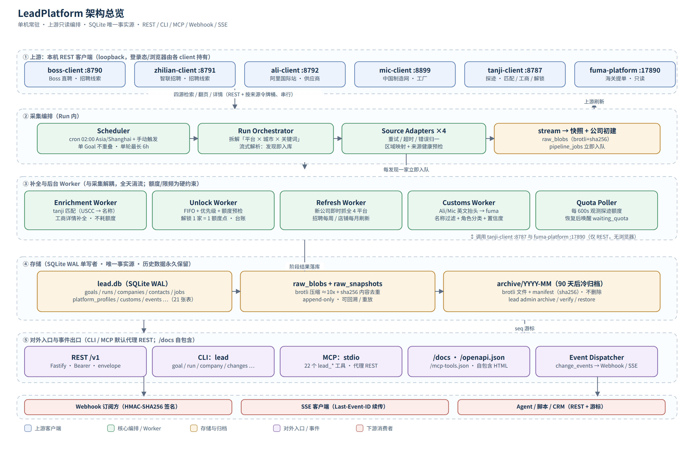
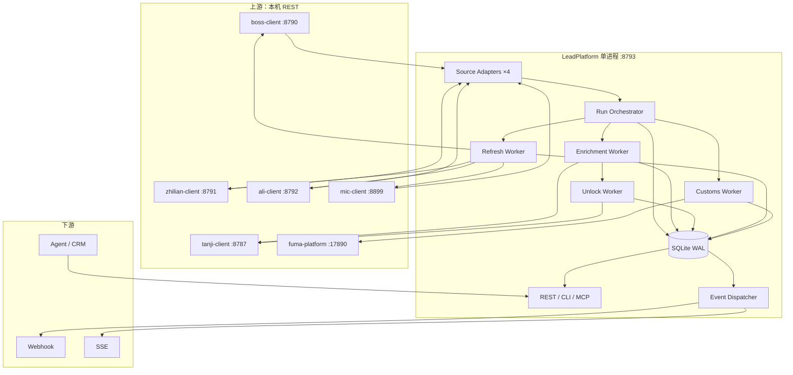
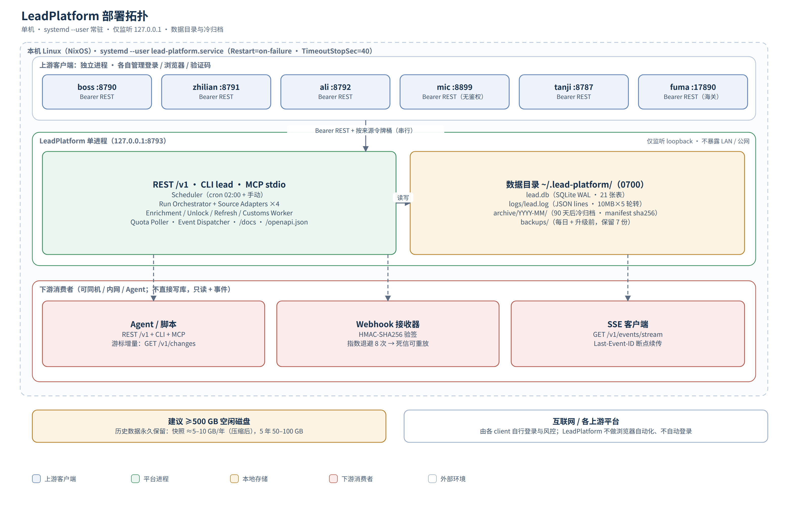

# LeadPlatform · 河北外贸线索聚合平台

> 本机常驻、以「区域目标（Goal）」为驱动的一站式线索聚合与补全平台：从 **Boss 直聘 / 智联招聘 / 阿里国际站 / 中国制造网** 四个招聘与 B2B 平台采集线索，经 **探迹** 匹配与工商补全、额度感知的联系人解锁、**平台档案 / 在招岗位** 持续刷新、**fuma 海关提单画像**，聚合成唯一公司主档，并以 **REST / CLI / MCP / Webhook / SSE** 对外提供查询、增量同步与事件订阅。


- **状态**：`v0.1.0`（首个可运行版本，MIT 开源；数据模型与 `/v1` 契约冻结，破坏性变更升 `/v2`）
- **形态**：单机单进程 · 仅监听 `127.0.0.1:8793` · SQLite（WAL）唯一事实源 · 无 Web UI、无 Docker 依赖
- **上游**：只读调用本机已运行的 6 个 REST client（招聘 4 源 + 探迹 + fuma 海关）；登录、浏览器、风控、限频由各 client 负责
- **语言**：TypeScript 严格模式 · Node.js ≥ 22.5 · Fastify 5 · zod
- **文档**：完整中文文档体系，从安装部署到技术深度解析、需求验收对照，见 [文档索引](#文档索引)

> GitHub：https://github.com/CindyRIng/lead-platform · Release：https://github.com/CindyRIng/lead-platform/releases/tag/v0.1.0

---

## 目录

- [为什么需要 LeadPlatform](#为什么需要-leadplatform)
- [核心能力](#核心能力)
- [架构总览](#架构总览)
- [关键设计约束](#关键设计约束)
- [快速开始](#快速开始)
- [使用示例](#使用示例)
- [数据模型概览](#数据模型概览)
- [项目结构](#项目结构)
- [测试与验收](#测试与验收)
- [部署与运维](#部署与运维)
- [文档索引](#文档索引)
- [安全与合规](#安全与合规)
- [License](#license)

---

## 为什么需要 LeadPlatform

外贸线索分散在多个平台：招聘网站只能看到「正在招外贸岗位」的公司，国际站 / 制造网只能看到供应商与工厂，海关提单又只能按英文抬头查询。人工在多个客户端之间反复检索、复制、比对公司信息，既慢又容易漏，而且**联系人解锁额度极其稀缺**（探迹个人月额度 1,500 点，1 家企业 = 1 点）。

LeadPlatform 解决的正是这一段「采集 → 补全 → 聚合 → 分发」的重复劳动：

- 一次配置区域目标，每天定时（默认 02:00 Asia/Shanghai）或手动触发，自动完成四源采集；
- 每发现一家公司**立即**进入流水线：探迹匹配 → 工商补全 → 公司主档，不等整批跑完；
- 额度允许时按优先级自动解锁联系人，额度耗尽自动挂起、恢复后自动续跑，**不丢任务、不重复扣点**；
- 持续维护每家公司在各平台的**最新档案与在招岗位**（招聘周刷、店铺月刷），Ali/Mic 公司自动生成**海关画像**；
- 全部字段级变更写入事件流，通过 webhook / SSE / 增量游标交给下游 Agent、CRM 或外呼系统。

> 一期只做「聚合 + 补全 + 查询 + 事件」，不做 CRM 业务编排、不直接写下游库、不做 Web UI。

## 核心能力

| 能力 | 说明 |
|---|---|
| 🎯 **Goal 驱动采集** | 省 → 地级市枚举；平台 × 城市 × 关键词拆分；单 Goal 不重叠、单轮最长 6h；支持 cron 与手动触发 |
| ⚡ **流式异步流水线** | 线索发现即落原始快照并投递任务；采集、补全、解锁三通道并行推进 |
| 🏢 **权威公司主档** | 以探迹工商信息为准，USCC → 归一化名称 → 探迹 ID 三级去重合并，保留全部来源证据与合并历史 |
| 🔐 **额度感知解锁** | FIFO + 优先级队列（P0 招聘在招 > P1 平台付费/认证会员 > P2 有海关记录 > P3 其余），`waiting_quota` 挂起 / 恢复续跑，`unlock_ledger` 全程台账 |
| 🗂️ **来源快照永久保留** | 检索页 / 详情 / 探迹响应全量 append-only；brotli 压缩（≈10×）+ sha256 内容去重；90 天后冷归档、**不删除** |
| 📇 **平台档案与岗位** | 每公司 × 每平台最新档案；Boss/智联岗位 `active/closed` 生命周期与历史；新公司即时抓全，存量招聘周刷、店铺月刷 |
| 🚢 **海关画像** | Ali/Mic 英文抬头 → fuma 海关（进口/出口视图）→ 名称过滤 + 角色分类 + 目的国/HS/产品/买家 Top 榜单，标注 `sampled=true` 与 `confidence` |
| 📡 **完整事件模型** | 字段级变更（老值 → 新值、来源、run、版本号）+ 全局 `seq`；Webhook HMAC-SHA256 签名、指数退避重试、死信可重放；SSE 断点续传 |
| 🧰 **三种交付形态** | REST（OpenAPI 3.1 + 自包含 `/docs`）、CLI `lead`、MCP `lead_*` 工具；CLI/MCP 默认代理 REST，不重复持有数据 |
| 🧪 **可验证** | mock 上游 + 合成 fixtures 的单元 / 集成 / 验收测试；`npm run accept` 输出验收报告；`gen:check` 防契约漂移 |

## 架构总览



<details>
<summary>展开 Mermaid 源码（GitHub 直接渲染）</summary>



</details>

> 架构图（PNG/SVG）与 Mermaid 源文件位于 [`docs/assets/`](docs/assets/)；更多图示见 [docs/16 技术深度解析](docs/16-技术深度解析.md)。

## 关键设计约束

这些约束由真实上游实测与用户决策得出，直接决定了系统形态：

1. **探迹额度是硬瓶颈**：日 500 / 月 1,500 / 企业月 19,500，结算日 11 号。河北四源实测覆盖约 **9,586 家**唯一公司，全量解锁需 ≈6.4 个月 —— 因此必须**优先级解锁**，P3 只入工商库、不排解锁；额度耗尽只挂起、不失败、不丢任务。
2. **登录态会过期**：Boss 会话约 5 天、智联约 1 月，需要人工扫码 / 短信。平台**不自动登录**：检测到失效 → 标记来源不健康 → 跳过该来源、继续其它来源，并在 `/v1/sources` 与日志中暴露。
3. **四源只到省 / 地级市**：Goal 按「省 → 地级市」枚举，县级企业随市级结果自然覆盖，不做区县精确筛选。
4. **严格按来源限频**：Boss 12 req/min、智联 15 req/min、Ali 10s/页（详情并发 2）、Mic ≈1 req/2s、探迹 20 req/min；平台只做「不并发轰炸 + 令牌桶 + 冷却」，不做浏览器层风控对抗。
5. **历史数据永久保留**：原始快照 / 变更事件 / 岗位 / 店铺 / 海关画像全部永久；brotli + 哈希去重 + 90 天冷归档，磁盘不足时扩归档盘而**不删除历史**。
6. **隐私最小化**：联系人明文仅在 Bearer 鉴权 API 中返回；日志对手机号 / 邮箱打码；快照与备份不进入仓库。

## 快速开始

### 0. 前置依赖

| 依赖 | 要求 |
|---|---|
| OS | Linux（systemd user 可用；开发环境亦可在 macOS 运行） |
| Node.js | **≥ 22.5**（推荐 22 LTS；需 `node:sqlite`，启动带 `--experimental-sqlite`） |
| 上游服务 | 本机已运行的 `boss-client :8790`、`zhilian-client :8791`、`ali-client :8792`、`mic-client :8899`、`tanji-client :8787`、`fuma-platform :17890` |
| 磁盘 | 建议 ≥ 500 GB 空闲（历史数据永久保留，预估 5 年 50–100 GB） |

> 上游 client 各自负责登录、验证码与平台风控，LeadPlatform 只通过其 REST 接口读取数据，**不持有浏览器与账号密码**。

### 1. 安装

```bash
git clone <repository-url> lead-platform
cd lead-platform
npm ci
npm run build
npm run typecheck     # 可选：类型检查
npm test              # 可选：单元 + 集成测试（mock 上游，不访问真实网络）
```

### 2. 配置

```bash
cp .env.example .env
chmod 600 .env
# 生成强随机 Token（≥32 字节）
node -e "console.log(require('crypto').randomBytes(32).toString('hex'))"
```

`.env` 最少需要填写：`LEAD_API_TOKEN` 与 6 个上游的地址 / Token（Mic 无鉴权）。完整配置项见 [docs/14 安装部署手册](docs/14-安装部署手册.md)。配置读取优先级：环境变量 / `.env` > `~/.lead-platform/config.json`；两个文件权限都必须为 `0600`。

### 3. 初始化并启动

```bash
# 首次启动会自动创建数据目录（0700）与 SQLite schema（幂等迁移，无需单独初始化）
npm start

# 一键部署（可选）：构建 + systemd user + CLI 软链 + 健康检查
# bash scripts/deploy.sh

# 健康检查
curl -s http://127.0.0.1:8793/v1/health
TOKEN=$(grep '^LEAD_API_TOKEN=' .env | cut -d= -f2)
curl -s -H "Authorization: Bearer $TOKEN" http://127.0.0.1:8793/v1/status | jq
```

### 4. 常驻运行（systemd user）

```bash
mkdir -p ~/.config/systemd/user
cp systemd/lead-platform.service ~/.config/systemd/user/
systemctl --user daemon-reload
systemctl --user enable --now lead-platform.service
systemctl --user status lead-platform.service
journalctl --user -u lead-platform -f
```

数据目录结构：

```text
~/.lead-platform/
├─ lead.db              # SQLite（WAL）：公司主档 / 任务队列 / 变更事件 / 平台档案 / 海关画像…
├─ logs/lead.log        # 结构化 JSON 日志（10 MB × 5 轮转，PII 自动打码）
├─ archive/YYYY-MM/     # 90 天后冷归档（brotli + manifest sha256，可恢复、不删除）
└─ backups/             # 每日 + 升级前备份
```

### 5. 安装 CLI 与 MCP

```bash
npm link                          # 链接 bin：lead -> dist/cli.js
export LEAD_API_TOKEN="<同上>"
lead status                       # 服务 / 队列 / 上游 / 额度概览
lead sources                      # 六个上游健康与登录态
lead quota                        # 探迹三层额度与近 7 天消耗
```

MCP（stdio，默认代理 REST，不直接持有数据库）：

```json
{
  "mcpServers": {
    "lead-platform": {
      "command": "node",
      "args": ["/opt/lead-platform/dist/mcp/server.js"],
      "env": { "LEAD_API_TOKEN": "<同上>", "LEAD_BASE_URL": "http://127.0.0.1:8793" }
    }
  }
}
```

> 也可直接访问自包含文档页 `http://127.0.0.1:8793/docs`、`/openapi.json`、`/mcp-tools.json`。

## 使用示例

### 创建 Goal 并触发一轮采集

```bash
TOKEN=<LEAD_API_TOKEN>

# 1) 创建「河北省 · 四源 · 默认关键词」目标
curl -s -X POST http://127.0.0.1:8793/v1/goals \
  -H "Authorization: Bearer $TOKEN" -H 'Content-Type: application/json' \
  -d '{
    "name": "河北省-外贸线索",
    "region": { "province": "河北省" },
    "platforms": ["boss","zhilian","ali","mic"],
    "keywords": { "boss": ["外贸","外贸业务员"], "zhilian": ["外贸"], "ali": [], "mic": [] },
    "maxLeadsPerRun": 2000,
    "schedule": { "cron": "0 2 * * *", "timeZone": "Asia/Shanghai" }
  }' | jq

# 2) 手动触发并查看运行进度
curl -s -X POST http://127.0.0.1:8793/v1/goals/<goalId>/run \
  -H "Authorization: Bearer $TOKEN" | jq
curl -s -H "Authorization: Bearer $TOKEN" http://127.0.0.1:8793/v1/runs/<runId> | jq

# 3) 查询线索
curl -s -H "Authorization: Bearer $TOKEN" \
  'http://127.0.0.1:8793/v1/companies?province=河北省&limit=20' | jq
```

### 增量同步与事件订阅

```bash
# 全局增量变更（断点续传：持久化 nextSeq，下次带上）
curl -s -H "Authorization: Bearer $TOKEN" \
  'http://127.0.0.1:8793/v1/changes?sinceSeq=12345&limit=100' | jq

# 订阅事件（HMAC-SHA256 签名投递，失败指数退避，死信可重放）
curl -s -X POST http://127.0.0.1:8793/v1/webhooks \
  -H "Authorization: Bearer $TOKEN" -H 'Content-Type: application/json' \
  -d '{"url":"https://example.com/hooks/lead",
       "eventTypes":["company.created","contact.unlocked"]}' | jq

# SSE 实时事件流（Last-Event-ID 断点续传）
curl -N -H "Authorization: Bearer $TOKEN" \
  'http://127.0.0.1:8793/v1/events/stream?types=company.created,contact.unlocked'
```

### CLI 常用命令

```bash
lead status
lead goal list
lead goal create --name 河北省-外贸线索 --province 河北省 --platforms boss,zhilian,ali,mic
lead goal run <goalId> --wait                 # 触发并跟随进度
lead company list --province 河北省 --limit 20
lead company show <companyId>                 # 主档 + 来源 + 联系人 + 匹配信息
lead company platforms <companyId>            # 各平台最新档案卡片
lead company jobs <companyId> boss            # 在招 / 已下线岗位
lead company customs <companyId>              # Ali/Mic 海关画像
lead changes --since-seq 12345
lead events tail --types company.created,contact.unlocked
lead webhook deliveries <webhookId> --status dead
lead job list --status dead && lead job retry <jobId>
```

- 所有 CLI 命令支持 `--json`（输出与 REST `data` 一致）与 `--base-url`；Token 从 `LEAD_API_TOKEN` 或配置文件读取。
- 完整端点、CLI 命令树、MCP 工具与 Webhook/SSE 消费示例见 [docs/18 API / CLI / MCP 使用指南](docs/18-API-CLI-MCP使用指南.md)。

## 数据模型概览

SQLite 单文件、WAL 模式，共 21 张表；**数据库是唯一事实源**，进程重启后从任务表恢复：

| 域 | 表 | 说明 |
|---|---|---|
| 目标与运行 | `goals`、`goal_runs`、`source_queries` | 目标配置、每轮运行、平台 × 城市 × 关键词检索进度 |
| 原始数据 | `raw_blobs`、`raw_snapshots` | brotli 压缩 + sha256 去重，append-only，永久保留（90 天冷归档） |
| 公司主档 | `companies`、`company_sources`、`company_contacts` | 当前态 + 来源证据 + 解锁联系人（明文仅 Bearer API） |
| 流水线与额度 | `pipeline_jobs`、`unlock_ledger` | 租约任务队列（stage/status/重试/死信）、解锁扣点台账 |
| 平台档案 | `company_platform_profiles`、`company_platform_jobs` | 4 平台最新档案、Boss/智联岗位生命周期 |
| 海关画像 | `company_customs_profiles` | Ali/Mic 提单聚合（totals / 目的国 / HS / 买家 / confidence） |
| 事件 | `change_events`、`webhook_subscriptions`、`webhook_deliveries` | 字段级变更 + 全局 seq、订阅与投递记录 |
| 区域与运行态 | `regions`、`region_platform_map`、`quota_observations`、`source_health`、`meta_kv` | 区域映射、额度曲线、来源健康、迁移/锁等元数据 |

字段级模型、状态机、去重匹配算法与容量估算详见 [docs/02 架构与数据模型](docs/02-架构与数据模型.md) 与 [docs/16 技术深度解析](docs/16-技术深度解析.md)。

## 项目结构

```text
lead-platform/
├─ src/
│  ├─ main.ts / config.ts / logger.ts      # 进程入口、配置校验、结构化日志（PII 打码）
│  ├─ db/                                 # SQLite 连接、schema、版本化迁移
│  ├─ repositories/                       # 各表数据访问（事务/租约/FIFO/游标）
│  ├─ domain/                             # 归一化、去重、匹配打分、分页游标（纯业务）
│  ├─ adapters/                           # boss / zhilian / ali / mic / tanji / fuma 上游适配
│  ├─ region/                             # 区域注册表 + 平台映射 + 字典同步
│  ├─ pipeline/                           # 调度、采集编排、补全、解锁、刷新、海关 worker
│  ├─ events/                             # change_events → webhook / SSE
│  ├─ http/                               # Fastify 路由、鉴权、envelope、/docs
│  ├─ cli/                                # CLI `lead`
│  ├─ mcp/                                # MCP server（stdio，代理 REST）
│  ├─ services/                           # 跨模块服务（goals/companies/runs/quota/admin…）
│  └─ shared/                             # 类型、错误码、ULID、加解密、时间工具
├─ scripts/                               # 契约生成（gen）、验收（acceptance）、基准
├─ spec/                                  # openapi.json / cli-commands.json / mcp-tools.json（生成物）
├─ skills/lead/                           # Agent SKILL 使用手册
├─ tests/                                 # unit / integration / mock-upstreams / fixtures
├─ systemd/                               # systemd user unit
├─ docs/                                  # 00–19 完整文档体系 + assets 图示
```

目录职责、关键文件、二次开发与测试策略详见 [docs/19 项目结构与代码导读](docs/19-项目结构与代码导读.md)。

## 测试与验收

```bash
npm run typecheck                    # TypeScript 严格模式
npm test                             # Vitest：单元 + 集成（mock 六上游，零真实网络请求）
npm run gen && npm run gen:check     # 生成并校验 OpenAPI / MCP 工具清单 / CLI 清单
npm run accept                       # 验收报告（reports/acceptance-<ts>.json）
```

- 测试全部使用 `tests/mock-upstreams/` 与合成 fixtures（虚构公司名如「河北示例机械有限公司」），**不访问真实上游、不消耗探迹额度、不调用真实 unlock**；
- 验收标准覆盖 [docs/01 需求规格](docs/01-需求规格.md) 的 **AC-1 – AC-18**，逐条验收方法与证据见 [docs/17 需求解释与验收对照](docs/17-需求解释与验收对照.md)。

## 部署与运维

- 从零安装、systemd 常驻、升级回滚、卸载与常见问题：[docs/14 安装部署手册](docs/14-安装部署手册.md)
- 日常巡检、备份 / 归档 / 恢复、故障 Runbook（登录失效 / 额度耗尽 / 刷新积压 / 海关异常 / Webhook 死信 / 磁盘）：[docs/15 运维手册](docs/15-运维手册.md)
- 服务的告警事件（`source.session_invalid`、`quota.exhausted`、`job.dead`、`webhook.delivery_failed`、`customs.permission_denied` 等）通过 `/v1/status.alerts` 与结构化日志暴露。



## 文档索引

| 文档 | 内容 |
|---|---|
| [00 需求访谈记录](docs/00-需求访谈记录.md) | 原始意图、七轮访谈决策、只读调研事实 |
| [01 需求规格](docs/01-需求规格.md) | 目标/范围、术语、场景、FR/NFR、业务规则、AC-1..AC-18 |
| [02 架构与数据模型](docs/02-架构与数据模型.md) | 组件架构、21 张表、状态机、去重/匹配、额度队列、事件模型、容量 |
| [03 接口草案](docs/03-接口草案.md) | REST 契约、错误码、Webhook/SSE、CLI 命令树、MCP 工具清单 |
| [04 上游对接与区域映射](docs/04-上游对接与区域映射.md) | 六上游端点/限频/字段映射、河北 11 市四平台映射样例 |
| [05 部署与运维](docs/05-部署与运维.md) | 配置、systemd、巡检、故障 Runbook、归档与容量 |
| [06 实施计划](docs/06-实施计划.md) | P0–P7 阶段、出口标准、测试策略、风险 |
| [07 平台档案与招聘信息](docs/07-平台档案与招聘信息.md) | 平台档案/岗位模型、刷新策略、容量核算、验收 |
| [08 海关数据补全](docs/08-海关数据补全.md) | 英文抬头 → fuma 提单 → 线索画像（匹配/聚合/刷新） |
| [09 上游接口与流水线验证报告](docs/09-上游接口与流水线验证报告.md) | 小批量实测矩阵、迷你流水线结果、设计校正 |
| [10 需求确认清单](docs/10-需求确认清单.md) | 决策汇总、开放项、验收清单、冻结流程 |
| [11 河北外贸企业覆盖度分析](docs/11-河北外贸企业覆盖度分析.md) | 覆盖度分析、关键词扩展实验、覆盖策略 |
| [12 河北四源覆盖实测报告](docs/12-河北四源覆盖实测报告.md) | 各平台数量、去重 ≈9,586、对容量/额度的校准 |
| [13 数据口径与质量说明](docs/13-数据口径与质量说明.md) | 指标定义、各源口径与质量、去重方法与置信区间 |
| [14 安装部署手册](docs/14-安装部署手册.md) | 从零安装、配置、systemd、升级/卸载、排错 |
| [15 运维手册](docs/15-运维手册.md) | 巡检、日志、备份恢复、额度运营、故障 Runbook、应急响应 |
| [16 技术深度解析](docs/16-技术深度解析.md) | 架构、数据流、状态机、并发/租约/限频、匹配算法、事件模型、取舍 |
| [17 需求解释与验收对照](docs/17-需求解释与验收对照.md) | FR/AC 逐条解释、实现位置、验收步骤与证据 |
| [18 API / CLI / MCP 使用指南](docs/18-API-CLI-MCP使用指南.md) | 认证、envelope、全部端点、CLI/MCP、Webhook/SSE 消费示例 |
| [19 项目结构与代码导读](docs/19-项目结构与代码导读.md) | 目录树、模块职责、关键文件、二次开发与测试策略 |

## 安全与合规

- 仅监听 `127.0.0.1`、关闭 CORS、单 Bearer Token 鉴权（常量时间比较）；Token 与配置权限 `0600`、数据目录 `0700`；
- 联系人明文只通过 Bearer 鉴权 API 返回，日志自动对手机号 / 邮箱打码；`/docs` 与 OpenAPI 示例均为合成数据；
- 本仓库**不含任何真实公司、联系人、招聘人或 PII**；文档与测试数据全部为合成示例；
- 本工具用于合法获客与自有客户数据管理，使用者须遵守各上游平台的服务条款与当地法律法规（含个人信息保护要求）；
- 发现安全问题请按 [SECURITY.md](SECURITY.md) 私下报告，请勿公开 Issue 提交密钥或个人信息。

## License

[MIT](LICENSE) © 2026 LeadPlatform contributors

> 免责声明：LeadPlatform 是非官方工具，与 Boss 直聘、智联招聘、阿里巴巴国际站、中国制造网、探迹、孚盟等平台无隶属关系。上游数据的使用需遵守对应平台的服务条款；本项目不提供爬虫、绕过风控或自动登录能力。
