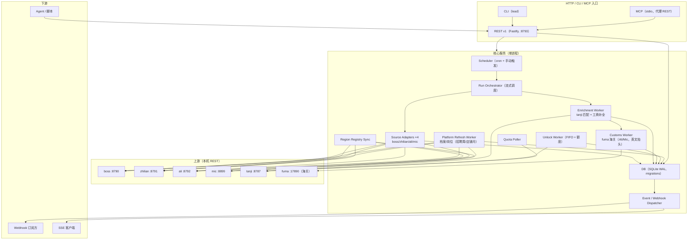
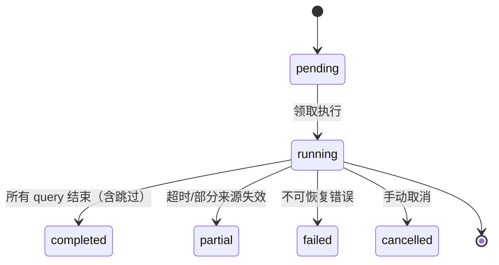
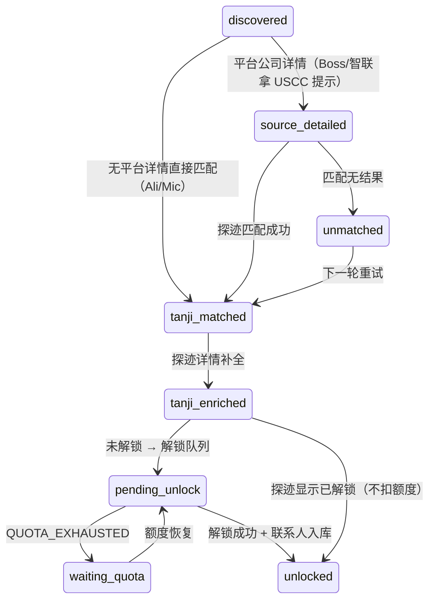

# 02 · 架构与数据模型（v0.4 设计稿（数据校准））

- 状态：待评审；与 [01-需求规格](01-需求规格.md) 同步冻结
- v0.2 变更：新增「平台档案 + 岗位」数据模型、刷新 worker 与容量核算（详见 [07-平台档案与招聘信息](07-平台档案与招聘信息.md)）
- v0.3 变更：新增 Customs Worker / `company_customs_profiles` / fuma 海关对接（详见 [08-海关数据补全](08-海关数据补全.md)）
- v0.3.1 变更（Q7）：历史数据永久保留 —— brotli 压缩 + 哈希去重 + 90 天后冷归档，不按龄删除（见 5.4 / 16 节）
- 原则：单机、单进程、SQLite 单写者；所有上游依赖均可失败、可恢复；所有写操作幂等

> **实现核对（v0.1.0）**：数据模型共 **21 张表**，与 `src/db/schema.sql` 一致；历史数据策略为「brotli 压缩 + sha256 去重 + 90 天冷归档、不删除」（文中个别早期「按保留期删除」表述以 [15-运维手册](15-运维手册.md) 为准）。实现规模与文档差异见 [19 §17](19-项目结构与代码导读.md#17-实现状态与文档差异说明)。

---

## 1. 设计原则

1. **编排与能力分离**：LeadPlatform 只做编排（查谁、何时查、补全、解锁、入库、广播）；采集/登录/风控全部由五个 client 负责。
2. **流式流水线**：线索一发现就落快照 + 入队，采集、补全、解锁三个通道并行推进；不做整批等待。
3. **数据库是唯一事实源**：内存队列只做加速；重启后从 `pipeline_jobs` 恢复。
4. **额度是一等公民**：解锁任务先查额度再执行；额度耗尽进入 `waiting_quota`，绝不用失败换额度。
5. **快照不可变、主档可变但可追溯**：原始数据 append-only；主档变更全部落到 `change_events`。
6. **对外只读为主 + 显式事件**：外部系统通过查询 + 事件/游标同步；不直接写 LeadPlatform 主档（手工纠正除外）。
7. **契约同源**：zod schema → REST / OpenAPI / MCP tools / CLI 帮助统一生成，`gen:check` 防漂移。

---

## 2. 总体架构



### 组件职责

| 组件 | 职责 |
|---|---|
| Scheduler | 读取启用的 Goal，按 cron（默认 02:00 Asia/Shanghai）创建 Run；手动触发也走同一入口；保证单 Goal 不重叠 |
| Run Orchestrator | 把 Run 拆成「平台 × 城市 × 关键词」查询任务；按来源串行 + 限频执行；流式解析结果 → 快照 + 公司关联 + 流水线任务 |
| Source Adapters | 五个 client 的 HTTP 适配（重试、超时、限频、错误码归一、上游 schema 校验） |
| Region Registry | 从各 client 同步区域字典（Boss/智联 cities、Ali regions、Mic regions），维护平台映射；失败时回退内置基线 |
| Enrichment Worker | 对 `source_detail` 完成后的公司做探迹匹配（USCC/名称）、拉取工商详情、更新主档与来源证据、投递解锁任务 |
| Unlock Worker | 单通道 FIFO；执行前查额度；成功拉联系人入库；额度不足转 waiting_quota |
| Platform Refresh Worker | 新公司即时抓 4 平台档案/岗位；存量招聘每周、店铺每月到期刷新；全天按来源限频涓流执行（与采集 Run 解耦） |
| Customs Worker | 对 Ali/Mic 公司：英文抬头 → fuma `POST /v1/customs/query`（flag 1/2）→ 名称过滤/角色分类 → `company_customs_profiles`；新公司即时、存量每月；账号串行 |
| Quota Poller | 周期性采集 tanji `/v1/status` 额度快照（写 `quota_observations`）；检测日刷新/结算日恢复 → 唤醒 waiting_quota |
| Event Dispatcher | 把 `change_events` 映射为对外事件，写入 webhook_deliveries 并按退避投递；供 SSE 广播 |
| REST/CLI/MCP | 对外查询与操作入口；CLI/MCP 默认代理 REST |

> 一期无 Web UI；`/docs` 为自包含 HTML + OpenAPI 3.1。

---

## 3. 进程模型与部署拓扑

- 单进程 Node 22（Fastify + 后台 worker loops），由 systemd user service `lead-platform.service` 常驻。
- 监听 `127.0.0.1:8793`（仅 loopback）。
- SQLite：`~/.lead-platform/lead.db`（WAL），`synchronous=NORMAL`；写事务短小。
- 日志：`~/.lead-platform/logs/lead.log`（JSON lines，按大小轮转）。
- 配置：`~/.lead-platform/config.json`（0600）或 `.env`；token 不落日志。
- 与上游：全部 `127.0.0.1` HTTP；每个上游一个 adapter + 令牌桶；串行请求（除 Ali 详情允许并发 2）。
- 关闭信号：SIGTERM → 停止领取新任务 → 等待在飞请求（≤30s）→ 释放租约 → 退出。
- 单进程假设：scheduler 与 worker 在同一进程；用 `meta_kv` 中的 leader 锁防止误起第二个实例（端口占用本身也会阻止）。

---

## 4. 代码结构（计划）

```
lead-platform/
├─ src/
│  ├─ main.ts                 # 进程入口：config → db → scheduler → workers → http
│  ├─ config.ts               # env/config 解析 + zod 校验
│  ├─ db/
│  │  ├─ index.ts             # 连接、WAL、迁移执行
│  │  ├─ migrations/          # 001_init.sql ...
│  │  └─ repositories/        # goals/companies/jobs/events/... 数据访问
│  ├─ domain/                 # 纯业务：去重、匹配打分、diff、状态机
│  ├─ adapters/upstream/      # boss/zhilian/ali/mic/tanji REST 客户端
│  ├─ region/                 # 区域注册表 + 平台映射
│  ├─ pipeline/
│  │  ├─ orchestrator.ts      # Run → source_queries → 流式入队
│  │  ├─ enrichment.ts        # 探迹匹配 + 工商补全
│  │  ├─ unlock.ts            # FIFO 解锁 + 额度状态机
│  │  ├─ platformRefresh.ts   # 平台档案/岗位刷新（招聘周/店铺月，全天涓流）
│  │  ├─ customs.ts           # fuma 海关补全（Ali/Mic 英文抬头）
│  │  └─ scheduler.ts         # cron + 手动触发
│  ├─ events/                 # change_events → webhook/SSE
│  ├─ api/rest/               # Fastify 路由（zod schema）
│  ├─ api/cli.ts              # commander
│  ├─ api/mcp.ts              # MCP server（代理 REST）
│  ├─ data/                   # 内置区域基线、默认关键词、抓取上限
│  └─ utils/                  # logger、token bucket、retry、ulid、hash
├─ spec/                      # openapi 生成物 / schema 快照
├─ skills/lead-platform/      # SKILL 包
├─ scripts/                   # gen、smoke、bench
├─ systemd/lead-platform.service
├─ tests/                     # unit + integration（mock upstream）
├─ docs/                      # 本套文档
└─ package.json / tsconfig.json
```

依赖方向：`api/* → domain/pipeline/adapters → db`；domain 不依赖 Fastify/DB 实现。

---

## 5. 数据模型

> SQLite（WAL）。所有时间戳用 ISO 8601 UTC 文本；ID 用 ULID 文本；JSON 字段用 TEXT 存 JSON（zod 校验）。金额/额度用 INTEGER。

### 5.1 `goals`（目标）

| 字段 | 类型 | 说明 |
|---|---|---|
| id | TEXT PK | ULID |
| name | TEXT NOT NULL | 目标名 |
| region_province_code | TEXT NOT NULL | 省级 GB/T 2260（如 `130000`） |
| region_province_name | TEXT NOT NULL | 如「河北省」 |
| city_codes | TEXT NOT NULL | JSON 数组；空 `[]` = 全省所有地级市 |
| platforms | TEXT NOT NULL | JSON，如 `["boss","zhilian","ali","mic"]` |
| keywords | TEXT NOT NULL | JSON，按平台：`{"boss":[...],"zhilian":[...],"ali":[...],"mic":[]}` |
| max_leads_per_run | INTEGER NULL | 单轮线索上限（null=不限） |
| daily_lead_limit | INTEGER NULL | 每日线索上限（null=不限） |
| schedule_cron | TEXT NOT NULL DEFAULT '0 2 * * *' | Asia/Shanghai |
| time_window | TEXT NULL | 如 `02:00-08:00` |
| priority | INTEGER NOT NULL DEFAULT 100 | 一期单 Goal，预留 |
| trade_filter | TEXT NULL | 预留 JSON（默认 null） |
| enabled | INTEGER NOT NULL DEFAULT 1 | 0/1 |
| version | INTEGER NOT NULL DEFAULT 1 | 乐观锁 |
| created_at / updated_at | TEXT NOT NULL | UTC |

### 5.2 `goal_runs`（每轮运行）

| 字段 | 类型 | 说明 |
|---|---|---|
| id | TEXT PK | ULID |
| goal_id | TEXT NOT NULL FK | goals.id |
| trigger | TEXT NOT NULL | `cron` / `manual` |
| status | TEXT NOT NULL | `pending` → `running` → `completed` / `partial` / `failed` / `cancelled` |
| started_at / finished_at / heartbeat_at | TEXT | |
| stats | TEXT NOT NULL DEFAULT '{}' | JSON：各平台 queries/pages/leads/companies_new；enrich/unlock 计数 |
| error_code / error_message | TEXT NULL | |
| created_at | TEXT NOT NULL | |

索引：`(goal_id, created_at DESC)`、`(status)`。

> 注意：Run 完成 ≠ 全部补全/解锁完成。采集结束后，enrichment/unlock 队列仍在后台继续；Run.stats 记录挂起数量。

### 5.3 `source_queries`（平台 × 城市 × 关键词 查询）

| 字段 | 类型 | 说明 |
|---|---|---|
| id | TEXT PK | ULID |
| run_id | TEXT NOT NULL FK | goal_runs.id |
| platform | TEXT NOT NULL | `boss` / `zhilian` / `ali` / `mic` |
| city_code | TEXT NOT NULL | 规范地级市 code；省级检索写 `province:<code>` |
| platform_region_value | TEXT NOT NULL | 实际传给 client 的值（Boss cityCode / 智联 code / Ali 名或 code / Mic 英文名） |
| keyword | TEXT NULL | Ali/Mic 可为 null |
| upstream_query_id | TEXT NULL | client 返回的 queryId（Boss/智联/Ali） |
| status | TEXT NOT NULL | `pending` / `running` / `done` / `failed` / `skipped` |
| pages_fetched / total_pages / total_count | INTEGER | 进度 |
| last_error | TEXT NULL | |
| started_at / finished_at | TEXT | |

唯一约束：`(run_id, platform, platform_region_value, keyword)`。

### 5.4 `raw_blobs` + `raw_snapshots`（原始快照）

**`raw_blobs`**（内容去重 + 压缩 + 永久保留）

| 字段 | 类型 | 说明 |
|---|---|---|
| hash | TEXT PK | `sha256:<hex>` |
| encoding | TEXT NOT NULL | `brotli`（默认，实测 ≈10x）/ `gzip` / `plain` |
| body | BLOB NOT NULL | 压缩后内容（≤ 数 MB） |
| bytes | INTEGER NOT NULL | 原始字节数 |
| created_at | TEXT NOT NULL | |

**`raw_snapshots`**（元数据，append-only）

| 字段 | 类型 | 说明 |
|---|---|---|
| id | INTEGER PK AUTOINCREMENT | |
| kind | TEXT NOT NULL | `source_search_page` / `source_company_detail` / `tanji_search` / `tanji_company_detail` / `fuma_customs_query` |
| platform | TEXT NULL | boss/zhilian/ali/mic/tanji/fuma |
| run_id | TEXT NULL | goal_runs.id |
| ref_type / ref_id | TEXT NULL | 如 `source_query` / queryId、`company_source` / platform company id、`company` / id |
| url | TEXT NULL | 允许记录脱敏 URL |
| blob_hash | TEXT NOT NULL FK | raw_blobs.hash |
| fetched_at | TEXT NOT NULL | |
| archived | INTEGER NOT NULL DEFAULT 0 | 0=hot（DB BLOB）；1=已转冷归档 |
| archive_path | TEXT NULL | 归档文件相对路径（如 `archive/2027-01/part-0003.br`） |
| archived_at | TEXT NULL | |

索引：`(kind, ref_type, ref_id)`、`(run_id)`、`(fetched_at)`、`(archived)`。

> **Q7 保留策略**：不按年龄删除。原始快照/变更事件/岗位/店铺/海关画像**全部永久保留**。默认 90 天后把 blob 移入冷归档（brotli 文件 + 清单索引，`raw_snapshots.archive_path` 可恢复查询）；hot 库只保留近期数据。归档清单记录在 `meta_kv.archive_manifests`（按月，含文件、条数、字节、sha256）。`lead admin restore --month=YYYY-MM` 可恢复归档到 hot 库。

### 5.5 `companies`（公司主档，当前态）

| 字段 | 说明 |
|---|---|
| id TEXT PK | ULID（LeadPlatform 内部 ID） |
| uscc | 统一社会信用代码，UNIQUE（可空；来自平台文本或探迹权威） |
| tanji_company_id | 探迹企业 ID，UNIQUE（可空） |
| name | 展示名称（优先探迹注册名，否则来源公司名） |
| english_name | 英文抬头（Ali/Mic 来源；用于海关查询/tanji 英文匹配） |
| normalized_name | 归一化名称（去空格/括号/后缀统一），用于兜底去重 |
| legal_representative / reg_capital / found_time / oper_status / industry / scale / company_type / registration_authority / approved_at | 工商字段 |
| province / city / district / address | 地区与地址（Province/City 为规范名；district 来自探迹地址解析，可空） |
| business_scope / homepage / phone_count / email_count / contact_count | 经营范围与联系方式统计 |
| extra | JSON：非一等扩展字段（探迹 tags/股东/年报/参保人数/英文名/曾用名等；见 04 文档字段映射） |
| trade_tags | JSON 数组：外贸证据标签 |
| source_count | 来源平台数 |
| enrichment_status | `discovered` → `source_detailed` → `tanji_matched` → `tanji_enriched` / `unmatched` / `failed` |
| unlock_status | `none` / `pending` / `waiting_quota` / `unlocked` / `failed` |
| match_meta | JSON：`{candidates:[{id,name,uscc,score}], confidence, matched_at, matched_by}` |
| first_run_id / first_seen_at / last_seen_at | |
| merged_into | TEXT NULL：被合并到的公司 id（软合并，对外只暴露存活主体） |
| version | 公司内变更版本（每次字段变更批次 +1） |
| created_at / updated_at | |

索引：`normalized_name`、`(province, city)`、`enrichment_status`、`unlock_status`、`updated_at`。

### 5.6 `company_sources`（来源证据）

| 字段 | 类型 | 说明 |
|---|---|---|
| id | TEXT PK | ULID |
| company_id | TEXT NOT NULL FK | companies.id |
| platform | TEXT NOT NULL | |
| platform_company_id | TEXT NOT NULL | 平台公司 ID |
| source_name / source_url | TEXT | 平台展示名与链接 |
| city_name | TEXT NULL | 平台侧城市 |
| evidence | TEXT NOT NULL DEFAULT '{}' | JSON：命中关键词、职位数、供应商等级、会员等 |
| first_seen_at / last_seen_at | TEXT NOT NULL | |

唯一：`(platform, platform_company_id)`；索引 `(company_id)`。

### 5.7 `company_contacts`（解锁后的联系人）

| 字段 | 说明 |
|---|---|
| id TEXT PK | ULID |
| company_id TEXT NOT NULL FK | |
| tanji_contact_id TEXT NULL | 探迹联系人 ID |
| name / position / department / region | 姓名/职位/部门/地区（姓名可能脱敏） |
| type | `mobile` / `phone` / `email` |
| value | 明文号码/邮箱（仅 Bearer API 返回，日志脱敏） |
| masked | 0/1 |
| source | 探迹来源描述（如政务公示平台） |
| is_key | 0/1（探迹关键联系人） |
| unlocked_at / created_at / updated_at | |

唯一：`(company_id, type, value)`；索引 `(company_id)`。

### 5.8 `pipeline_jobs`（流水线任务/队列）

| 字段 | 说明 |
|---|---|
| id TEXT PK | ULID |
| company_id TEXT NOT NULL FK | |
| platform TEXT NULL | 平台维度（`platform_profile` / `platform_jobs` 阶段必填；其它阶段为空） |
| run_id TEXT NULL | 首次触发 run |
| stage | `source_detail` / `tanji_match` / `tanji_detail` / `unlock` / `contact_sync` / `platform_profile` / `platform_jobs` / `customs` |
| status | `pending` / `running` / `waiting_quota` / `done` / `failed` / `dead` / `cancelled` |
| attempts / max_attempts | 重试计数（默认 max=3，unlock 由额度错误不计重试） |
| next_retry_at | 指数退避时间 |
| lease_owner / lease_until | 租约（进程重启后过期接管） |
| last_error | 归一化错误码 + 信息 |
| created_at / updated_at | |

唯一：`(company_id, stage, platform)`（platform 可空，唯一索引对 NULL 用 - 代替）；索引 `(status, next_retry_at)`、`(stage, status, created_at)`（FIFO）。

### 5.9 `unlock_ledger`（额度台账）

| 字段 | 说明 |
|---|---|
| id TEXT PK | ULID |
| company_id / tanji_company_id | |
| result | `unlocked` / `already_unlocked` / `failed` |
| quota_cost | 0/1（already_unlocked 记录 0） |
| quota_before / quota_after | 可选（`quota=true` 时） |
| account_id | 探迹账号 ID（当前 `main`） |
| idempotency_key | UNIQUE；如 `unlock:<companyId>:<yyyy-mm-dd>` |
| error_code / requested_at / finished_at | |

### 5.10 `change_events`（字段级变更 + 全局事件序）

| 字段 | 说明 |
|---|---|
| seq INTEGER PK AUTOINCREMENT | 全局单调序号（对外游标） |
| company_id TEXT NOT NULL | |
| entity_type | `company` / `platform_profile` / `job`（v0.2；默认 `company`） |
| entity_id | 实体 ID（平台档案 id / 岗位 id；company 事件可空） |
| version INTEGER NOT NULL | 公司内版本（同一变更批次一致） |
| event_type | `company.created` / `company.updated` / `contact.unlocked` / `company.merged` / `company.rematched` / `platform.profile.updated` / `platform.jobs.updated` / `customs.updated` / `company.deleted`(P1) |
| field | 字段名（平台字段用 `platforms.<platform>.<field>`；岗位聚合用 `platforms.<platform>.jobs`） |
| old_value / new_value | 文本/JSON 字符串；新增时 old=null |
| value_type | `string` / `number` / `json` / `bool` |
| source | `source:boss` / `source:zhilian` / `source:ali` / `source:mic` / `tanji` / `fuma:customs` / `system:unlock` / `api` |
| run_id / actor | 来源 run；`system` / `api` / `manual` |
| occurred_at / created_at | |

索引：`(company_id, version)`、`(company_id, seq)`、`(event_type, seq)`。

### 5.11 `webhook_subscriptions` / `webhook_deliveries`

**subscriptions**：`id`、`url`、`secret`（HMAC 密钥，0600 存储）、`event_types` JSON、`active`、`description`、`created_at/updated_at`。

**deliveries**：`id`、`subscription_id`、`event_seq`、`event_type`、`status`（`pending`/`delivered`/`failed`/`dead`）、`attempts`、`next_retry_at`、`response_status`、`response_body_head`、`last_error`、`created_at`、`delivered_at`。

### 5.12 `quota_observations` / `source_health` / `regions` / `meta_kv`

- **quota_observations**：`id`、`observed_at`、`daily_remaining`、`monthly_remaining`、`enterprise_remaining`、`settlement_day`、`raw` JSON。用于额度曲线与恢复判断。
- **source_health**：`platform` PK、`state`（`ok`/`degraded`/`session_invalid`/`verification_pending`/`unavailable`）、`logged_in`、`expires_at`、`checked_at`、`consecutive_failures`、`detail` JSON。
- **regions**：`code` PK（GB/T 2260）、`name`、`level`（province/city）、`parent_code`。
- **region_platform_map**：`(region_code, platform)` PK、`platform_value`、`source`（`client_sync`/`builtin`）、`synced_at`。
- **meta_kv**：`key` PK、`value` JSON（schema_version、leader 锁、各 Goal 上次 run 时间等）。

### 5.13 `company_platform_profiles` / `company_platform_jobs`（v0.2 新增）

| 表 | 作用 | 关键字段 |
|---|---|---|
| `company_platform_profiles` | 每公司 × 每平台最新档案 | `(company_id, platform)` 唯一；display_name/source_url/city/address/industry/scale/stage/logo/intro/tags/benefits、job_count/boss_count/recruiters、`store` JSON、platform_status、last_fetched_at/last_seen_at、next_jobs_refresh_at/next_store_refresh_at、version |
| `company_platform_jobs` | Boss/智联岗位 + 生命周期 | `(platform, platform_company_id, job_id)` 唯一；title/salary/city/district/degree/experience/publish_time/recruiter/job_url、status(`active`/`closed`)、first_seen_at/last_seen_at/closed_at |

> 完整字段、刷新策略、容量核算与字段映射见 [07-平台档案与招聘信息](07-平台档案与招聘信息.md)。

### 5.14 `company_customs_profiles`（海关画像，v0.3 新增）

| 字段 | 说明 |
|---|---|
| company_id TEXT PK/FK | 公司主档 ID（每公司 1 行） |
| english_name / chinese_name | 查询用英文抬头/中文注册名 |
| query_names | JSON：实际查询名列表 |
| upstream_totals | JSON：各查询名 × flag 的 totalNum/allCount/cached/source |
| fetched_records / matched_records / exporter_records / importer_records / unmatched_records | 样本统计 |
| date_min / date_max | 命中提单日期范围 |
| destinations / origins / hs4 / products / buyers / suppliers | JSON Top 榜单 |
| total_weight / total_count / amount | 样本求和（可空） |
| sample_records | JSON：最多 20 条命中提单摘要（供复核） |
| confidence | `high` / `medium` / `low` / `none` |
| account_id / source / cached / cached_at / expires_at / upstream_version | fuma 账号与缓存元信息 |
| sampled | 固定 1（样本模式） |
| fetched_at / next_refresh_at / version / created_at / updated_at | |

索引：`(next_refresh_at)`、`(confidence)`。原始响应落 `raw_snapshots(kind=fuma_customs_query)`，保留 90 天。详见 [08-海关数据补全](08-海关数据补全.md)。

---

## 6. 区域注册表与平台映射

- 内置基线：`src/data/regions.ts`（省 + 地级市 GB/T 2260，含河北省 11 市），保证上游字典同步失败时可用。
- 同步：启动时 + 每日（可配）从各 client 拉取字典并更新 `region_platform_map`：
  - Boss：`GET /v1/cities?refresh=true`（374 城；字段 cityCode/cityName，**刷新结果无 province，需要按内置基线匹配城市名**）。
  - 智联：`GET /v1/cities`（492 条，含 level/province）。
  - Ali：`GET /v1/regions`（373 条，code `CN-13` / `CN-13-1301`，含 nameZh/nameEn/aliases）。
  - Mic：`GET /api/regions` + `?province=Hebei` 取城市（`api_value` 英文省名，`cities_complete` 按省不同；河北完整）。
- 组成查询：Goal 的 `region_province_code` → 取该省城市列表（`city_codes` 为空时）→ 每个城市取各平台映射值 → 生成 source_queries。
- 河北省映射样例见 [04-上游对接与区域映射](04-上游对接与区域映射.md#4-河北省映射样例)。
- 省直辖县/区县：一期不映射；后续用探迹注册地址解析（`district`）做二次筛选。

---

## 7. 流水线状态机

### 7.1 Run 状态



### 7.2 公司处理状态



### 7.3 任务状态（`pipeline_jobs`）

```
pending → running → done
running → failed → (next_retry_at) → pending → running ...
failed  → dead（超过 max_attempts）
running → waiting_quota → pending（额度恢复唤醒；不计失败次数）
```

---

## 8. 去重与合并规则

1. **来源记录级**：`(platform, platform_company_id)` 唯一 → 已存在则更新 `last_seen_at` + 追加快照，不重复建公司。
2. **公司级（按优先级）**：
   - a. 有 USCC：查 `companies.uscc`；命中 → 关联；
   - b. 无 USCC（或未命中）且名称/地区可用：`normalized_name` 相同 + 同省（有城市则同市）→ 关联为同一公司（记录 `evidence.merged_by=name`）；
   - c. 探迹匹配成功：若目标 `tanji_company_id` 已存在 → 合并两条公司记录（保留较完整字段 + 全部来源 + 变更事件 `company.merged`）；
   - d. 否则新建公司（`enrichment_status=discovered`）。
3. **名称归一化**：去首尾空格、全半角统一、去除括号内容中的「（曾用名）」、统一「有限公司/有限责任公司」写法、去掉「河北省/河北」前缀不影响匹配（仅作为辅助，不做激进合并）。
4. **合并语义**：被合并公司软删除（`merged_into` 字段或事件标记）；`company_sources`/`change_events` 指向新主体；对外只暴露存活主体。
5. 人工 rematch 触发的重新匹配走同一合并逻辑，并记录 `company.rematched`。

---

## 9. 探迹匹配算法

输入：公司名、省/市、来源详情中的 USCC（若有）、来源平台与证据。

1. **USCC 精确**：`POST /v1/search/name {name: uscc, field: socialCreditCode}` → 取第一条同名 USCC 结果，置信度 1.0。
2. **名称精确/近似**：`POST /v1/search/name {name: 规范全名, field: name}` → 对候选打分：
   - 名称归一化后完全相等：+0.6；包含关系：+0.4；编辑距离/相似度：`0.3*sim`；
   - 省份相同：+0.2；城市相同：+0.2；
   - 探迹相关度 `score/rankScore` 归一化：+0.1；
   - 总分 ≥ 阈值（默认 0.55）→ 取最高者为最佳匹配；低分也仍**自动匹配**（用户决策），但 `confidence` 记录，供事后核对/rematch。
3. **多候选**：全部保存 `match_meta.candidates`（最多 5 条）与置信度、匹配方式。
4. **无结果**：`enrichment_status=unmatched`，下一轮 Run 重试（名称可换用平台详情中的「fullName/注册名」再试）。
5. **详情补全**：`GET /v1/companies/{tanjiId}` → 写主档；若 `unlocked=true` 直接拉联系人并置 `unlocked`（不扣额度）。
6. **rematch**：清空匹配信息 → 重新执行上述流程 → 字段级变更入库 → `company.rematched` 事件。

---

## 10. 快照与变更日志

### 10.1 快照

- 每次上游响应（检索页 / 平台详情 / 探迹搜索 / 探迹详情）→ 计算 payload sha256 → 若 `raw_blobs` 无该 hash 则 gzip 写入；`raw_snapshots` 追加一条元数据。
- 快照与业务解耦：解析失败也保留原始 payload（便于回溯/重放）。
- 清理任务：按 `LEAD_SNAPSHOT_RETENTION_DAYS`（默认 365）删除元数据，再清无引用 blob；支持 `lead admin purge --dry-run`。

### 10.2 变更

- 每次对 `companies` 的写入先算 diff（字段级）；无变化则跳过（不产生事件），有新快照仍照常记录。
- 变更批次：同一事务内的多条字段变更共享一个 `version`（公司 `version+1`）与同一 `run_id/source`。
- 事件类型：
  - `company.created`：公司首次入库（含初始字段快照）；
  - `company.updated`：字段变化（每个字段一行，`field/old/new`）；
  - `contact.unlocked`：联系人解锁完成（`new_value` 为联系人数量摘要，具体联系人通过详情接口取）；
  - `company.merged` / `company.rematched`：合并/纠正。
- 对外 `/v1/changes` 按 `seq` 游标返回（事件级）；单公司 `/companies/{id}/changes` 按 `version` 分页返回（可聚合为「每版本一条」的可读视图）。
- 保证：同一公司内事件按 version 有序；全局按 seq 有序；客户端以 seq 去重即可幂等。

---

## 11. 额度队列（Unlock Worker）

- **入队**：`tanji_enriched` 且 `unlock_status=pending` 的公司创建 `pipeline_jobs(stage=unlock, status=pending)`；唯一约束保证一家公司只有一个解锁任务。
- **顺序**：`ORDER BY created_at`（FIFO）。
- **执行前**：读取最近 `quota_observations`（≤ 2 分钟旧）；若 `daily.remaining=0` 或 `monthly.remaining=0` → 任务置 `waiting_quota`，worker 睡眠，等待 Quota Poller 唤醒。
- **执行**：`POST /v1/companies/{tanjiId}/unlock {confirm:true, idempotencyKey:"unlock:<companyId>:<yyyy-MM-dd>"}`：
  - 成功 → `unlock_ledger` + 拉 `contacts` → 写 `company_contacts` → 公司 `unlock_status=unlocked` → `contact.unlocked` 事件；
  - `alreadyUnlocked=true` → 不扣额度，按 0 记台账；
  - `QUOTA_EXHAUSTED` → `waiting_quota`（不计失败次数），触发一次额度刷新；
  - 其他错误 → 退避重试，超限 `failed`。
- **恢复**：Quota Poller 每 10 分钟（可配）拉 `/v1/status`；检测到 remaining 增加、或跨过结算日/次日零点 → 把 `waiting_quota` 任务批量改回 `pending`（保持 FIFO 顺序）。
- **不设每日上限**（用户决策）：worker 会持续消费直到额度耗尽。保留 `LEAD_UNLOCK_DAILY_CAP` 配置（默认空 = 不限），便于以后限流而不用改代码。
- **实测校准（2026-11-16）**：河北四源唯一线索 ≈9,586 家，个人月额度 1,500 → 全量解锁 ≈6.4 个月。解锁队列必须按**优先级**（P0 招聘在招 → P1 Ali/Mic 付费/认证会员 → P2 有海关出口记录 → P3 其余），而不是全库 FIFO；P3 只入工商库、不排解锁。优先级策略为待确认项 Q14。
- **台账**：每次解锁都写 `unlock_ledger`（含 `quota_before/after`，`quota=true` 时精确）；对外 `/v1/quota` 展示当前额度与近 N 天消耗。

### 11.5 平台档案与岗位刷新（v0.2）

- **入队**：公司 `discovered` 时创建 4 平台 `platform_profile` + 2 平台 `platform_jobs` 任务（即时抓全）；到期刷新由 `next_jobs_refresh_at`（每周）/`next_store_refresh_at`（每月）扫描生成任务。
- **调度**：Refresh Worker 常驻，按来源令牌桶（Boss 12/min、智联 15/min、Ali 10s/页、Mic ~30/min）**全天涓流**执行；优先级：新公司 > 到期刷新 > 手动 refresh（可插队）。
- **抓取**：Boss `GET /v1/companies/{id}` + `/jobs`；智联 `GET /v1/companies/{companyNumber}` + `/jobs`；Ali `GET /v1/suppliers/{id}`；Mic `GET /api/companies/{account}?include=audit,response,reviews`。
- **写入**：更新 `company_platform_profiles`（字段 diff → 公司变更事件 `platforms.<platform>.<field>`）与 `company_platform_jobs`（新增/下线/重新上线；聚合事件 `platforms.<platform>.jobs`）。
- **容量（2 万家）**：招聘每周 ≈ 11,400 请求/天（Boss/智联各 ≈4 次/分钟，低于限频）；店铺每月 ≈ 1,300 请求/天；新公司约 6 请求/家叠加。**全量每日刷新不可行**（≈100 小时/天），故采用全量降频。
- **快照**：岗位列表响应保留 30 天、店铺档案响应 90 天（归一化岗位/档案永久）；其余快照仍 365 天。

### 11.6 海关补全（Customs Worker，v0.3）

- **触发**：Ali/Mic 公司完成 tanji 匹配（获得中文主体、英文抬头仍在）→ 创建 `pipeline_jobs(stage=customs)`；新公司即时，存量每月刷新（`company_customs_profiles.next_refresh_at`）。
- **执行**：fuma `POST /v1/customs/query`（`accountId`=配置账号，`companyFlag=1/2`，`pageSize=20`，page 1）；英文抬头为主查询名，中文名可补充；账号串行、不并发。
- **处理**：名称 token 过滤 + 角色分类（出口商/进口商）→ 聚合画像（样本统计，`sampled=true`）；`confidence` 低时保留数据但不推送。
- **写库**：`company_customs_profiles` + `change_events(source=fuma:customs, field=customs.*)` + `customs.updated` 事件；原始响应入 `raw_snapshots`。
- **失败**：`permission_denied`/401 → 标记 fuma 来源异常并跳过（不影响主流程）；`totalNum=0` → `no_data` 不重试；网络错误退避重试（≤3 次）。
- **容量**：Ali/Mic 新公司 200–1000/天 × 4 查询 ≈ 800–4,000 次/天；fuma 单查询 0.8–1.5s、账号串行 → 约 7–60 分钟/天，可接受。

### 11.7 覆盖基线与容量（实测校准，2026-11-16）

- **覆盖基线**：河北四源唯一公司 ≈9,586（Mic 5,008 / Ali 2,961 / 招聘 2,375；Ali∩Mic 459；招聘↔Ali/Mic 估算 ≈299）。
- **一次性补全**：探迹匹配 9,586 + 详情 9,586 ≈ 19,172 次（20 req/min ≈16h）；海关 7,510 家 ×4 = 30,040 次（≈12.5h，可多日）。
- **存量刷新**（按 9,586 校准）：招聘周刷 ≈680 req/天、店铺月刷 ≈250/天、海关月刷 ≈1,001/天；2 万家设计余量仍保留。
- **额度缺口**：月 1,500 点 × 6.4 个月才够全量解锁 → 一期必须优先级解锁（见 11 节）。
- **数据质量**：Ali 2,961 中名称启发式 1,330（45%）建议上线前详情核验；招聘仅第 1 页（计数偏保守）；跨语言重叠为抽样估算（3.75%，CI 0.8–6.7%）。


---

## 12. 调度与限频

### 12.1 调度

- 进程内 cron（默认 `0 2 * * *` Asia/Shanghai），tick 每 30s 检查到期 Goal；手动 `POST /goals/{id}/run` 立即创建 Run。
- 同一 Goal 若存在 `pending/running` 的 Run → 拒绝（`RUN_IN_PROGRESS`），不排队（默认；可配为排队）。
- Run 最长 6h（`LEAD_RUN_MAX_HOURS`）：超时停止派发新查询、等待在飞请求结束，Run 置 `partial`；已入队任务继续执行。
- 采集结束 ≠ 补全结束：Run 完成后 enrichment/unlock 仍继续；`/v1/status` 展示队列积压。

### 12.2 限频（按来源串行 + 令牌桶）

| 来源 | 速率/间隔 | 并发 | 其它 |
|---|---|---|---|
| boss | 12 req/min；页间 2500ms | 1 | `pages≤5`/次，可按 queryId 继续翻页 |
| zhilian | 15 req/min；页间 2500ms + jitter | 1 | 同上 |
| ali | 10s/页 | 详情 2 | `pages` 默认 5、硬上限 20；遇 x5sec/验证码暂停 |
| mic | 按客户端缓存/上游建议（默认 1 req/2s，可配） | 1 | Focus Captcha 由 client 处理，失败即退避 |
| tanji | 20 req/min | 1（解锁优先） | 解锁走 priority；批量读不阻塞解锁 |

- 每个 adapter 内部：请求前 `await bucket.take()`；429/风控 → `cooldownUntil` 指数退避，期间该来源任务顺延。
- 采集前检查 `source_health`；`session_invalid/verification_pending` → 跳过该来源（记录 skipped 原因），Run 继续。
- 页面间隔来自客户端配置（尽量让 client 自己限速），LeadPlatform 只做「不并发轰炸」+ 全局 QPS 上限。

---

## 13. 失败处理、重试与租约

| 场景 | 处理 |
|---|---|
| 网络/超时/5xx | 指数退避重试（1s/5s/30s，最多 3 次）→ 失败任务 dead letter |
| 上游 401/登录失效 | 不重试；标记 source_health=session_invalid；当前 query skipped；Run 继续其它来源 |
| 上游验证码/风控 | 标记 degraded + cooldown；稍后重试（不计死信） |
| 探迹 QUOTA_EXHAUSTED | waiting_quota；不计失败次数；额度恢复自动续跑 |
| 探迹搜索结果解析异常 | 保留原始快照；重试一次；仍失败 → dead letter + 日志 |
| 进程崩溃 | 租约过期（默认 60s）后任务被重新领取；`unlock_ledger.idempotency_key` 与探迹业务幂等防重复扣点 |
| DB busy/locked | 短事务 + 重试（busy_timeout）；写队列串行化 |
| 死信 | `GET /v1/jobs?status=dead` 可见；`POST /v1/jobs/{id}/retry` 重试；日志告警事件预留 |

---

## 14. 事件模型与 Webhook/SSE

### 14.1 事件 envelope

```json
{
  "eventId": "evt_01J...",
  "seq": 12345,
  "type": "company.updated",
  "occurredAt": "2026-11-16T05:30:00.000Z",
  "companyId": "cmp_01J...",
  "version": 7,
  "source": "tanji",
  "runId": "run_01J...",
  "data": { "field": "business_scope", "oldValue": "...", "newValue": "...", "valueType": "string" }
}
```
- `company.created`：`data` 为公司初始快照（不含联系人明文）。
- `contact.unlocked`：`data.contactCount` + `data.types` 摘要；联系人明文通过详情接口取（避免 webhook 泄露 PII）。
- 事件由 `change_events` 映射；同一 `seq` 对外唯一；订阅方按 `seq` 去重。

### 14.2 Webhook 投递

- 订阅：`POST /v1/webhooks {url, eventTypes, secret?}`；服务端生成/保存 secret（也可由调用方提供）。
- 请求头：`X-Lead-Event: company.updated`、`X-Lead-Delivery: <uuid>`、`X-Lead-Timestamp: <unix>`、`X-Lead-Signature: sha256=<hex>`；签名 = `HMAC-SHA256(secret, timestamp + "." + rawBody)`。
- 成功：2xx；失败：指数退避（10s/1m/5m/30m/2h/6h，最多 8 次）→ `dead`；`GET /v1/webhooks/{id}/deliveries` 可查，`POST /v1/webhooks/{id}/deliveries/{did}/replay` 重放。
- 顺序：不保证跨事件严格顺序（按 `seq` 去重）；需要顺序的消费者用游标拉取。

### 14.3 SSE

- `GET /v1/events/stream?types=company.created,contact.unlocked`：`text/event-stream`，事件格式同上；断线重连用 `Last-Event-ID`（= seq）续传（服务端从 DB 补发）。

---

## 15. 安全与隐私

- 仅监听 `127.0.0.1`；无 CORS；Bearer token（`LEAD_API_TOKEN`，≥32 字节随机），常量时间比较。
- Token/密钥文件权限 0600；日志中打码手机号/邮箱（`138****1234`）；错误信息不回显上游原始 PII。
- Webhook secret 每订阅独立；投递签名可验证；只允许 http(s) URL，禁止本机回环之外的未授权内网地址（可配白名单）。
- 联系人数据仅通过 Bearer API 返回；`/docs` 不含真实数据。
- 备份文件不放入仓库；数据目录 0700。

---

## 16. 容量估算（单机）

| 数据 | 估算 | 说明 |
|---|---|---|
| 公司主档 | 河北实测 **9,586 家**；设计余量 10 万 ≈ 200–400 MB | 单表无压力 |
| 覆盖基线（河北） | 9,586（Ali 2,961 / Mic 5,008 / 招聘 2,375） | 见 12 文档 |
| 联系人 | 每家 1–10 条；解锁量受额度限制（1,500/月） | 额度是瓶颈，非存储 |
| 平台档案 + 岗位 | 实测招聘 2,375 家档案；岗位按每家 10–100 条（历史永久）；设计余量 2 万 | 需索引 `(company_id, platform, status)` |
| 海关画像 | 实测 Ali/Mic 7,510 家 × 1 行（含 sampleRecords JSON ≈ 2–10 KB）≈ 20–80 MB | 仅 Ali/Mic；永久 |
| 原始快照（brotli ≈10x + 哈希去重，**永久**） | 实测样例：45 个响应 1.15 MB → brotli 0.12 MB（≈9.9x）；估算 Ali/Mic/Boss/智联采集 + 岗位/店铺/海关刷新 ≈ 10–20 GB/年压缩后；5 年 ≈ 50–100 GB | 90 天后转冷归档；不删除 |
| 变更事件 | 每公司每轮 0–5 条；10 万公司 × 365 天 ≈ 千万级行（永久） | SQLite + 索引可承受；按年分区/归档可选 |
| Webhook 投递 | 按事件量线性 | 30 天热数据 + 死信保留 |

> 结论：单机 SQLite 足够；永久保留下瓶颈是磁盘容量与归档管理，而非 DB 查询性能。需监控磁盘（建议 ≥500 GB 空闲）并按年扩容。

---

## 17. 关键取舍（已决策）

| 取舍 | 决策 | 理由 |
|---|---|---|
| 队列存储 | DB 表而非内存队列 | 重启可恢复、可观测、幂等简单 |
| 解锁并发 | 单通道 FIFO | 额度是硬约束，并发无收益；顺序可解释 |
| 每日解锁上限 | 不设上限（配置保留） | 用户决策：尽快把线索解锁，接受月额度一次性耗尽 |
| 解锁优先级 | 新增：P0 招聘在招 → P1 付费/认证会员 → P2 有海关记录 → P3 其余（待确认 Q14） | 实测覆盖 9,586 vs 1,500/月，全库 FIFO 不可行 |
| 匹配策略 | 总是自动最佳匹配 + 留痕 + rematch | 用户决策：效率优先，靠事后纠正兜底 |
| CRM 查重 | 一期不做 | 减少依赖，先跑通聚合闭环 |
| 下游写入 | 不主动写，只发事件 | 解耦；下游自己消费 |
| 区县 | 不做精确筛选 | 上游只支持到地级市；县级自然覆盖 |
| Web UI | 不做（仅 /docs） | 一期 API/CLI 优先 |
| 快照 | 全量 + gzip + 哈希去重 | 可追溯 + 控制体积 |
| 平台档案 | 独立表 + 详情卡片展示 | 店铺/招聘数据结构差异大，不宜塞进公司主档 |
| 存量刷新 | 招聘每周、店铺每月（全量降频） | 2 万家按限频核算；每日全量≈100 小时/天不可行 |
| 列表平台筛选 | 一期不做（接口预留） | 需求方只要求详情可见，避免过早扩列表语义 |
| 海关补全范围 | 一期仅 Ali/Mic（英文抬头） | 实测英文抬头可查 fuma；Boss/智联中文名与英文提单名无法精确匹配 |
| 海关聚合口径 | 样本（每查询名×flag 第 1 页 20 条）+ 上游 totalNum 参考 | 全量提单体积大、且 totalNum 为模糊命中；样本可解释、标注 sampled |
| 调度 | 每日 02:00 + 手动 | 错峰、可控 |
