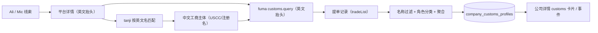

# 08 · 海关数据补全（fuma-platform）（v0.4 增量设计（数据校准））

- 状态：待评审（基于 2026-11-16 真实只读实测）
- 需求来源：用户第五轮追加 ——「对于 Ali/Mic 的客户，可以拿到英文抬头，应该通过英文抬头用 fuma-platform 查海关数据，补充进线索画像」
- 关联：[07-平台档案与招聘信息](07-平台档案与招聘信息.md)、[09-上游接口与流水线验证报告](09-上游接口与流水线验证报告.md)、[04-上游对接与区域映射](04-上游对接与区域映射.md)
- v0.3.1（Q7）：海关原始响应改为**永久保留**（brotli 压缩 + 90 天后冷归档），不按龄删除；Q1 确认展示 Top 买家/供应商名单，Q2 刷新每月，Q3 Boss/智联一期不做

---

## 1. 结论先行

- **可行且已验证**：Ali/Mic 详情能拿到英文公司名（英文抬头）；tanji 用英文名匹配能找回中文工商主体；fuma-platform `POST /v1/customs/query` 用英文抬头能返回该公司的提单项（tradeList），可聚合出「出口记录数、目的国、HS、产品、买家」等画像字段。
- **一期范围**：海关补全只对 **Ali / Mic 线索**启用（有英文抬头）；Boss/智联线索暂不做海关补全（中文名模糊查询返回大量无关记录，见 09 报告，后续可用拼音/英文名映射再评估）。
- **不消耗探迹额度**：海关查询走 fuma-platform，与 tanji 解锁无关。
- **实测样例**（2026-11-16）：Ali「Hebei Sample-A Metal Products」→ 匹配中文主体「河北示例甲金属制品有限公司」→ 海关匹配 45 条出口提单（乌克兰/美国/哥斯达黎加）；Ali「Hebei Sample-B Pipe-Fitting」→ 20 条（巴基斯坦）；Mic「Hebei Sample-C Wires & Cables」→ 40 条（印尼/厄瓜多尔，买家含 BUYER_C/BUYER_D）。

---

## 2. 数据流



1. Ali/Mic 公司详情完成后，将英文抬头（`companyName / company_name`）写入 `companies.english_name` 与平台档案。
2. tanji 匹配用英文名检索（实测可行，见 09）：拿回中文注册名、USCC、工商信息。
3. 海关补全任务（`pipeline_jobs.stage=customs`）：
   - 以英文抬头为主查询名；如已有中文注册名，可做补充查询（`companyFlag=1` 中文名实测可返回记录）；
   - 分别查询 `companyFlag=1`（进口数据源）与 `companyFlag=2`（出口数据源）；
   - 每路取第 1 页（`pageSize=20`），同时记录上游 `totalNum/allCount`；
   - 对返回提单按公司名 token 过滤 + 角色分类（公司作为出口商/进口商）；
   - 聚合成 `company_customs_profiles`，原始响应落 `raw_snapshots(kind=fuma_customs_query)`。
4. 公司详情接口返回 `customs` 摘要；海关画像变化产生 `customs.updated` 事件（并入公司变更日志 `customs.*`）。

---

## 3. 上游契约（fuma-platform）

```http
POST /v1/customs/query
Authorization: Bearer $FUMA_API_TOKEN
content-type: application/json

{
  "accountId": "acct_01",
  "inputCompany": "Hebei Sample-A Metal Products Co., Ltd.",
  "companyFlag": 1,
  "page": 1,
  "pageSize": 20,
  "forceRefresh": false,
  "allowStale": true
}
```

响应 `data` 字段（实测）：

| 字段 | 说明 |
|---|---|
| `list[]` | 提单记录（tradeList）；字段见 04 文档 6.6 节 |
| `totalNum / allCount` | 上游命中总数（模糊匹配结果，**不等于**目标公司的精确提单数） |
| `exactCount` | 实测恒为 0（不可依赖） |
| `source` | `upstream` / `cache` |
| `cached / cachedAt / expiresAt` | 本地缓存（默认 TTL 24h） |
| `stale` | 上游失败时降级返回过期缓存 |
| `upstreamVersion` | 上游数据版本（可用于失效判断） |

约束与实测事实：

- `accountId` 用于海关数据权限校验（当前账号 `acct_01` 有权限）；无权限返回 `permission_denied`。
- fuma-platform 有**强制本地缓存**（同参数 24h 内不重复请求上游；`forceRefresh=true` 强制刷新）。
- fuma 请求走账号级请求池（串行 + 限速）；LeadPlatform 必须按账号串行、控制并发（建议 ≤1）。
- 数据覆盖：导入 72 国 / 导出 60 国；不同国家/时间段覆盖不同，`totalNum=0` 属正常（如河北示例戊自动化无海关记录）。
- 一次查询 pageSize 可达 100（实测），但为控制体积与延迟，默认取 20。

---

## 4. 匹配与聚合算法（关键）

上游返回的是**模糊匹配的提单列表**，必须过滤后才能计入画像。

### 4.1 名称归一化

- 大写、去标点、压缩空格；英文去掉 `CO/LTD/LIMITED/GROUP/CORP/INC/LLC/COMPANY/AND/THE` 等通用词，保留 ≥3 字符的核心 token。
- 例：`Hebei Sample-A Metal Products Co., Ltd.` → `HEBEI / SAMPLE-A / METAL / PRODUCTS`。

### 4.2 角色分类

对每条提单分别计算：

- **出口证据**：`rawexporter / exporter / usedsuppliername` 命中公司 token → 公司作为出口商（`asExporter`）；
- **进口证据**：`rawimporter / importer / usedbuyername` 命中公司 token → 公司作为进口商（`asImporter`）；
- 两侧都命中或都不命中分别处理（记录 `unmatched`，不计入画像）。

> 实测中大量记录的 `rawimporter/rawexporter` 为 null，但 `importer/exporter` 字段有值；必须宽松覆盖所有名称字段。

### 4.3 聚合字段

| 字段 | 来源 |
|---|---|
| 出口记录数 / 进口记录数 | 角色分类计数（样本内） |
| `dateRange` | 命中记录 `regdate` 的 min/max |
| `topDestinations` | 出口记录的目的国（`importercountryen / destcountry`） |
| `topOrigins` | 进口记录的来源国（`exportercountryen / origincountry`） |
| `topHs4 / topProducts` | `hscode` 前 4 位 / `detail` 前 40 字符 |
| `topBuyers` | 出口记录中的进口商名称（**潜在买家线索**） |
| `topSuppliers` | 进口记录中的出口商名称 |
| `totalWeight / totalCount / amount` | 样本内求和（`money` 多数为 0，不可当金额总额） |
| `confidence` | matched ≥5 → high；1–4 → medium；0 → none |

### 4.4 采样说明

- 一期只取第 1 页（20 条/路），聚合是**样本统计**，必须在接口与文档中标注 `sampled=true`；上游 `totalNum` 另行展示，但**不可声称是该公司的精确提单总数**。
- 若 matched 很少（<3）而 `totalNum` 很大，说明名称匹配噪声大 → 标记 `confidence=low`，不展示 Top 榜单（只展示总数与样例）。

---

## 5. 数据模型（在 02 基础上新增）

### 5.1 `companies` 增列

| 字段 | 说明 |
|---|---|
| `english_name` | 英文抬头（Ali/Mic 来源；Tanji 详情 `englishName` 常为空，实测为 null） |

### 5.2 `company_customs_profiles`（每公司 1 行）

| 字段 | 说明 |
|---|---|
| `company_id` TEXT PK/FK | 公司主档 ID |
| `english_name / chinese_name` | 查询用名称 |
| `query_names` JSON | 实际查询名列表（EN/CN） |
| `upstream_totals` JSON | 各查询名 × flag 的 `totalNum/allCount/cached/source` |
| `fetched_records / matched_records / exporter_records / importer_records / unmatched_records` | 样本统计 |
| `date_min / date_max` | 命中提单日期范围 |
| `destinations / origins / hs4 / products` JSON | Top 榜单 |
| `buyers / suppliers` JSON | Top 买家/供应商（公司名，非个人） |
| `total_weight / total_count / amount` | 样本求和（可空） |
| `sample_records` JSON | 最多 20 条命中提单摘要（供详情展示/复核） |
| `confidence` | high/medium/low/none |
| `account_id / source` | fuma 账号、来源（固定 fuma） |
| `cached / cached_at / expires_at / upstream_version` | 上游缓存元信息 |
| `sampled` | 固定 1（一期样本模式） |
| `fetched_at / next_refresh_at` | 刷新时间 |
| `version` | 变更版本 |
| `created_at / updated_at` | |

索引：`(next_refresh_at)`、`(confidence)`。

### 5.3 其他

- `raw_snapshots.kind` 新增 `fuma_customs_query`（原始响应 gzip + 哈希去重）。
- `pipeline_jobs.stage` 新增 `customs`（唯一约束 `(company_id, stage, platform)`，platform 为空）。
- `change_events`：`source=fuma:customs`，字段路径 `customs.*`（如 `customs.exporterRecords`、`customs.topDestinations`、`customs.confidence`）；对外事件 `customs.updated`。
- 原始海关响应保留期：**永久保留（Q7）**：brotli 压缩 + 哈希去重，90 天后转冷归档、不删除；聚合画像永久。

---

## 6. 刷新策略

| 对象 | 策略 |
|---|---|
| 新公司（Ali/Mic） | 平台详情 + tanji 匹配后立即入队查询一次 |
| 存量 | **每月刷新**（与店铺档案同期；fuma 本地缓存 24h，重复查询免费） |
| 手动 | `POST /v1/companies/{id}/customs/refresh`（可插队） |
| 失败 | 权限错误/上游错误 → 退避重试（最多 3 次）→ 标记 `customs.status=failed`；`totalNum=0` 视为正常无数据，不重试 |
| 容量 | Ali/Mic 新公司 200–1000/天 × 4 次查询（EN×2 flag + CN×2 flag）≈ 800–4,000 次/天；fuma 账号串行下约 7–60 分钟/天，压力可控 |

---

## 7. 接口（详细契约见 03）

| 方法 | 路径 | 说明 |
|---|---|---|
| GET | `/v1/companies/{id}?include=customs` | 公司详情附海关摘要卡片 |
| GET | `/v1/companies/{id}/customs` | 海关画像详情（含 sampleRecords / upstreamTotals / confidence） |
| POST | `/v1/companies/{id}/customs/refresh` | 手动刷新（`202` + job） |

**海关卡片示例**

> 为公开发布，本示例中的公司名、USCC、联系方式与海外买家名已做合成化脱敏；字段结构、数量与结论保持实测原值。

```json
{
  "status": "ok",
  "confidence": "high",
  "sampled": true,
  "englishName": "Hebei Sample-A Metal Products Co., Ltd.",
  "chineseName": "河北示例甲金属制品有限公司",
  "totals": {
    "importView": { "totalNum": 1310, "source": "upstream" },
    "exportView": { "totalNum": 754, "source": "upstream" }
  },
  "sample": { "fetched": 45, "matched": 45, "asExporter": 45, "asImporter": 1 },
  "dateRange": { "min": "2026-09-05", "max": "2026-11-08" },
  "topDestinations": [{ "key": "Ukraine", "count": 26 }, { "key": "United States", "count": 10 }],
  "topHs4": [{ "key": "7314", "count": 20 }, { "key": "7313", "count": 12 }],
  "topBuyers": [{ "key": "BUYER_A LTD", "count": 17 }],
  "topProducts": [{ "key": "GALVANIZED ROUND PIPE CHAIN LINK FENCE", "count": 8 }],
  "lastFetchedAt": "2026-11-16T14:00:00+08:00",
  "nextRefreshAt": "2026-12-16T03:00:00+08:00"
}
```

---

## 8. 权限、合规与边界

- fuma 海关查询使用 `acct_01`（账号持有人已脱敏）账号权限；**不写 fuma、不占客保**，只读。
- 海关提单含外国买方公司名（商业信息，非个人信息）；不落盘联系人手机/邮箱。
- **不能**把 `totalNum` 当作目标公司精确提单量；详情页需标注「样本统计」。
- Ali/Mic 英文抬头可能为缩写/贸易名（与注册名不完全一致）→ 需要保留 `query_names` 与 `matchedSample` 供人工复核；`confidence` 低时不进入下游推送。
- 买家/供应商名可能含噪声（模糊匹配）→ 下游消费时按 `confidence` 过滤。
- 一期只对 Ali/Mic 启用；Boss/智联的海关补全需解决「中文名 → 英文提单名」映射（拼音匹配/名称解析），列入后续评估（见 10 待确认项）。

---

## 9. 验收标准（新增）

| # | 验收项 |
|---|---|
| AC-14 | Ali/Mic 公司入库后自动产生海关画像：`company_customs_profiles` 有记录，公司详情 `customs` 卡片含 totals/dateRange/topDestinations/topHs4/confidence；`sampled=true` 明确标注。 |
| AC-15 | 名称过滤有效：随机抽取 matchedSample，目标公司应出现在 exporter/importer 字段；unmatched 记录不计入榜单；`confidence=none` 时接口仍可查但榜单为空。 |
| AC-16 | fuma 权限/无数据/缓存场景正确：无权限 → 任务 `failed(PERMISSION_DENIED)` 且不影响其它流程；`totalNum=0` → `status=no_data` 不重试；同参数 24h 内重复查询命中 fuma 缓存（`cached=true`）且不重复消耗上游。 |
