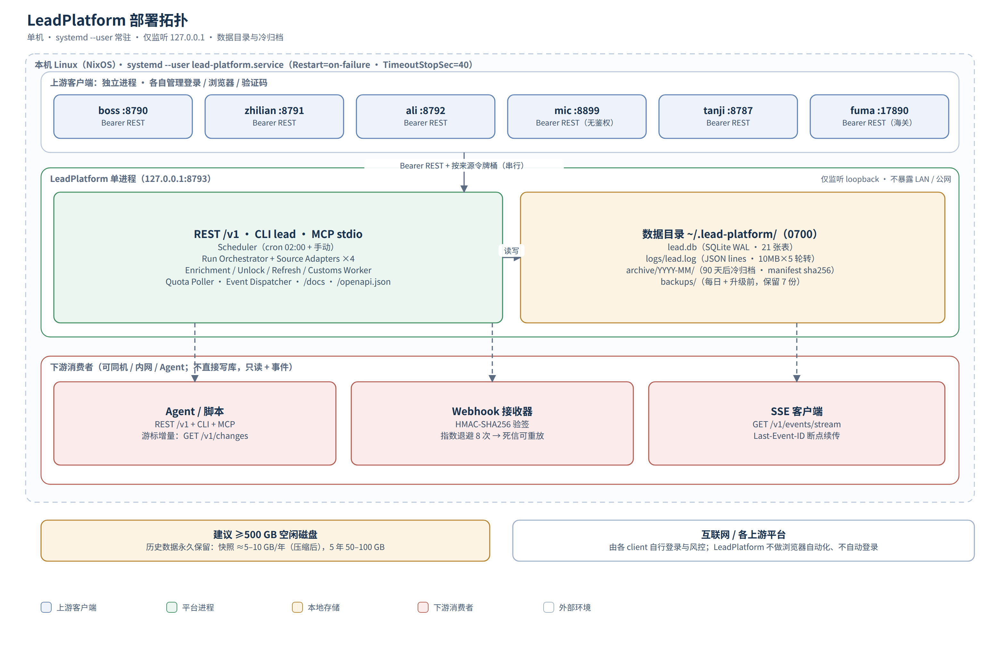

# 14 · 安装部署手册

> **状态**：v0.4 设计稿配套 · 随实现更新；标注「以最终代码为准」处需在 P6 后回填。
> **适用读者**：开发者、运维、首次在本机部署 LeadPlatform 的同学。
> **关联**：[README](../README.md) · [.env.example](../.env.example) · [systemd/lead-platform.service](../systemd/lead-platform.service) · [05-部署与运维](05-部署与运维.md) · [06-实施计划](06-实施计划.md) · [15-运维手册](15-运维手册.md)
> **范围**：从零安装到上线验收，含升级/回滚/卸载；日常巡检见 [15-运维手册](15-运维手册.md)。

---

## 1. 适用读者与部署形态

### 1.1 单机、loopback、单进程

LeadPlatform 是**本机常驻的单进程**：监听 `127.0.0.1:8793`，数据落 SQLite（WAL），由 systemd user service 拉起；scheduler、采集、刷新/解锁 worker、REST/CLI/MCP 都在同一进程内。不引入容器、反代、消息队列或第二实例（见 [02-架构与数据模型](02-架构与数据模型.md) 第 3 节）。



### 1.2 与六个上游 client 的关系

LeadPlatform 只通过 REST 调用上游，**不持有浏览器/profile、不自动登录**；上游独立安装、运行和维护登录态。

| 上游 | 地址 | 鉴权 | 用途 |
|---|---|---|---|
| boss-client | `127.0.0.1:8790` | `BOSS_API_TOKEN` | 招聘线索、岗位/档案 |
| zhilian-client | `127.0.0.1:8791` | `ZHILIAN_API_TOKEN` | 招聘线索、岗位/档案 |
| ali-client | `127.0.0.1:8792` | `ALI_API_TOKEN` | 国际站供应商、店铺 |
| mic-client | `127.0.0.1:8899` | 无（仅 loopback） | 制造网工厂、店铺 |
| tanji-client | `127.0.0.1:8787` | `TANJI_API_TOKEN` | 匹配/工商/解锁 |
| fuma-platform | `127.0.0.1:17890` | `FUMA_API_TOKEN` + `acct_01` | 海关画像（只读） |

上游不可用时跳过该来源（tanji/fuma 仅暂停补全/海关）；安装/登录见各 README，巡检见 [15-运维手册](15-运维手册.md)。

---

## 2. 环境要求与端口清单

### 2.1 软件与系统

| 项 | 要求 | 核对 |
|---|---|---|
| OS | Linux，systemd user 可用（当前 NixOS） | `systemctl --user status` |
| Node | **>= 22.5**（当前实测 v22.23.2） | `node -v` |
| npm | 随 Node 22 提供（10.x） | `npm -v` |
| SQLite CLI | 可选，仅人工核验/备份 | `sqlite3 --version` |
| curl / jq / git | curl 必需；jq 推荐；git 用于升级 | `curl --version`、`jq --version`、`git --version` |
| 运行用户 | 与上游 client 相同的登录用户，能读上游 token 文件 | `id -un` |

### 2.2 端口清单

所有端口只应绑定 `127.0.0.1`；六个上游必须先于 LeadPlatform 运行。

| 端口 | 进程 | 用途 | 鉴权 |
|---|---|---|---|
| **8793** | lead-platform | REST / SSE / Webhook / `/docs` | `LEAD_API_TOKEN`（health/docs/openapi 除外） |
| 8790 / 8791 / 8792 | boss / zhilian / ali | 招聘、国际站 | 各自 `*_API_TOKEN` |
| 8899 | mic-client | 制造网 | 无 |
| 8787 | tanji-client | 匹配/工商/解锁 | `TANJI_API_TOKEN` |
| 17890 | fuma-platform | 海关 | `FUMA_API_TOKEN` + 账号 |

### 2.3 时区、磁盘与内存

- **时区**：调度 `Asia/Shanghai`（`LEAD_TZ`）；DB 存 UTC，展示层转本地。系统时区建议同步：`sudo timedatectl set-timezone Asia/Shanghai`。
- **磁盘**：数据 + `archive/` + `backups/`；压缩后 0.3–0.6 GB、年度 5–10 GB、余量 10–20 GB/年；永久保留，[05-部署与运维](05-部署与运维.md) 建议 **≥500 GB** 空闲。
- **内存**：单进程 Node + SQLite，建议至少 **2 GB** 空闲；2 万公司/大查询的 RSS 以实测为准。
- **安全**：不要把 8793 暴露到 LAN/公网。

---

## 3. 安装前检查

### 3.1 版本与 SQLite 能力

```bash
node -v                    # 期望 v22.23.2；最低 >= v22.5.0
npm -v                     # 期望 10.x
node --experimental-sqlite --input-type=module -e \
  "import { DatabaseSync } from 'node:sqlite'; const db = new DatabaseSync(':memory:'); console.log(db.prepare('select sqlite_version() as v').get()); db.close();"
```

最后一条打印内置 SQLite 版本即通过；若报 `No such built-in module: node:sqlite`，先解决 Node 版本/flag。

### 3.2 上游健康探测

```bash
BOSS_TOKEN=$(sed -n 's/^BOSS_API_TOKEN=//p' ~/boss-client/.env | tail -1)
ZHILIAN_TOKEN=$(sed -n 's/^ZHILIAN_API_TOKEN=//p' ~/zhilian-client/.env | tail -1)
ALI_TOKEN=$(sed -n 's/^ALI_API_TOKEN=//p' ~/ali-client/.env | tail -1)
TANJI_TOKEN=$(jq -r '.apiToken // empty' ~/.tanji-client/config.json)
FUMA_TOKEN=$(jq -r '.server.apiToken // empty' ~/.fuma-platform/config.json)

curl -fsS -o /dev/null -w 'boss     %{http_code}\n' -H "Authorization: Bearer $BOSS_TOKEN" http://127.0.0.1:8790/v1/status
curl -fsS -o /dev/null -w 'zhilian  %{http_code}\n' -H "Authorization: Bearer $ZHILIAN_TOKEN" http://127.0.0.1:8791/v1/status
curl -fsS -o /dev/null -w 'ali      %{http_code}\n' -H "Authorization: Bearer $ALI_TOKEN" http://127.0.0.1:8792/v1/status
curl -fsS -o /dev/null -w 'mic      %{http_code}\n' http://127.0.0.1:8899/api/version
curl -fsS -o /dev/null -w 'tanji    %{http_code}\n' -H "Authorization: Bearer $TANJI_TOKEN" http://127.0.0.1:8787/v1/status
curl -fsS -o /dev/null -w 'fuma     %{http_code}\n' -H "Authorization: Bearer $FUMA_TOKEN" http://127.0.0.1:17890/v1/status
```

### 3.3 端口、目录与 NixOS

```bash
# 上游应在 LISTEN，8793 应为空
ss -lntp | grep -E ':(8790|8791|8792|8899|8787|17890|8793)[[:space:]]' || true
ss -lntp | grep ':8793' && echo "警告：8793 已被占用" || echo "OK：8793 空闲"
stat -c '%a %U:%G %n' ~/.lead-platform 2>/dev/null || echo "OK：数据目录尚未创建"

# NixOS 临时环境
nix-shell -p nodejs_22 sqlite --run 'node -v'
```

NixOS 的 `node`/`sqlite3` 可能只在某个 profile 可见，systemd 的 `PATH` 与登录 shell 不一致；必要时在 unit 写绝对路径（8.3）。`ss` 来自 `iproute2`。

---

## 4. 获取代码与依赖

```bash
git clone <repo-url> ~/lead-platform    # 首次；地址以团队 remote 为准
cd ~/lead-platform                      # 已有代码
npm ci                    # 严格按 package-lock.json；不要省略
npm run typecheck         # TypeScript strict
npm run build             # tsc -> dist/
npm test                  # 可选；CI 也执行
```

> 仓库 `LICENSE` 为 MIT。unit 假定仓库在 `~/lead-platform`，否则见 8.3。
>
> **一键部署（可选）**：仓库提供 `scripts/deploy.sh`，依次完成「检查/生成 `.env` → `npm ci`（首次）→ `npm run build` → 创建数据目录 → 安装 systemd user unit 并启动 → 软链 CLI 到 `~/.local/bin/lead` → 等待 `/v1/health` 通过」。适合新机器快速落地；生产升级仍建议按第 11 节手动执行以保留备份与回滚点。

---

## 5. 配置 .env

### 5.1 生成 .env 与 API token

```bash
cd ~/lead-platform
cp -n .env.example .env             # 已存在则不会覆盖
chmod 600 .env
TOKEN=$(node -e "console.log(require('crypto').randomBytes(32).toString('hex'))")
sed -i "s/^LEAD_API_TOKEN=.*/LEAD_API_TOKEN=$TOKEN/" .env
stat -c '%a %n' .env                # 期望 600
```

`LEAD_API_TOKEN` 至少 32 字节随机（上面为 32 字节 = 64 位 hex）；也可 `openssl rand -hex 32`。随后补齐各上游 token。可选：`node scripts/bootstrap-env.mjs` 从本机上游配置自动生成（会读取 boss/zhilian/ali 的 `.env`、tanji/fuma 的 `config.json`）；`--force` 会重建并生成新的 LEAD token，下游需同步。

### 5.2 配置项逐项说明

**服务与运行时**

| 变量 | 默认/示例 | 说明 |
|---|---|---|
| `LEAD_API_TOKEN` | `<64 位 hex>`（必填） | Bearer；≥32 字节随机；轮换后重启 |
| `LEAD_PORT` / `LEAD_DB` / `LEAD_LOG_LEVEL` / `LEAD_TZ` | `8793` / `~/.lead-platform/lead.db` / `info` / `Asia/Shanghai` | 仅 127.0.0.1；路径支持 `~`（应用展开）；DB 存 UTC |
| `LEAD_HOST` / `LEAD_DATA_DIR` / `LEAD_BACKUP_DIR` / `LEAD_PUBLIC_BASE_URL` | `127.0.0.1` / `~/.lead-platform` / `~/.lead-platform/backups` / `http://127.0.0.1:8793` | 监听地址；数据根目录（未显式配 `LEAD_DB` 时 DB 在其下）；备份目录；生成链接/文档用的对外地址 |
| `LEAD_SCHEDULER_ENABLED` / `LEAD_RUN_MAX_HOURS` / `LEAD_JOB_LEASE_SEC` / `LEAD_JOB_MAX_ATTEMPTS` / `LEAD_QUOTA_POLL_SEC` | `true` / `6` / `60` / `3` / `600` | cron；单轮上限；租约/重试；额度轮询 |
| `LEAD_SNAPSHOT_COMPRESSION` / `LEAD_ARCHIVE_AFTER_DAYS` / `LEAD_ARCHIVE_DIR` / `LEAD_REFRESH_WORKER_ENABLED` | `brotli` / `90` / `~/.lead-platform/archive` / `true` | 压缩、冷归档（**不删除**）、刷新；归档随 DB |
| `LEAD_JOB_REFRESH_DAYS` / `LEAD_STORE_REFRESH_DAYS` / `LEAD_CUSTOMS_REFRESH_DAYS` / `LEAD_CUSTOMS_MAX_PAGE_SIZE` | `7` / `30` / `30` / `20` | 存量刷新周期；fuma 单页条数 |
| `LEAD_PLATFORM_ACTIVE_DAYS` / `LEAD_PLATFORM_LOST_DAYS` / `LEAD_UNLOCK_DAILY_CAP` / `LEAD_WEBHOOK_MAX_ATTEMPTS` | `8` / `45` / 空（不限）/ `8` | 平台阈值；试点解锁 `50`；Webhook 重试 |

**上游 client（全部 loopback）**

| 变量 | 默认/示例 | 说明 |
|---|---|---|
| `BOSS_CLIENT_URL` / `BOSS_API_TOKEN`；`ZHILIAN_CLIENT_URL` / `ZHILIAN_API_TOKEN` | `:8790` / 必填；`:8791` / 必填 | 招聘；token 见各自 `.env` |
| `ALI_CLIENT_URL` / `ALI_API_TOKEN`；`MIC_CLIENT_URL` | `:8792` / 必填；`:8899` / 无鉴权 | 国际站/制造网；mic 不暴露 |
| `TANJI_CLIENT_URL` / `TANJI_API_TOKEN`；`FUMA_CLIENT_URL` / `FUMA_API_TOKEN` / `FUMA_ACCOUNT_ID` | `:8787` / 必填；`:17890` / 必填 / `acct_01` | 匹配/解锁（1 家 = 1 点）；海关需权限 |

**默认关键词与采集**

| 变量 | 默认/示例 | 说明 |
|---|---|---|
| `LEAD_DEFAULT_KEYWORDS_BOSS` / `LEAD_DEFAULT_KEYWORDS_ZHILIAN` | 外贸,外贸业务员,外贸经理,外贸单证员,国际贸易,跨境电商,外贸跟单,外贸专员,海外销售,国际业务 | 10 个；两源可分别收敛 |
| `LEAD_DEFAULT_KEYWORDS_ALI` / `LEAD_MAX_PAGES_PER_QUERY` | machinery,hardware,auto parts,pipe fitting,glass,bicycle,furniture / 空 | Ali 行业词；空=客户端上限 |

### 5.3 读取优先级与安全

建议生效顺序：**显式环境变量（systemd `EnvironmentFile`）> `./.env` > `~/.lead-platform/config.json` > 内置默认值**（实现即此顺序）。生产只保留 `.env` 一处；若改用 `config.json`（0600），至少包含 `apiToken`，不要两边写不同值。

> **绝不可提交 `.env`**：`.gitignore` 已忽略 `.env`、`.env.*`（保留 `.env.example`）。不要 `git add -f`，不要把 token 贴到 issue/日志/截图，也不要放进 URL 查询串。

```bash
git check-ignore -v .env && node scripts/check-no-secrets.mjs
```

---

## 6. 初始化数据目录与数据库

用**运行服务的同一用户**执行，不要 `sudo`（否则 DB 归 root，服务无法写）：

```bash
umask 077
mkdir -p ~/.lead-platform/{logs,archive,backups}
chmod 700 ~/.lead-platform
cd ~/lead-platform
npm start   # 看到 listening 后 Ctrl-C；启动时自动建表/迁移（当前无 --migrate）
```

```bash
sqlite3 ~/.lead-platform/lead.db "PRAGMA user_version; PRAGMA journal_mode; PRAGMA integrity_check;"   # 期望 1 / wal / ok
sqlite3 ~/.lead-platform/lead.db "SELECT count(*) FROM sqlite_master WHERE type='table' AND name NOT LIKE 'sqlite_%';"  # 期望 21
```

没有 `sqlite3` 时用 `node --experimental-sqlite` 打开同一路径执行等价 PRAGMA。

- **`PRAGMA user_version` 期望 1**（对应 `001_init`）。若表数已是 21 但仍为 0，说明迁移未写版本号，以最终代码为准；不要在版本不明时长期运行。
- **21 张核心表**：`meta`、`goals`、`goal_runs`、`companies`、`company_sources`、`pipeline_jobs`、`change_events`、`webhook_*`、`company_platform_*`、`company_customs_profiles` 等 21 张（完整清单以 `src/db/schema.sql` 为准）。
- **WAL**：运行中出现 `lead.db-wal`、`lead.db-shm` 正常，**不要删除**；备份用 `.backup`，不要运行中只 `cp lead.db`；收缩先停服务，`PRAGMA wal_checkpoint(TRUNCATE);` 后再处理。

---

## 7. 启动验证

```bash
cd ~/lead-platform
npm run dev      # tsx 直跑，开发用；或
npm start        # 需先 build；脚本已带 --experimental-sqlite
```

看到监听日志后再做 HTTP 检查：

```bash
curl -fsS http://127.0.0.1:8793/v1/health | jq
TOKEN=$(sed -n 's/^LEAD_API_TOKEN=//p' .env | tail -1)
curl -fsS -H "Authorization: Bearer $TOKEN" http://127.0.0.1:8793/v1/status | jq
curl -fsS -H "Authorization: Bearer $TOKEN" http://127.0.0.1:8793/v1/sources | jq -c '.data // .'
curl -fsS -H "Authorization: Bearer $TOKEN" http://127.0.0.1:8793/v1/quota | jq -c '.data // .'
curl -s -o /dev/null -w 'no-auth: %{http_code}\n' http://127.0.0.1:8793/v1/status   # 期望 401
curl -s -o /dev/null -w 'docs: %{http_code}\n' http://127.0.0.1:8793/docs           # 期望 200
curl -s http://127.0.0.1:8793/openapi.json | jq -r '.openapi'                       # 期望 3.1.x
```

启动日志为 JSON lines（字段 `ts, level, msg, component` + 业务字段；以最终代码为准）：

```jsonl
{"ts":"2026-11-16T09:00:00.000Z","level":"info","msg":"database initialized","component":"lead-platform","file":"/home/example/.lead-platform/lead.db"}
{"ts":"2026-11-16T09:00:00.120Z","level":"info","msg":"lead-platform listening","component":"lead-platform","url":"http://127.0.0.1:8793","docs":"http://127.0.0.1:8793/docs"}
```

前台 `Ctrl-C` 应优雅退出：停止领取新任务、等待在飞请求、释放租约。

---

## 8. systemd user service 常驻

```bash
cd ~/lead-platform
mkdir -p ~/.config/systemd/user
cp systemd/lead-platform.service ~/.config/systemd/user/
systemctl --user daemon-reload
systemctl --user enable --now lead-platform.service
systemctl --user status lead-platform.service --no-pager

journalctl --user -u lead-platform -f
loginctl enable-linger "$USER"          # 退出登录/重启后仍常驻
loginctl show-user "$USER" -p Linger    # 期望 Linger=yes
```

unit 关键行为：`EnvironmentFile=%h/lead-platform/.env`、`WorkingDirectory=%h/lead-platform`、`ExecStart=/usr/bin/env node --experimental-sqlite .../dist/main.js`、`Restart=on-failure`、`TimeoutStopSec=40`。**改 `.env` 后必须 restart**；只改 unit 才需 `daemon-reload`。

- `TimeoutStopSec=40` 给应用约 30s 等待在飞请求 + 释放租约；`stop` 变慢正常。超时 SIGKILL 后 WAL 可恢复，任务租约 60s 到期接管，依赖幂等键**不会重复扣额度**。
- 不 enable linger 时，注销后 user manager 可能停服务；无登录会话的 SSH 中 `systemctl --user` 报 bus 错误时先 `export XDG_RUNTIME_DIR="/run/user/$(id -u)"`。

---

## 9. 安装后验收清单

| # | 检查项 | 通过标准 |
|---|---|---|
| 1 | `curl -fsS http://127.0.0.1:8793/v1/health` | `ok:true` |
| 2 | 带 token 请求 `/v1/status` | `db.ok`、`queue`、`upstream` |
| 3 | 不带 token 请求 `/v1/status` | HTTP `401` |
| 4 | `npm link && lead status` | 正常输出，无 401 |
| 5 | `/docs`、`/openapi.json` | 200；OpenAPI `3.1.x` |
| 6 | `lead goal create ...` | `goal_...` + `resolvedCities` |
| 7 | `lead goal run <goalId>` | `run_...` + 进度 |
| 8 | `lead company list --province 河北省 --limit 5` | Run 后有公司、字段完整 |
| 9 | `lead events tail` 或 SSE | 收到事件 |
| 10 | `systemctl --user status lead-platform` | `active (running)` |

### 9.1 curl 与 CLI

```bash
TOKEN=$(sed -n 's/^LEAD_API_TOKEN=//p' .env | tail -1)
curl -fsS http://127.0.0.1:8793/v1/health | jq
curl -fsS -H "Authorization: Bearer $TOKEN" http://127.0.0.1:8793/v1/status | jq -c '{service, db, queue, quota}'
curl -s -o /dev/null -w 'no-auth: %{http_code}\n' http://127.0.0.1:8793/v1/status   # 401

cd ~/lead-platform
npm link
lead status
GOAL_ID=$(lead goal create \
  --name "河北试点-外贸" --province 河北省 --platforms boss \
  --cron "0 2 * * *" --keywords-boss "外贸,外贸业务员" --max-leads 200 \
  --json | jq -r '.id')
RUN_ID=$(lead goal run "$GOAL_ID" --json | jq -r '.id')
lead run show "$RUN_ID"
```

`npm link` 因 NixOS/只读 prefix 失败时，设 `npm config set prefix "$HOME/.npm-global"` 并把其 `bin` 加入 `PATH`；或 `ln -sf "$PWD/dist/cli.js" "$HOME/.local/bin/lead"`。

### 9.2 公司与事件

```bash
lead company list --province 河北省 --limit 5
lead events tail --types company.created,company.updated
```

没有事件时在另一终端再触发一次小 Run；`Ctrl-C` 结束 tail。SSE：`timeout 15 curl -sN -H "Authorization: Bearer $TOKEN" "http://127.0.0.1:8793/v1/events/stream?types=company.created"`。

公司列表合成示例（非真实数据）：`cmp_01JEXAMPLE0000000000000` / 河北示例机械有限公司 / `91130100MA0EXAMPLE` / 河北省石家庄市 / `locked`。

---

### 9.3 MCP（stdio）自检

MCP server 默认代理 REST，不直连数据库；服务未启动时会返回 `SERVICE_UNAVAILABLE`。

```bash
# 服务已启动的前提下，用 JSON-RPC 方式做一次 stdio 冒烟（可选）
printf '%s\n%s\n' \
  '{"jsonrpc":"2.0","id":1,"method":"initialize","params":{"protocolVersion":"2024-11-05","capabilities":{},"clientInfo":{"name":"smoke","version":"1"}}}' \
  '{"jsonrpc":"2.0","id":2,"method":"tools/list","params":{}}' | \
  LEAD_API_TOKEN="$TOKEN" LEAD_BASE_URL="http://127.0.0.1:8793" node dist/mcp/server.js | head -c 2000
```

客户端配置示例（Claude Desktop / 其它支持 MCP 的 Agent）：

```json
{
  "mcpServers": {
    "lead-platform": {
      "command": "node",
      "args": ["/opt/lead-platform/dist/mcp/server.js"],
      "env": { "LEAD_API_TOKEN": "<LEAD_API_TOKEN>", "LEAD_BASE_URL": "http://127.0.0.1:8793" }
    }
  }
}
```

工具清单以 `GET /mcp-tools.json` 为准（当前 36 个 `lead_*` 工具，含查询、Goal/Run、公司详情/联系人/平台/海关、变更与事件、Jobs、Webhook、stats）。完整用法见 [18-API / CLI / MCP 使用指南](18-API-CLI-MCP使用指南.md)。

---

## 10. 首次采集建议

### 10.1 先单城市试点，再扩全省

① boss + 石家庄市（`130100`）+ 1 个关键词 + 上限 200，验证登录/翻页/入库；② 加 zhilian（3–5 个关键词）；③ 加 ali/mic（默认词）；④ 四源跑河北 11 市（默认 10 词，上限 2000）。每一步都先看 `/v1/sources`、`/v1/status`、`/v1/quota`。

单城市试点用 `--city-codes 130100`（与 REST `region.cityCodes` 等价）：

```bash
lead goal create --name 河北试点-石家庄 --province 河北省 --city-codes 130100 \
  --platforms boss --keywords-boss 外贸 --max-leads 200
```

之后用返回的 goal id 手动 run；扩城时改 `cityCodes` 或新建 Goal，不要同时跑多个同源 Goal 抢限频。

### 10.2 默认 10 关键词与节奏

`.env.example` 的 Boss/智联默认各 10 个关键词（外贸、外贸业务员、外贸经理、外贸单证员、国际贸易、跨境电商、外贸跟单、外贸专员、海外销售、国际业务）；Ali 默认 7 个行业词；Mic 留空。关键词增加会成倍增加请求与时长、覆盖率收益递减；先用默认集，观察 `/v1/stats?kind=coverage` 再收敛。Boss 12 req/min、智联 15 req/min、Ali 页间 10s、Mic 约 1 req/2s、探迹 20 req/min；首轮通常以小时计，不要并发轰炸。

### 10.3 登录态、额度与来源差异

- **Boss / 智联**：扩量前看 `/v1/sources` 的 `loggedIn`；失效时在 client 侧 `POST /v1/session/login` → 轮询（智联另处理 `/v1/verification`）。LP 不自动登录。
- **探迹额度**：日 500 / 月 1500 / 企业月 19500，结算日 11；2026-11-16 仅剩 223。解锁 1 家=1 点，匹配不扣。**不要一次全量解锁**：试点设 `LEAD_UNLOCK_DAILY_CAP=50`，每天看 `/v1/quota`。
- **Ali / Mic**：Ali 按省检索，关键词做本地过滤；扩展每约 40 次查询冷却 60s，`CAPTCHA_REQUIRED/RATE_LIMITED` 即停。Mic 省+11 市、约 1 req/2s，`cities_complete=true`，可作覆盖主力但需串行。
- **覆盖基线**：四源约 **9,586** 家（Mic 5,008 / Ali 2,961 / 招聘 2,375，重叠 299）；参考基线，非全部外贸企业或验收承诺；偏差 >20% 查上游。

---

## 11. 升级与回滚

### 11.1 升级（先备份，再停服）

```bash
cd ~/lead-platform
STAMP=$(date +%F-%H%M)
mkdir -p ~/.lead-platform/backups
sqlite3 ~/.lead-platform/lead.db ".backup '$HOME/.lead-platform/backups/lead-$STAMP.db'"
install -m 600 .env "$HOME/.lead-platform/backups/env-$STAMP"
tar -czf "$HOME/.lead-platform/backups/archive-$STAMP.tgz" -C "$HOME/.lead-platform" archive

systemctl --user stop lead-platform
git pull --ff-only
npm ci && npm run build
systemctl --user start lead-platform   # 启动时自动迁移（幂等）
```

迁移「只增不改」，启动时自动执行且幂等。升级后按第 7、9 节复验 `/v1/health`、`/v1/status` 与 `PRAGMA user_version`；也可用 `lead admin backup` 在线备份。

### 11.2 回滚

```bash
systemctl --user stop lead-platform
cd ~/lead-platform
git checkout <旧版本 commit 或 tag>     # 临时回滚；之后可 git switch main
npm ci && npm run build
systemctl --user start lead-platform
```

若新版本已迁移并改写数据、旧代码无法读取，停服后 `sqlite3 ~/.lead-platform/lead.db ".restore '$HOME/.lead-platform/backups/lead-$STAMP.db'"` 再启动；冷归档从 `archive-$STAMP.tgz` 恢复，先保留当前 `archive/`。回滚后重跑第 7、9 节。

### 11.3 API 与数据兼容

- REST 以 **`/v1` 冻结**：只做向后兼容的加字段/加接口；破坏性变更升 `/v2`，不静默改语义；`meta.schemaVersion` 供下游判断。
- 错误码/envelope 稳定；CLI/MCP 与 REST 同源，升级后 `npm run gen:check` 应通过。

---

## 12. 卸载

```bash
systemctl --user disable --now lead-platform.service
rm -f ~/.config/systemd/user/lead-platform.service
rm -rf ~/.config/systemd/user/lead-platform.service.d
systemctl --user daemon-reload

npm unlink -g lead-platform 2>/dev/null || true     # npm link 方式
rm -f "$HOME/.local/bin/lead"                       # deploy.sh 软链方式
```

数据目录按需保留或删除（先停服务并核对绝对路径）：

```bash
mv ~/.lead-platform ~/.lead-platform.removed-$(date +%F)   # 保留，可原样恢复
rm -rf -- ~/.lead-platform                                 # 彻底删除，不可恢复
```

数据含 `lead.db`、`archive/`、`backups/` 与 `.env`；删除前先导出，上游不受影响。

---

## 13. 常见安装问题排查

| 症状 | 原因 | 处理 |
|---|---|---|
| `EADDRINUSE` / 8793 被占 | 旧实例未停；其它进程占用 | 停旧实例；不要起第二实例 |
| `No such built-in module: node:sqlite` | Node < 22.5，或未带 `--experimental-sqlite` | 升级 Node；命令/unit 加 flag |
| 上游 `503 SOURCE_UNAVAILABLE` | 上游 client 未启动/端口不对 | 启动上游；unit 不会自动拉起 |
| 所有请求 `401 UNAUTHORIZED` | token 不一致、环境未刷新、头格式错 | 查 header/`.env`；restart |
| `EACCES` / `SQLITE_CANTOPEN` | 目录或 `.env` 权限/属主不对，或用了 sudo | 0700/0600；改回属主 |
| 服务起不来但手工命令正常 | `EnvironmentFile` 特殊字符/`~` 未展开 | 改绝对路径；systemd 语法核对 |
| cron 时间/日期偏移 | 系统时区或 `LEAD_TZ` 不一致 | `timedatectl` + Goal `timeZone` |
| `SQLITE_BUSY: database is locked` | 第二个实例，或 sqlite3 长事务/写锁 | 停多余实例；checkpoint |
| `lead: command not found` / `/docs` 404 | PATH 未生效；或未 build | 查 `npm config get prefix`；build |

### 13.1 排查命令速查

```bash
ss -lntp | grep ':8793' || echo "8793 空闲"                 # 端口
node -v; command -v node; systemctl --user show-environment | grep -E '^PATH='   # Node
curl -sS -o /dev/null -w '%{http_code}\n' http://127.0.0.1:8790/v1/status        # 上游
stat -c '%a %U:%G %n' ~/.lead-platform ~/.lead-platform/lead.db .env            # 权限
timedatectl; TZ=Asia/Shanghai date                                              # 时区
ps -ef | grep '[d]ist/main.js'; sqlite3 ~/.lead-platform/lead.db "PRAGMA integrity_check;"  # 实例/DB
```

`EnvironmentFile` 非 shell：`~` 不展开，空格/引号按 systemd 语法。

---

## 14. 附录

### 14.1 数据目录结构

```text
~/.lead-platform/                 0700
├── lead.db (+ -wal / -shm)       SQLite 主库（WAL），sidecar 运行期勿删
├── config.json                   可选，0600；与 .env 二选一为主
├── logs/lead-platform.log        JSON lines，20 MB 轮转
├── archive/2026-11/part-0003.br  冷归档（brotli）；清单在 DB 的 meta_kv
└── backups/                      lead-*.db / env-* / archive-*.tgz
```

### 14.2 常用命令速查

| 目的 | 命令 |
|---|---|
| 启动/停止/重启 | `systemctl --user start\|stop\|restart lead-platform` |
| 日志 | `journalctl --user -u lead-platform -f`；`-n 200 --no-pager` |
| 健康/运行态 | `curl -fsS http://127.0.0.1:8793/v1/health`；`lead status` |
| 上游/额度 | `lead sources`；`lead quota` |
| 首个 Goal | `lead goal create --name ... --province 河北省 --platforms boss` |
| 手动 Run | `lead goal run <goalId>`；`lead run show <runId>` |
| 公司/事件 | `lead company list --province 河北省 --limit 5`；`lead events tail` |
| DB 核验/备份 | `sqlite3 ~/.lead-platform/lead.db "PRAGMA integrity_check;"`；`.backup '$HOME/backup.db'` |

### 14.3 与 docs/15 的分工

| 场景 | 本文（14） | [15-运维手册](15-运维手册.md) |
|---|---|---|
| 首次安装、配置、初始化、systemd 接入、升级/回滚/卸载 | ✅ 主文档 | 引用 |
| 日常巡检、告警、额度/登录失效、刷新积压、Webhook 死信、备份演练、容量 | 仅安装期检查 | ✅ 主文档 |

设计依据：[05-部署与运维](05-部署与运维.md)、[02-架构与数据模型](02-架构与数据模型.md) 第 3 节、[03-接口草案](03-接口草案.md) 第 1 节。不一致时以代码与 `spec/openapi.json` 为准。
