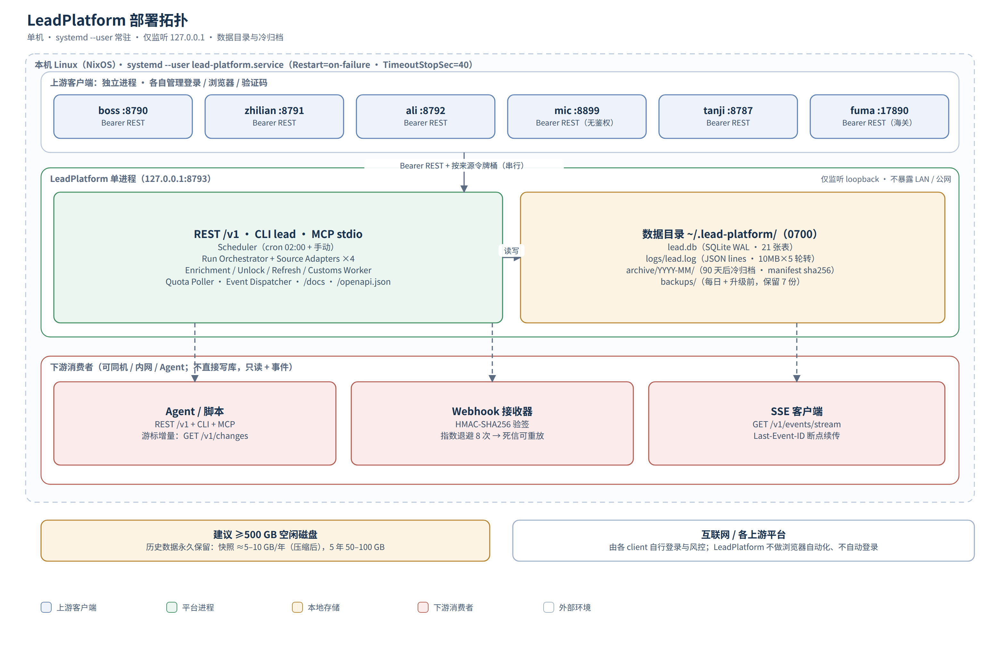

# 15 · 运维手册

> **状态**：v0.4 设计稿配套；实现并行开发中，命令/字段/路径**最终以代码为准**。
> **读者**：值班运维、平台负责人；销售/数据支持只读使用。
> **关联**：[05-部署与运维](05-部署与运维.md)、[03-接口草案](03-接口草案.md)、[02-架构与数据模型](02-架构与数据模型.md)、[07-平台档案](07-平台档案与招聘信息.md)、[08-海关数据](08-海关数据补全.md)、[12-覆盖实测](12-河北四源覆盖实测报告.md)、[13-数据口径](13-数据口径与质量说明.md)、[README](../README.md)、[.env.example](../.env.example)、[systemd unit](../systemd/lead-platform.service)、[schema.sql](../src/db/schema.sql)。
> **合成数据**：「河北示例机械有限公司」、`138****0000`、`contact@example.com` 均为合成；禁止真实公司/PII/token 入文档、工单或截图。

---

## 1. 运维对象与职责

单机单进程：Node 22 + Fastify 5 + SQLite/WAL，仅 `127.0.0.1:8793`，systemd user service。运维对象：**进程、DB/归档、六个上游、对外接口**。

| 对象 | 位置 | 关键动作 |
|---|---|---|
| 进程 | `lead-platform.service` | 启停、重启、journal |
| 数据库 | `~/.lead-platform/lead.db`（`-wal`/`-shm`） | 备份、一致性、容量 |
| 归档/日志/备份/配置 | `~/.lead-platform/{archive,logs,backups}`、`.env` 0600 | 校验、检索、7 份 |

### 1.1 六个上游

| 上游 | 端口 | 鉴权 | 登录/会话 | 失联影响 |
|---|---|---|---|---|
| boss-client | 8790 | `BOSS_API_TOKEN` | 约 **5 天**，人工扫码 | Boss 采集/刷新停 |
| zhilian-client | 8791 | `ZHILIAN_API_TOKEN` | 约 **1 个月** | 智联采集/刷新停 |
| ali-client | 8792 | `ALI_API_TOKEN` | 匿名 + x5sec | Ali 采集/刷新停 |
| mic-client | 8899 | 无（loopback） | 匿名 + Focus Captcha | Mic 采集/刷新停 |
| tanji-client | 8787 | `TANJI_API_TOKEN` | token 长期；额度按账号 | 补全、**解锁**停 |
| fuma-platform | 17890 | `FUMA_API_TOKEN` + `FUMA_ACCOUNT_ID` | `acct_01`，缓存 24h | 仅海关停 |

### 1.2 目录与权限

```text
~/.lead-platform/          0700
├── lead.db                0600   SQLite（WAL）
├── lead.db-wal/-shm       0600
├── logs/lead.log          0600   设计口径（现状见 3.1）
├── archive/YYYY-MM/       0700   brotli 冷归档
└── backups/               0700   每日/升级前备份
```

数据目录 0700；`.env`、DB、归档、备份 0600。`scripts/bootstrap-env.mjs` 生成 `.env`，`scripts/deploy.sh` 建目录并 chmod。本机以仓库根 `.env` 为实际配置（systemd `EnvironmentFile`）；`config.json` 兼容性以代码为准。

### 1.2.1 配置项补充（v0.1.0 实现）

除 [14 安装部署手册](14-安装部署手册.md) 与 `.env.example` 列出的配置外，`src/config.ts` 还支持：`LEAD_HOST`（监听地址，默认 127.0.0.1）、`LEAD_DATA_DIR`（数据目录根）、`LEAD_BACKUP_DIR`（备份目录）、`LEAD_PUBLIC_BASE_URL`（生成链接/文档时使用的对外地址）。改配置后需重启服务生效；Token / secret 文件权限保持 `0600`。

### 1.3 拓扑



> 图：`docs/assets/deployment-topology.png`；缺失时用 `docs/assets/lead-platform-sketch.png` 应急。数据流：cron/手动 → Run → 四源采集 → tanji 匹配/补全 → 额度感知解锁 → 平台刷新 + fuma 海关 → SQLite → REST/CLI/MCP/Webhook/SSE。采集结束 ≠ 补全结束。

### 1.4 铁律

1. **不替上游登录**：登录/验证码只在 client 侧人工完成。
2. **不重启上游**：先看 client `/v1/status` 与 `/docs`，重启由 client 所有者执行。
3. **不直接写库**：不手工 `UPDATE/INSERT/DELETE`；迁移由服务启动时自动执行（幂等，只增不改），修数据走 API/CLI/rematch。
4. **不删历史数据**：只压缩、归档、扩容；轮转只删**备份文件**。

---

## 2. 日常巡检

### 2.1 前置

```bash
export LEAD_BASE="http://127.0.0.1:8793"
set -a; . "$HOME/lead-platform/.env"; set +a
AUTH="Authorization: Bearer $LEAD_API_TOKEN"
# 本机未装 sqlite3：nix shell nixpkgs#sqlite，或用附录 A 的 LSQL
```

CLI `lead` 需 `npm run build` 且 `~/.local/bin` 在 `PATH`；仓库外执行前先 source `.env`。

### 2.2 每日（工作日 09:00 前）

| # | 检查项 | 命令 | 期望值 | 异常动作 |
|---|---|---|---|---|
| D1 | 服务 | `systemctl --user is-active lead-platform.service` | `active` | §6.7 |
| D2 | 健康 | `curl -fsS "$LEAD_BASE/v1/health"` | `status=ok`，<100ms | §6.7 |
| D3 | 状态/告警 | `curl -fsS -H "$AUTH" "$LEAD_BASE/v1/status"` | `alerts=[]`；schema=1 | §3.5、§6.6 |
| D4 | 六源 | `lead sources` | 六源均 `ok` | §6.1/6.4/6.9 |
| D5 | 额度 | `lead quota` | 差值可解释；waiting 不异常涨 | §4、§6.2 |
| D6 | 最近 Run | `lead run list` | completed/partial；无 >6.5h running | §6.3 |
| D7 | 死信 | `sqlite3 -readonly "$LEAD_DB" "SELECT COUNT(*) FROM pipeline_jobs WHERE status='dead';"` | 0 | §6.3 |
| D8 | 队列 | `sqlite3 -readonly "$LEAD_DB" "SELECT status,COUNT(*) FROM pipeline_jobs GROUP BY status;"` | waiting 可解释 | §6.2/6.3 |
| D9 | 刷新 | `curl -fsS -H "$AUTH" "$LEAD_BASE/v1/status"` | `refresh.due` 稳定/下降 | §6.8 |
| D10 | 海关 | `sqlite3 -readonly "$LEAD_DB" "SELECT confidence,COUNT(*) FROM company_customs_profiles GROUP BY confidence;"` | 分布稳定 | §6.9 |
| D11 | 海关抽查 | `lead company customs <companyId>` | `sampled=true`、字段完整 | §6.9 |
| D12 | Webhook | `sqlite3 -readonly "$LEAD_DB" "SELECT COUNT(*) FROM webhook_deliveries WHERE status='dead';"` | 0 | §6.5 |
| D13 | 磁盘 | `df -h "$HOME/.lead-platform"` | 可用 ≥100GB | §6.10 |
| D14 | 备份 | `ls -lh "$HOME/.lead-platform/backups"` | 当日文件存在、<26h | §5.2 |
| D15 | 日志 | `journalctl --user -u lead-platform.service -p warning -n 50 --no-pager` | 无连续 ERROR | §3.3 |
| D16 | 监听 | `ss -ltnp`（过滤 8793） | 仅 `127.0.0.1:8793` | §9.1 |

### 2.3 每周（周一）

| # | 检查 | 命令 | 期望/动作 |
|---|---|---|---|
| W1 | 死信清零 | `lead job list --status dead` | 0 或有工单；§6.3 |
| W2 | Webhook | `sqlite3 -readonly "$LEAD_DB" "SELECT status,COUNT(*) FROM webhook_deliveries GROUP BY status;"` | dead=0；delivered ≥99% |
| W3 | 快速检查/WAL | `sqlite3 -readonly "$LEAD_DB" "PRAGMA quick_check;"`；`ls -lh "$LEAD_DB-wal"` | `ok`；WAL <256MB |
| W4 | 备份抽检 | 最新备份跑 `PRAGMA quick_check` + 计数 | `ok`、行数接近 |
| W5 | 登录到期 | `curl -fsS -H "Authorization: Bearer $BOSS_API_TOKEN" http://127.0.0.1:8790/v1/status` | expiresAt >7 天；否则 §6.1 |
| W6 | 新鲜度/覆盖 | `SELECT platform_status,COUNT(*) ...`；`/v1/stats?kind=coverage` | stale<10%；全量 ≥8,500 |

### 2.4 每月（1–5 日；11 日另见 §4.7）

| # | 检查 | 命令 | 期望/动作 |
|---|---|---|---|
| M1 | 完整性/空闲页 | `PRAGMA integrity_check;`；`PRAGMA freelist_count;` | `ok`；>20% 考虑 VACUUM |
| M2 | 归档/异地 | `lead admin manifests`；`lead admin verify --month $(date +%Y-%m)`；`rsync -a "$HOME/.lead-platform/backups/" /mnt/backup/lead/` | 清单/sha256 全过；异地 7 份 |
| M3 | 台账对账 | 附录 B 的额度 SQL 与 `/v1/quota` | 扣点=额度差值 |
| M4 | 容量/权限 | `du -sh`；`stat -c '%a %U:%G %n'` | 12 个月余量；§9.3 |
| M5 | 恢复/审计/复盘 | 备份副本恢复；PII/token 检索；本月 P1/P2/P3 | 可查、计数正确；无明文；更新阈值 |

> 巡检按附录 D 留档；P1/P2 另建事件记录并复盘。

---

## 3. 日志与监控

### 3.1 落点与轮转

| 项 | 设计口径 | 当前基线（以代码为准） |
|---|---|---|
| 文件 | `~/.lead-platform/logs/lead.log` | `logs/lead-platform.log` |
| 格式 | JSON lines | 相同 |
| 轮转 | 10MB × 5 | 20MB 后按时间戳重命名，未限 5 份 |
| 输出 | 文件 + journal | 文件 + stdout/stderr |

巡检统一用 `logs/lead*.log` 通配；不要外部 logrotate 与程序轮转同时切同一文件。journal 清理用 `journalctl --user --vacuum-time=30d`（只清 journal）。

### 3.2 JSON 字段

```json
{"ts":"2026-11-16T02:00:01.234Z","level":"info","msg":"http","component":"lead-platform","requestId":"req_01JEXAMPLE","method":"GET","url":"/v1/status","status":200,"ms":3}
```

关键字段：`ts`（UTC ISO，报表按 `Asia/Shanghai`）、`level`（debug/info/warn/error）、`msg`/`event`、`component`/`module`、`requestId`（透传 `X-Request-Id`）、`runId`/`companyId`/`platform`、`errorCode`、`ms`/`durationMs`。字段非固定 schema，检索用 `(.field // "")` 兜底。

### 3.3 journalctl 与检索
```bash
journalctl --user -u lead-platform.service -n 200 --no-pager
journalctl --user -u lead-platform.service -f
journalctl --user -u lead-platform.service -p warning -n 100 --no-pager
journalctl --user -u lead-platform.service --since "2026-11-16 02:00" --until "2026-11-16 09:00"

LOG_DIR="$HOME/.lead-platform/logs"
tail -n 5000 "$LOG_DIR"/lead*.log | jq -c 'select(.level=="error")'
tail -n 5000 "$LOG_DIR"/lead*.log | jq -c 'select((.msg // "") | test("session_invalid|quota|dead|delivery_failed"))'
tail -n 5000 "$LOG_DIR"/lead*.log | jq -c 'select(.msg=="http" and (.ms // 0) > 300)'
grep -h 'source.session_invalid' "$LOG_DIR"/lead*.log | tail -5
```

重启前留 15 分钟日志；重启会丢内存态，但 DB 队列与租约可恢复。

### 3.4 PII 打码

手机 `138****0000`（前 3 后 4）、邮箱 `co***@example.com`（前 2 + 域名）、身份证形态 `130102********1234`（前 6 后 4）、token/secret/password/authorization 整体 `"***"`。`LEAD_LOG_LEVEL=debug` 只短时排障；工单/截图只贴打码片段。发现快照未打码按 P2 处理（[09 报告](09-上游接口与流水线验证报告.md) 问题 9）。

### 3.5 关键事件与 alerts

| 事件 | 级别 | 含义 | 首查 |
|---|---|---|---|
| `source.session_invalid` | warn | 登录失效 | §6.1 |
| `source.verification_pending` / `upstream.rate_limited` | warn | 验证码/429 冷却 | §6.4 |
| `quota.exhausted` / `unlock.quota_exhausted` | warn | 额度耗尽 | §4/§6.2 |
| `run.partial` / `run.failed` / `job.dead` | warn/error | 部分/失败/死信 | §6.3 |
| `webhook.delivery_failed` | warn | 投递失败 | §6.5 |
| `customs.permission_denied` / `customs.upstream_error` | warn | 海关权限/上游 | §6.9 |
| `customs.updated` | info | 画像更新（可推送） | §6.9 |

命名存在设计/实现差异；检索用正则同时匹配，最终以代码为准。`/v1/status.alerts` 当前含 `tanji monthly quota low`（月额度 <50，§4）与 `database unavailable`（§6.6/6.7）。一期不接外部通知，轻量探针：

```bash
curl -fsS -H "$AUTH" "$LEAD_BASE/v1/status" | jq -e '.data.alerts | length == 0' >/dev/null \
  || echo "LEAD_ALERT $(date -Is)"
```

---

## 4. 额度运营

### 4.1 三层额度

| 层级 | 限额 | 重置 | 说明 |
|---|---|---|---|
| 日 | **500/天** | 每日 00:00（Asia/Shanghai） | 每天最多 500 |
| 个人月 | **1,500/月** | **每月 11 日结算** | 硬瓶颈，500×3 天打满 |
| 企业月 | **19,500/月** | 每月结算 | 企业池共享 |

1 家解锁 = 1 点；`alreadyUnlocked` 不扣点。2026-11-16 实测示例：日 500/500、月 223/1500、企业 11914/19500。河北 ≈9,586 家按 1,500/月需 ≈6.4 个月，**不可全库 FIFO**。

### 4.2 `waiting_quota`

```text
pending → 执行前读 ≤2min 的 quota_observations
  ├─ 有额度 → running → 成功：unlock_ledger + 联系人 + contact.unlocked
  └─ 无额度 / QUOTA_EXHAUSTED → waiting_quota（不计失败）
       └─ Quota Poller 每 600s；日切/结算/额度增加 → 批量回 pending（保序）
```

这是保护不是故障；任务不丢、不重复扣点；采集/补全/刷新/海关照常。

### 4.3 优先级（Q14）

设计默认 `goals.unlock_policy={"mode":"priority","order":["recruiting","paid_member","customs","rest"]}`：**批次内 FIFO**，非全库 FIFO。

| 优先级 | 对象 | 判定（示意） | 动作 |
|---|---|---|---|
| P0 | 招聘在招（Boss/智联有外贸岗） | `company_platform_jobs.status='active'` | 优先解锁（≈2,375） |
| P1 | Ali/Mic 付费/认证会员 | 店铺 `store` 的 membership/verified/audited | 次优先 |
| P2 | 有海关出口记录 | `confidence∈(high,medium)` 且 `exporter_records>0` | 第三批 |
| P3 | 其余 | 不满足以上 | **只入工商库，不排解锁** |

若代码仍是全库 FIFO（Q14 未落地），**不要手工改库**；周报标注偏差，由负责人决定。优先级调整需审批，观察 1–2 天台账与 P0 积压。

### 4.4 台账核对

```bash
sqlite3 -readonly -header -column "$LEAD_DB" "
SELECT date(requested_at,'+8 hours') day,COUNT(*) unlocks,SUM(quota_cost) points
FROM unlock_ledger GROUP BY day ORDER BY day DESC LIMIT 14;"

lead quota --json
curl -fsS -H "$AUTH" "$LEAD_BASE/v1/quota" | jq '.data'
curl -fsS -H "Authorization: Bearer $TANJI_API_TOKEN" http://127.0.0.1:8787/v1/status | jq '.data.quota'
```

对账：台账日扣点 = `quota_observations` 日剩余下降（考虑 11 日重置）；`idempotency_key=unlock:<companyId>:<yyyy-MM-dd>` 唯一；同公司同日应只有 1 条；同公司累计扣点 >1 用 `GROUP BY company_id HAVING SUM(quota_cost)>1` 核查。

### 4.5 `LEAD_UNLOCK_DAILY_CAP`

空（默认）= 不限，额度耗尽才停；`LEAD_UNLOCK_DAILY_CAP` 取 50/30/100 约 30/50/15 天用满 1,500，分别适合平稳/只保 P0/短期冲刺。改 `.env` 后 `chmod 600` 并 `systemctl --user restart lead-platform.service`，记录日期/旧值/新值/原因/审批人。`0` 的语义（禁用/不限）以代码为准；需冻结解锁时优先停服或设小正数。

### 4.6 耗尽时该做/不该做

- **该做**：确认日/月额度与 waiting/P0 占比；确认 Poller、结算日、自动恢复；评估 cap/优先级；用已解锁联系人服务销售并说明可解锁时间。
- **不该做**：重启“试试”；新建/切换探迹账号；手工改 `pending`/删任务/提高并发；承诺“马上有联系人”。

### 4.7 结算日与异常

10 日记录月剩余、waiting、P0；11 日 00:10 后确认 `quota_observations` 新周期、月剩余回升。10–20 分钟内 waiting 应批量回 pending；未恢复则重启一次并按 §6.2。

- 消耗远大于台账：停解锁，查探迹调用与台账，联系账号所有者（可能绕过台账/重复 unlock/账号他用）。
- 有扣点但未解锁：查任务 `last_error`、重试、必要时 rematch（上游超时/联系人拉取失败）。
- `alreadyUnlocked` 多但联系人为空：查 tanji contacts，勿重复 unlock；waiting 不恢复：查日志与观测、重启、核对结算日。

---

## 5. 备份、归档与恢复

### 5.1 策略

| 对象 | 频率 | 保留 | 位置/备注 |
|---|---|---|---|
| SQLite | 每日 09:30（Run 02:00 起、最长 6h）+ 升级前 | **7 份** | `backups/lead-YYYY-MM-DD.db` |
| 归档 | 每月 + 归档后 | 同业务寿命 | 异地/NAS 一份 |
| `.env`/密钥 | 变更时 | 按制度 | 密码管理器/离线，勿入 DB 备份包 |
| 发布前 | 每次发布 | 最近 3 次 | 文件名带 commit |

必须同时覆盖 **`lead.db` + `archive/`**；只备份 DB 会丢已归档快照。备份禁止进 git。

### 5.2 在线备份与校验

```bash
mkdir -p "$HOME/.lead-platform/backups"; STAMP=$(date +%F)
sqlite3 "$LEAD_DB" ".backup '$HOME/.lead-platform/backups/lead-$STAMP.db'"
chmod 600 "$HOME/.lead-platform/backups/lead-$STAMP.db"
sha256sum "$HOME/.lead-platform/backups/lead-$STAMP.db" > "$HOME/.lead-platform/backups/lead-$STAMP.db.sha256"
```

无 `sqlite3` 时用 Node 22 `VACUUM INTO` 兜底（`node --experimental-sqlite`，约一个 DB 大小空间、目标不存在、短时占写锁）。设 `BACKUP="$HOME/.lead-platform/backups/lead-$(date +%F).db"`，校验 `PRAGMA integrity_check`、`PRAGMA user_version` 与 `companies/change_events/raw_snapshots` 计数；期望 `ok`、版本一致、行数接近；每季度按 §5.4 在**临时库**演练。

### 5.3 冷归档

90 天（`LEAD_ARCHIVE_AFTER_DAYS`）后 `raw_snapshots` 转 `archive/YYYY-MM/` brotli 文件；`archived=1`、`archive_path`、`archived_at`；**只归档不删除**。清单记录文件/条数/字节/sha256（设计 `meta_kv.archive_manifests`；当前 schema 为 `meta`，以代码为准）。普通 API 可按需读取归档。

```bash
lead admin archive --after-days 90 --dry-run     # 预估影响
lead admin archive --after-days 90               # 执行冷归档（只归档，不删除）
lead admin manifests                              # 归档清单（按月、含 sha256）
lead admin verify --month 2026-11                 # 校验归档文件 sha256 / 可读性
lead admin restore --month 2026-11 --dry-run      # 恢复演练
lead admin restore --month 2026-11                # 恢复某月到 hot 库
lead admin db-stats                               # DB 体积 / 各表行数
```

> 对应 HTTP（本机 Bearer）：`POST /v1/admin/archive`、`GET /v1/admin/archive/manifests`、`GET /v1/admin/verify`、`POST /v1/admin/restore`、`GET /v1/admin/db-stats`；备份目录可用 `LEAD_BACKUP_DIR` 配置（默认 `~/.lead-platform/backups`）。

```sql
SELECT COUNT(*) total,SUM(archived) archived,
       SUM(archived=0 AND julianday(fetched_at)<julianday('now','-90 days')) due FROM raw_snapshots;
```

归档进度与路径缺失用上面的 `due` + `SELECT COUNT(*) missing_path FROM raw_snapshots WHERE archived=1 AND (archive_path IS NULL OR archive_path='')` 核查；文件可解压性用 Node `zlib.brotliDecompressSync` 抽查。

### 5.4 恢复

**演练**：最新备份复制到 `/tmp/lead-drill.db` → `integrity_check` + 关键表计数 → 查询公司/变更/任务 → 记录耗时 → 清理；不要在首次演练覆盖生产。

**真实恢复**：

```bash
systemctl --user stop lead-platform.service
cp -p "$LEAD_DB" "$HOME/lead-platform-backup-incident-$(date +%F-%H%M).db"
cp -p "$HOME/.lead-platform/backups/lead-YYYY-MM-DD.db" "$LEAD_DB"
rm -f "$LEAD_DB-wal" "$LEAD_DB-shm"; chmod 600 "$LEAD_DB"
sqlite3 -readonly "$LEAD_DB" "PRAGMA integrity_check;"
systemctl --user start lead-platform.service; curl -fsS http://127.0.0.1:8793/v1/health
```

恢复会丢失备份时点后数据；`change_events.seq` 可能回退，需通知下游重新对齐或全量拉取。全程记录时间线。

### 5.5 容量与磁盘

| 项 | 估算 |
|---|---|
| 一次性补全（压缩后） | **0.3–0.6 GB** |
| 年度刷新 | **5–10 GB/年**（设计余量 10–20） |
| 5 年 / 建议空闲 | **50–100 GB** / **≥500 GB** |
| 公司主档 10 万 / 海关 | 200–400 MB / 20–80 MB |

磁盘分级：≥100GB 正常；50–100GB 预警、排扩容；20–50GB P2；<20GB P1。VACUUM/备份各需约一个 DB 大小临时空间。**只扩容/迁移，不删数据**。

---

## 6. 故障 Runbook

> 先止损（停写/停解锁/留空间）→ 留证据（journal/日志/status/备份）→ 修复 → 验证 → 预防。

### 6.1 Boss/智联登录失效
- **症状**：该源 `session_invalid`；Run query `skipped`；日志 `source.session_invalid`；`loggedIn=false`。
- **定位**：`lead sources`；`journalctl --user -u lead-platform.service -n 100 --no-pager`；client `GET /v1/status`。
- **处置**：1) client 侧 `POST /v1/session/login` → 轮询 `GET /v1/session/login/{id}`，人工扫码/短信；2) 确认 `loggedIn=true`、`expiresAt` 未来、无 verification；3) 下轮自动重试，或 `lead goal run <goalId> --wait`；4) 本轮 skipped 不补采，必要时下一轮重跑。
- **验证**：来源回 `ok`；新 Run 的 `skippedSources` 不含该源。
- **预防**：Boss 每 4 天、智联每月 25 日前续登；不复制 cookie/profile；不多端同登。

### 6.2 探迹额度耗尽（预期内）
- **症状**：日/月剩余 0；`queue.waiting_quota` 增长；日志 `quota.exhausted`/`unlock.quota_exhausted`。
- **定位**：`lead quota`；`curl -fsS -H "$AUTH" "$LEAD_BASE/v1/status" | jq '.data.queue,.data.quota'`。
- **处置**：1) 判断日额度（次日）还是月额度（等 11 日）；2) 确认 Poller 在跑、`quota_observations` 有新记录；3) **不重启、不改任务状态**，等自动恢复；4) 月额度提前耗尽且 P0 积压，评估 cap/优先级；5) 未按预期重置按 §4.7。
- **验证**：结算/日切后 waiting 批量回 pending，ledger 新增且扣点正确。
- **预防**：月初不做“打满测试”；月额度 <50 告警；按 P0/P1 消耗；每周对账。

### 6.3 采集卡住/队列积压
- **症状**：Run running >6.5h；`source_queries` 无进展；pending 持续涨；running 租约过期。
- **定位**：`curl -fsS -H "$AUTH" "$LEAD_BASE/v1/runs/<runId>" | jq '.data.status,.data.stats'`；租约过期任务用附录 B 查询。
- **处置**：1) 先查上游（§6.1/6.4）；2) 进程健康只是慢则等待，租约 60s 后重领，不加并发；3) 进程僵死（health 无响应/journal 无输出）→ `systemctl --user restart lead-platform.service`；4) Run 卡死但进程健康 → `POST /v1/runs/{id}/cancel`，保留已入库数据，下轮重跑；5) 不删任务。
- **验证**：running 下降、pending 消化；新 Run 在 6h 内完成；无新死信。
- **预防**：单轮上限 6h；监控租约过期与 pending 年龄；采集/刷新错峰。

### 6.4 上游风控/验证码
- **症状**：来源 `degraded`/`verification_pending`；日志 `upstream.rate_limited`；Ali `x5sec`、智联 `verification.pending`。
- **定位**：`curl -fsS -H "$AUTH" "$LEAD_BASE/v1/sources" | jq '.data'`；`curl -H "Authorization: Bearer $ALI_API_TOKEN" http://127.0.0.1:8792/v1/status | jq '.data.risk'`；智联 `GET /v1/verification`。
- **处置**：1) 立即停该源手动扩量；2) client 侧 `GET /v1/verification`，`POST /v1/verification/solve` 或人工完成；3) 等 `cooldownUntil`/`risk` 恢复；4) 不提高并发、不换 IP/账号硬扛；5) 连续多轮失败按 P2/P3 升级，必要时 Goal 暂时去掉该平台（需负责人）。
- **验证**：来源 `ok`；下一次查询成功；日志不再 rate_limited/captcha。
- **预防**：严守限频（Boss 12/min、智联 15/min、Ali 10s/页、探迹 20/min）；Ali 约 40 次查询冷却 60s；夜间错峰。

### 6.5 Webhook 死信与重放
- **症状**：`webhook_deliveries.status='dead'`；订阅方未收到；日志 `webhook.delivery_failed`；非 2xx/超时。
- **定位**：`lead webhook list`；`lead webhook deliveries <id> --status dead`；查 `response_status`/`last_error`；`curl -i -X POST <url> -d '{"ping":true}'`。
- **处置**：1) 401/403 查 secret/鉴权；5xx/超时修接收方；404 改 URL；2) 修复后 `lead webhook replay <id> <deliveryId>`（REST `POST .../replay`）；3) secret 不匹配：新建订阅（新 secret）→ 切换接收方 → 旧订阅 `active=false` 保留历史；4) 顺序敏感改用 `/v1/changes?sinceSeq=`。
- **验证**：死信重放后 `delivered`；接收方有 `X-Lead-Delivery`；24h 无新增死信。
- **预防**：接收方快速 2xx、按 delivery id 幂等；退避 10s/1m/5m/30m/2h/6h/24h，第 8 次进 dead。

### 6.6 SQLite 维护（一致性/VACUUM/迁移）
- **症状**：启动失败/`database unavailable`；`integrity_check` 非 ok；WAL 异常大；迁移后版本不符；`SQLITE_BUSY`。
- **定位**：`systemctl --user status lead-platform.service`；`journalctl ... -n 100`；`sqlite3 -readonly "$LEAD_DB" "PRAGMA integrity_check;"`；`"PRAGMA user_version;"`；`ls -lh "$LEAD_DB"-wal`。
- **处置**：1) 完整性失败：停写、备份现场（含 WAL）、按 §5.4 恢复，勿 VACUUM 损坏库；2) WAL 大：空闲 `PRAGMA wal_checkpoint(TRUNCATE);`；3) 回收：归档后且空闲页 >20%，低峰停服→备份→`VACUUM;`→启动；4) 迁移：服务启动时自动执行（幂等），确认 `PRAGMA user_version`；5) BUSY：确认单实例、缩短事务、勿长开 sqlite3 写会话。
- **验证**：`integrity=ok`；health 正常；`/v1/status.db.schemaVersion` 正确；写入恢复。
- **预防**：周 quick_check、月 integrity_check；升级前备份；Run 期间不 VACUUM；DB 不放 NFS/SMB。

### 6.7 进程崩溃恢复
- **症状**：服务 `failed`/反复重启；exit code；`startup failed`；API 连接拒绝。
- **定位**：`systemctl --user status lead-platform.service --no-pager -l`；`journalctl ... -n 200`；`systemctl --user show -p MainPID -p NRestarts`。
- **处置**：1) 查配置/端口/DB/上游；2) 修复后 `systemctl --user restart lead-platform.service`（自动迁移幂等）；3) 未完成任务租约 60s 后重领，解锁靠 idempotencyKey + 探迹幂等，**不重复扣点**；4) 不 `kill -9`，用 `systemctl --user stop`（SIGTERM，≤30s，TimeoutStopSec=40）；5) 反复崩溃停服留证，升级负责人。
- **验证**：health ok；队列 running 被接管；当日同公司 `unlock_ledger` 仅 1 条；DB 可读。
- **预防**：`Restart=on-failure`/`RestartSec=5`；配置校验前置；单实例；季度演练。

### 6.8 平台刷新积压/数据不新鲜
- **症状**：`refresh.due` 持续涨；`lastFetchedAt` 招聘 >8 天、店铺 >35 天；`stale/lost` 增多。
- **定位**：`curl -fsS -H "$AUTH" "$LEAD_BASE/v1/status" | jq '.data.refresh,.data.queue'`；SQL：`SELECT platform,platform_status,COUNT(*) FROM company_platform_profiles GROUP BY 1,2;`。
- **处置**：1) 先查 `/v1/sources`，登录/验证码按 §6.1/6.4；2) 确认 `LEAD_REFRESH_WORKER_ENABLED=true`，重启后 due 自动续跑；3) 手动刷新重点公司：`lead company refresh <companyId> --platforms boss --kinds jobs`；4) **不提频率/并发**（容量：招聘 ≈680、店铺 ≈250、海关 ≈1,001 请求/天）；5) 长期积压经审批延长 `LEAD_JOB_REFRESH_DAYS`/`LEAD_STORE_REFRESH_DAYS`，恢复后改回。
- **验证**：24h 内 due 下降；stale 回落；重点公司有新 `lastFetchedAt`。
- **预防**：刷新与 02:00 采集错峰；监控 due/stale；上游健康时再扩容。

### 6.9 fuma 海关权限/无数据/缓存
- **症状**：`/companies/{id}/customs` 为 `failed`/`no_data`；日志 `customs.permission_denied`/`customs.upstream_error`；来源异常；画像长期不刷。
- **定位**：`lead company customs <companyId>`；`curl -H "Authorization: Bearer $FUMA_API_TOKEN" http://127.0.0.1:17890/v1/status`；SQL 查 `confidence` 分布与 `next_refresh_at`。
- **处置**：1) 权限/401：查 `FUMA_ACCOUNT_ID` 与账号权限，勿换号绕过；2) `totalNum=0`/no_data 正常，**不重试**；3) 上游错误退避 ≤3 次，仍失败标 failed 并跳过，不影响主流程；4) 缓存 24h 内免费，需最新用 `lead company customs-refresh <companyId>`，勿批量 forceRefresh；5) 低置信度保留但不推送 `customs.updated`。
- **验证**：画像状态/置信度合理；仅 confidence≥medium 推送；来源恢复 `ok`。
- **预防**：仅 Ali/Mic 用英文抬头；中文名不作主查询；每月刷新；监控权限错误。

### 6.10 归档失败/磁盘不足
- **症状**：可用 <50GB；archive 报错；`archived=1` 但 `archive_path` 缺失；`ENOSPC`。
- **定位**：`df -h "$HOME/.lead-platform"`；`du -sh "$HOME/.lead-platform"/*`；`journalctl ... | grep -i 'enospc\|no space\|archive'`；归档 SQL 见 §5.3。
- **处置**：1) 暂停手动 Run/刷新（必要时停服），不删 DB/快照；2) 算需求（VACUUM/备份各约 DB 大小，迁移约 archive 大小）；3) 扩容/迁移：归档盘 `rsync -a` → 设 `LEAD_ARCHIVE_DIR` → 重启 → 校验，旧盘只读保留；DB 盘停服→备份→迁移→设 `LEAD_DB`→启动；4) 只清旧备份/journal/临时导出；5) 重跑 archive 并 verify。
- **验证**：可用 >100GB；due 下降；`missing_path=0`；health 正常。
- **预防**：按 5–10GB/年 + 一次性 0.3–0.6GB 规划，≥500GB 空闲；100/50/20GB 三级告警；每月异地副本。

---

## 7. 上游 client 协同

| 上游 | 状态 | 登录/验证 | 版本/缓存 | 注意 |
|---|---|---|---|---|
| boss | `GET /v1/status` | `POST /v1/session/login`、`GET /v1/session/login/{id}` | `/openapi.json` | 约 5 天；`risk.code37Count` |
| zhilian | `GET /v1/status` | `POST /v1/session/login`、`GET /v1/verification` | `/openapi.json` | 约 1 月；verification |
| ali | `GET /v1/status` | `GET /v1/verification`、`POST /v1/verification/solve` | `/v1/regions` | x5sec/cooldown |
| mic | `GET /api/version` | 无（内置 Focus Captcha） | `/api/version`、`/api/cache/stats` | 无 `/v1/status` |
| tanji | `GET /v1/status` | token/`/v1/accounts` | `/openapi.json` | 额度以它为准 |
| fuma | `GET /v1/status` | 账号权限 | 缓存 24h | 只读，不写 fuma |

原则：不自动登录、不重启 client、不改 client 配置；升级/重启前通知，升级后先只读冒烟；token 变更由 client 所有者执行，平台同步 `.env` 并重启；不复制 cookie/profile；记录版本与契约检查时间。升级兼容：`for p in 8790 8791 8792 8787 17890; do curl -fsS --max-time 3 http://127.0.0.1:$p/v1/status >/dev/null && echo "$p ok"; done`（mic 加 `/api/version`）；对比升级前后 `/openapi.json` 的字段/错误码/分页/限频；不兼容时暂缓升级或暂时停用该源，适配器变更走 §8。

---

## 8. 发布与升级运维

### 8.1 发布前

| # | 项 | 要求 |
|---|---|---|
| R1 | 代码 | 评审 + CI `typecheck/build/test/gen:check` 全绿 |
| R2 | 变更/备份 | 明确 migration、API/CLI 兼容、worker 行为；pre-release 备份并校验（§5.2） |
| R3 | 磁盘/上游 | 可用 ≥2×DB；六源健康，无登录/验证异常 |
| R4 | 运行态/回滚 | 无 running Run；`.env` diff 已审；上一 commit/tag 与命令就绪 |

### 8.2 标准流程

```bash
cd "$HOME/lead-platform"
git rev-parse HEAD; systemctl --user is-active lead-platform.service
COMMIT=$(git rev-parse --short HEAD)
sqlite3 "$LEAD_DB" ".backup '$HOME/.lead-platform/backups/lead-pre-$COMMIT-$(date +%F-%H%M).db'"
git pull --ff-only && npm ci && npm run typecheck && npm test && npm run build
systemctl --user stop lead-platform.service
# 启动时自动执行建库/迁移（幂等）；无需单独 --migrate
systemctl --user start lead-platform.service
for i in $(seq 1 30); do curl -fsS --max-time 2 http://127.0.0.1:8793/v1/health >/dev/null && break; sleep 1; done
curl -fsS http://127.0.0.1:8793/v1/health
```

### 8.3 迁移、灰度、回滚

- 只走 `src/db/migrations`/`schema.sql` + `PRAGMA user_version`，禁止手工改 schema；只增不改，破坏性变更升 `/v2`。校验 `PRAGMA user_version`、`/v1/status.db.schemaVersion`、关键表/索引；失败按 §5.4 恢复。
- 灰度 10 分钟：health/status（alerts 空）→ `lead sources`/`lead quota` → 小范围 Run → 抽查 1 家公司（详情/来源/平台/海关/变更）→ Webhook 测试事件 + `lead events tail` → CLI/MCP 与 REST 一致 → 30 分钟日志观察。
- 回滚：

```bash
systemctl --user stop lead-platform.service
cp -p "$LEAD_DB" "$HOME/.lead-platform/backups/lead-rollback-$(date +%F-%H%M).db"
git checkout <previous-commit-or-tag> && npm ci && npm run build
# migration 已改 schema 且旧代码不兼容：用 pre-release 备份恢复（§5.4），不要手工降级
systemctl --user start lead-platform.service; curl -fsS http://127.0.0.1:8793/v1/health
```

数据回滚会丢发布后写入；先评估可否用上游/事件补回。记录版本/原因/恢复时点；24h 内不重复发同一版本。

---

## 9. 安全运维

### 9.1 仅 loopback

```bash
ss -ltnp | grep 8793        # 期望 127.0.0.1:8793，不能 0.0.0.0/:::
```

禁止暴露 LAN/公网、反向代理、端口转发；远程只用 SSH 隧道（`ssh -L 8793:127.0.0.1:8793 <host>`）。上游端口同样应 loopback；发现 `0.0.0.0` 按 P1 处理。

### 9.2 Bearer token 轮换

```bash
NEW_TOKEN=$(node -e "console.log(require('node:crypto').randomBytes(32).toString('hex'))")
cp -p "$HOME/lead-platform/.env" "$HOME/lead-platform/.env.bak.$(date +%F)"
LEAD_NEW_TOKEN="$NEW_TOKEN" node -e 'const fs=require("node:fs"),p=process.env.HOME+"/lead-platform/.env";fs.writeFileSync(p,fs.readFileSync(p,"utf8").replace(/^LEAD_API_TOKEN=.*$/m,"LEAD_API_TOKEN="+process.env.LEAD_NEW_TOKEN),{mode:0o600});'
systemctl --user restart lead-platform.service
curl -fsS -H "Authorization: Bearer $NEW_TOKEN" http://127.0.0.1:8793/v1/status >/dev/null && echo new-ok
```

维护窗口执行，提前通知 CLI/MCP/下游；同步更新 shell/MCP 配置，不写仓库。旧 token 立即失效（单 token，不支持并行），可用旧值请求确认 401。

### 9.3 文件权限

| 对象 | 期望 | 不合格 |
|---|---|---|
| `~/lead-platform/.env`、`config.json` | 600 | `chmod 600` |
| `~/.lead-platform`、`logs/`、`archive/`、`backups/` | 700 | `chmod 700` |
| `lead.db`/`-wal`/`-shm`、归档/备份文件 | 600 | `chmod 600`（文件可 `find ... -exec chmod 600 {} +`） |

```bash
stat -c '%a %U:%G %n' "$HOME/lead-platform/.env" "$HOME/.lead-platform" "$LEAD_DB"
find "$HOME/.lead-platform" -maxdepth 2 -type d -printf '%m %p\n'
```

新文件受 umask 影响；建议 unit 加 `UMask=0077`（走发布变更），日常先 chmod 补救。

### 9.4 Webhook secret 与 PII/删除

- `webhook_subscriptions.secret` 在 DB 明文（仅服务端），列表 API 脱敏；**DB 备份也是敏感文件**。不在聊天/邮件明文传递。
- 轮换：新建同 URL/事件订阅（新 secret）→ 接收方切换 → 观察成功 → 旧订阅 `active=false` 保留历史 → 确认后删除（语义以代码为准）。接收方校验头 `X-Lead-Timestamp` 与 `X-Lead-Signature: sha256=HMAC-SHA256(secret, timestamp + "." + rawBody)`，并校验时间戳防重放；只允许 http(s) URL。
- 明文联系人只经 Bearer API；日志/错误/webhook 不含明文（`contact.unlocked` 只带数量/类型摘要）。导出落 0700 目录、用后删除，禁止入 git/共享盘/聊天。海关买方名属商业信息，不落手机/邮箱。
- **删除请求（P1，能力规划中）**：受理并核验 → 名称/USCC 定位（含 merged_into）→ 先 `lead admin backup` 单独备份（审计）→ 通过后续版本的删除命令/API 执行（当前版本无 `purge` 命令，**禁止手工 DELETE**）→ 验证详情/联系人/快照/事件不可查 → 通知下游 → 记录合规台账。能力未实现前升级负责人；合法删除优先于永久保留，需审批记录。

### 9.5 日志审计

```bash
grep -hEo '1[3-9][0-9]{9}' "$HOME/.lead-platform/logs"/lead*.log | head
grep -hEo '[A-Za-z0-9._%+-]+@[A-Za-z0-9.-]+\.[A-Za-z]{2,}' "$HOME/.lead-platform/logs"/lead*.log | head
cd "$HOME/lead-platform"; node scripts/check-no-secrets.mjs
git ls-files | grep -E '(^|/)\.env$' || echo "no .env tracked"
```

每月一次；发现明文 PII/token 立即删除/轮换、评估影响、按 P1/P2 记录。审计范围含 journal、备份、`/tmp` 导出、shell history。

---

## 10. 容量与性能

### 10.1 增长与索引

| 数据 | 规模 |
|---|---|
| 公司主档 | 9,586 实测；10 万 ≈200–400MB |
| 快照 | 一次性 0.3–0.6GB；年 5–10GB；5 年 50–100GB |
| 变更事件 | 千万级行，永久；按 `seq`/`company_id` 索引 |
| 平台/岗位/海关 | 招聘 2,375 + 店铺 7,510；岗位 10–100/家；海关 7,510 行（20–80MB） |

关键索引（详见 [schema.sql](../src/db/schema.sql)）：`companies(normalized_name, (province,city), enrichment_status, unlock_status, updated_at)`；`pipeline_jobs((status,next_retry_at), (stage,status,created_at), 唯一(company_id,stage,platform))`；`change_events((company_id,version), (company_id,seq), (event_type,seq))`；`raw_snapshots((kind,ref_type,ref_id), run_id, fetched_at, archived)`；平台/海关刷新时间、`platform_status`、`confidence`。新增查询先 `EXPLAIN QUERY PLAN`。

### 10.2 SQLite 单写者

- WAL 多读一写；长事务阻塞写并可能 `SQLITE_BUSY`。批量写分批（500–1000 行/批）并让出。
- 长读会阻止 checkpoint，WAL 膨胀；大导出放低峰或先备份离线查。
- DB 不放 NFS/SMB；不启第二个实例；`VACUUM` 独占且需约一个 DB 大小空间。
- 维护顺序：停写 → checkpoint → 备份 → VACUUM/迁移 → 启动 → 校验。

### 10.3 性能目标与测量

| 指标 | 目标 |
|---|---|
| 只读列表 API p95 | **<300ms**（本地/索引） |
| `/v1/changes?sinceSeq` | **<200ms**（100 万事件） |
| health | 毫秒级 |

```bash
tail -n 20000 "$HOME/.lead-platform/logs"/lead*.log | jq -r 'select(.msg=="http") | .ms' | sort -n | awk '{a[NR]=$1} END {print "p95="a[int(NR*.95)]}'
```

排查：索引命中 → WAL/磁盘 I/O → 长事务/大导出 → 代码。

### 10.4 大表

- 列表/变更用游标分页，禁深 `OFFSET`；不查 `raw_blobs.body` 全表；快照按 `ref_type/ref_id` 单条。
- `change_events` 按 `seq`/`company_id` 查，勿 `LIKE '%词%'` 扫全表；归档后 `raw_snapshots` 只留索引行，不反复 VACUUM 追求“变小”。

---

## 11. 应急响应分级

| 级别 | 判定（示例） | 动作 | 时限 |
|---|---|---|---|
| **P1** | 服务不可用 >5min；DB 损坏/数据丢失；磁盘 <20GB；token/PII 泄露；误删 | 立即止损（停写/停服）、留证、通知负责人；按 §5.4/6.6/9 处置 | 5min 响应，15min 止损，4h 恢复目标 |
| **P2** | 四源全停；Boss+智联同时失效；额度异常 >2×；Webhook 死信 >100；归档失败 >7 天；磁盘 <50GB | 1h 内定位、按 Runbook、通知需求方、给绕行方案 | 15min 响应，24h 恢复目标 |
| **P3** | 单上游失效/验证码；单平台刷新延迟；海关个别失败；单订阅死信 | 按 Runbook，记录，下一工作日跟进 | 1 个工作日响应，3 个工作日恢复 |

流程：发现（不明确按高一级）→ 止损 → 取证（journal/status/日志/DB 备份/时间线）→ 修复（一次只改一个变量）→ 验证 → 通报 → 复盘。升级：值班 → 平台负责人（P2/P1）→ 需求方/数据负责人（P1）→ 安全/法务（PII/泄露）。P1 冻结发布，变更需 incident commander 批准；对外口径由负责人统一。

复盘模板：

```markdown
## 事件复盘 · YYYY-MM-DD · <P1/P2/P3>
- 影响：时长/公司数/额度/下游
- 时间线：发现 → 止损 → 定位 → 修复 → 验证
- 根因/触发因素/待改进：
- 行动项：动作/负责人/截止日期/验证方式
```

---

## 12. 附录

### A. 常用命令
```bash
export LEAD_BASE="http://127.0.0.1:8793"
set -a; . "$HOME/lead-platform/.env"; set +a
AUTH="Authorization: Bearer $LEAD_API_TOKEN"; cd "$HOME/lead-platform"
curl -fsS "$LEAD_BASE/v1/health"
curl -fsS -H "$AUTH" "$LEAD_BASE/v1/status"
curl -fsS -H "$AUTH" "$LEAD_BASE/v1/quota"
curl -fsS -H "$AUTH" "$LEAD_BASE/v1/jobs?status=dead&limit=50"

lead status; lead sources; lead quota; lead run list
lead job list --status dead; lead webhook list; lead admin manifests; lead admin verify
lead company show <companyId>; lead company customs <companyId>
sqlite3 "$LEAD_DB" ".backup '$HOME/.lead-platform/backups/lead-$(date +%F).db'"
```

Node 只读 SQL 兜底（本机无 sqlite3）：`LSQL(){ node --experimental-sqlite -e 'const {DatabaseSync}=require("node:sqlite");console.table(new DatabaseSync(process.env.LEAD_DB,{readOnly:true}).prepare(process.argv[1]).all());' "$1"; }`；用 `LSQL "SELECT COUNT(*) dead FROM pipeline_jobs WHERE status='dead';"`。运行中 WAL 库报错时改用 §5.2 在线备份副本，不要 cp 主库。

### B. 只读 SQL

> 表名以 [schema.sql](../src/db/schema.sql) 为准；时间为 UTC，按北京时间用 `date(col,'+8 hours')`。

```sql
-- 队列/租约
SELECT stage,status,COUNT(*) n FROM pipeline_jobs GROUP BY 1,2;
SELECT id,stage,lease_until,attempts,last_error FROM pipeline_jobs
WHERE status='running' AND julianday(lease_until)<julianday('now') LIMIT 50;
-- 刷新/平台状态
SELECT platform,SUM(julianday(next_jobs_refresh_at)<=julianday('now')) jobs_due,
       SUM(julianday(next_store_refresh_at)<=julianday('now')) store_due
FROM company_platform_profiles GROUP BY platform;
-- 额度台账/观测
SELECT date(requested_at,'+8 hours') day,SUM(quota_cost) points
FROM unlock_ledger GROUP BY day ORDER BY day DESC LIMIT 14;
SELECT observed_at,daily_remaining,monthly_remaining,enterprise_remaining,settlement_day
FROM quota_observations ORDER BY observed_at DESC LIMIT 12;
-- Webhook/归档/来源
SELECT status,COUNT(*) n FROM webhook_deliveries GROUP BY 1;
SELECT COUNT(*) total,SUM(archived) archived FROM raw_snapshots;
SELECT platform,state,logged_in,checked_at FROM source_health;
```

### C. 告警事件表

| 事件 | 级别 | 触发 | 处置 |
|---|---|---|---|
| `source.session_invalid` | P3（多源 P2） | 预检 401/未登录 | §6.1 |
| `source.verification_pending` / `upstream.rate_limited` | P3（多源 P2） | 验证码/风控/429 | §6.4 |
| `quota.exhausted` / `unlock.quota_exhausted` | P2（预期可降 P3） | 日/月额度 0 | §4/§6.2 |
| `run.partial` / `run.failed` / `job.dead` | P3/P2 | 超时/来源跳过/失败/死信 | §6.3 |
| `webhook.delivery_failed` | P3 | 重试失败/接近死信 | §6.5 |
| `customs.permission_denied` / `customs.upstream_error` / `customs.updated` | P3/info | 海关权限/上游/画像更新 | §6.9 |

### D. 巡检记录模板

```markdown
## 巡检记录 · YYYY-MM-DD
- 服务：active / uptime / version / schemaVersion
- 上游：boss __ / zhilian __ / ali __ / mic __ / tanji __ / fuma __
- 队列：pending __ / running __ / waiting_quota __ / dead __
- 额度：日 __/500，月 __/1500，企业 __/19500，结算日 11
- 最近 Run：id / status / started / finished / uniqueCompanies
- 刷新：due __ / running __ / stale __；海关 profiles __（high/medium/low/none）
- Webhook：订阅 __；dead __；磁盘：free __ GB（DB/archive/backups __）
- 备份：文件 __；integrity ok/fail；sha256 ok/fail；日志：ERROR __
- 异常与处置：
```

示例（合成）：`2026-11-16 / active 8h / 六源 ok / pending 120 running 3 waiting_quota 380 dead 0 / 日 500/500 月 223/1500 企业 11914/19500 / run_01JEXAMPLE partial 9586 / due 240 stale 18 / 海关 7510 1800/2100/900/2710 / webhook dead 0 / free 480GB / 备份 integrity ok sha256 ok / ERROR 0`。

---

> **维护约定**：随代码发布同步更新；实现冻结后删除“以最终代码为准”标记并补真实命令/字段。上线前至少演练 §2、§5.4、§6.7、§9 各一次。
