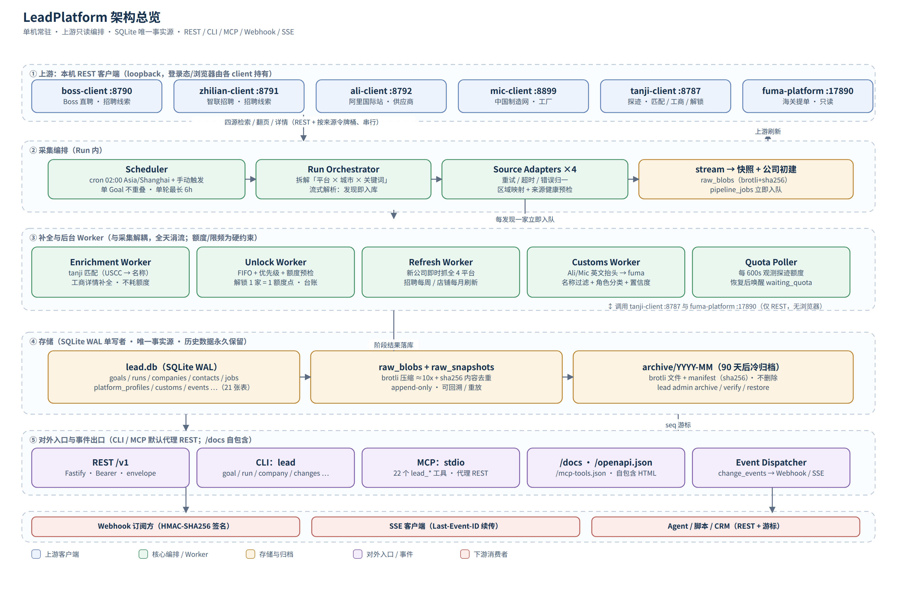
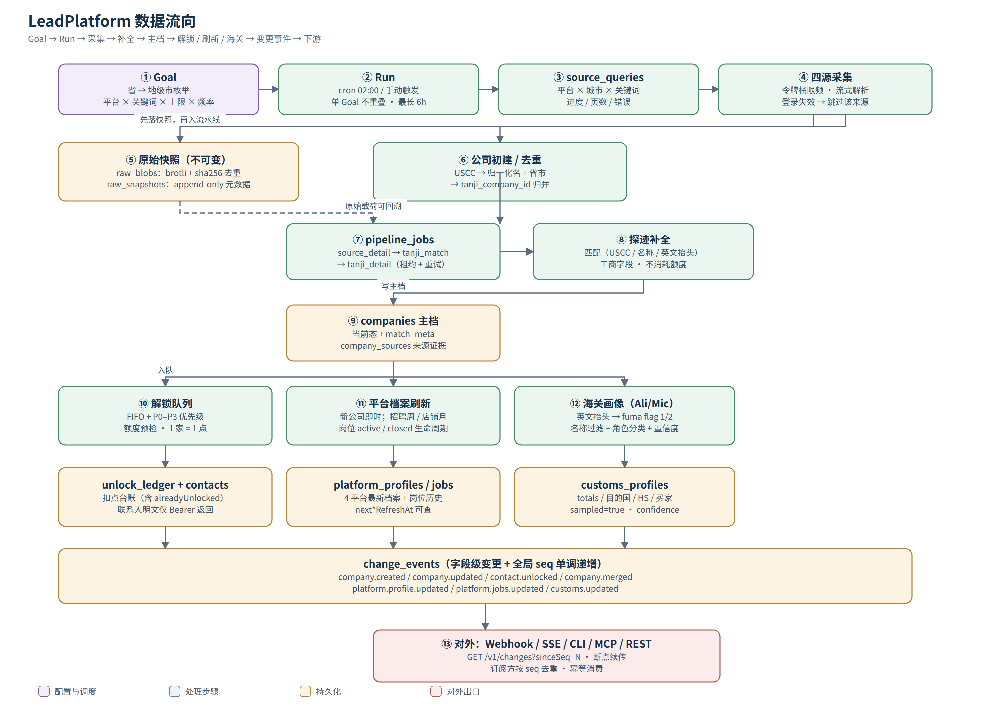
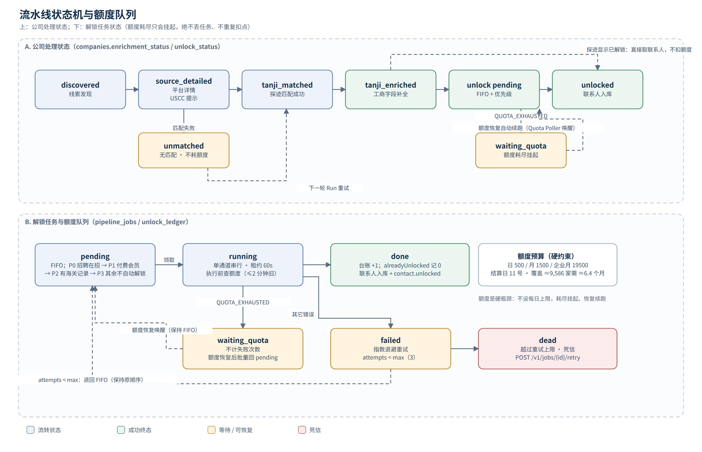

# 16 · 技术深度解析

- **状态**：v1.0（与 `v0.1.0` 实现同步；契约细节以生成的 `spec/openapi.json` 与代码为准）
- **适用读者**：需要理解/二次开发/审计本项目的工程师、架构评审者、下游集成开发者
- **关联**：[01-需求规格](01-需求规格.md)、[02-架构与数据模型](02-架构与数据模型.md)、[03-接口草案](03-接口草案.md)、[07-平台档案与招聘信息](07-平台档案与招聘信息.md)、[08-海关数据补全](08-海关数据补全.md)、[13-数据口径与质量说明](13-数据口径与质量说明.md)、[17-需求解释与验收对照](17-需求解释与验收对照.md)
- **图示**：`assets/architecture-overview.*`、`assets/data-flow.*`、`assets/pipeline-state.*`、`assets/deployment-topology.*`；`*.mmd` 为 GitHub 可渲染的 Mermaid 源，`*.svg/.png` 为同一内容的自包含渲染版
- **数据说明**：本文所有公司、联系人、金额示例均为合成数据，不代表任何真实企业

---

## 1. 设计哲学与总体架构

### 1.1 问题域与系统边界

目标是回答一个具体问题：**「在某个区域里，哪些公司正在做外贸、它们在每个平台上的现状如何、联系方式是什么，以及这些信息最近发生了什么变化？」**

这个问题的难点不在查询，而在**信息的组织方式**：

| 难点 | 现实约束 | 架构上的应对 |
|---|---|---|
| 线索分散 | 招聘（Boss/智联）× B2B（Ali/Mic）语义完全不同 | 统一「来源证据 → 公司主档」模型，平台差异收敛进 `company_sources.evidence` / `platform_profiles.store` |
| 主体识别 | 同一家公司可能有中文名、英文抬头、简称、曾用名 | USCC → 归一化名称 → 探迹主体 ID 三阶段去重与合并 |
| 权威性 | 平台字段可能是文本推导（Boss 的 USCC 来自页面文本），可能错误 | 探迹工商为权威；平台字段只作「提示/证据」，冲突时保留双方与匹配置信度 |
| 稀缺资源 | 探迹解锁额度 1 家 = 1 点，月额度远小于覆盖量 | 额度作为一等公民：优先级队列、`waiting_quota` 挂起、台账对账 |
| 上游脆弱 | 登录态过期、验证码、限频、接口改版 | 编排与能力分离：登录/风控由各 client 负责，本平台只做限频、重试、降级与可观测 |
| 信息不可变 | 线索随时在变，事后无法复原 | append-only 原始快照 + 字段级变更日志，永久保留 |

**明确的非目标**：不在本进程内做浏览器自动化、不自动登录、不直接写下游系统数据库、不做 CRM 业务编排、不做 Web UI、不做多机分布式。这些边界保证了系统可以长期无人值守运行，并且故障域清晰。

### 1.2 七条设计原则

1. **编排与能力分离**：LeadPlatform 决定「查谁、何时查、查完做什么」；采集、登录、风控、验证码全部由上游 client 负责。上游能力升级不影响本平台。
2. **流式流水线**：线索一发现就落快照并投递任务，采集 / 补全 / 解锁三条通道并行，不等整批采集结束。
3. **数据库是唯一事实源**：内存队列只做加速；进程崩溃后所有任务从 `pipeline_jobs` 恢复，租约过期即可重新领取。
4. **额度是一等公民**：解锁前查额度；额度不足进入 `waiting_quota`（不是失败），恢复后自动续跑；任何情况下不重复扣点。
5. **快照不可变、主档可变但可追溯**：原始响应 append-only；主档每次写入产生字段级 `change_events`。
6. **对外只读 + 显式事件**：外部系统通过查询与事件/游标同步，不直接写主档（手工纠正接口除外）。
7. **契约同源**：zod schema 是唯一契约源，REST / OpenAPI / MCP 工具 / CLI 帮助由同一份定义生成，`gen:check` 防漂移。

### 1.3 架构总览



架构分为五层：

| 层 | 组成 | 职责 |
|---|---|---|
| ① 上游 | `boss :8790`、`zhilian :8791`、`ali :8792`、`mic :8899`、`tanji :8787`、`fuma :17890` | 本机 REST；各自持有登录态 / 浏览器 / 风控处理 |
| ② 编排 | Scheduler、Run Orchestrator、Source Adapters | 拆查询、限频、流式解析、立即入队 |
| ③ Worker | Enrichment、Unlock、Refresh、Customs、Quota Poller | 补全、解锁、平台刷新、海关画像、额度观测 |
| ④ 存储 | SQLite WAL（`lead.db`）、`raw_blobs/raw_snapshots`、`archive/` | 唯一事实源、不可变快照、冷归档 |
| ⑤ 出口 | REST / CLI / MCP、Event Dispatcher、Webhook / SSE | 查询、操作、增量同步、实时事件 |

### 1.4 进程模型与并发

单进程 Node.js 22（Fastify + 后台 worker loop）。关键设计：

- **只有一个写者**：SQLite 单写者、WAL 模式、短事务。所有写路径通过 repository 串行化，避免 `SQLITE_BUSY` 抖动。
- **后台 worker 与 HTTP 共享事件循环**：所有上游调用都是异步 I/O，不做 CPU 密集计算；worker 用 `setInterval` 轮询（上一轮未结束则跳过本轮）+ 令牌桶控制节奏，不阻塞请求处理。
- **优雅退出**：`SIGTERM` → 停止领取新任务 → 等待在飞请求（≤ 30 s，systemd `TimeoutStopSec=40`）→ 释放租约 → 退出。未完成任务由下一次启动按租约接管。
- **防误起第二个实例**：端口占用本身会阻止；另有 `meta_kv` 中的实例锁作为兜底，避免 systemd 抖动产生双进程双写。

## 2. 数据流与流水线编排

### 2.1 从 Goal 到 source_queries

一个 Goal 描述「要什么」：

```text
province=河北省, cityCodes=[]（空 = 全省 11 个地级市）
platforms=[boss, zhilian, ali, mic]
keywords={boss:[外贸, 外贸业务员...], zhilian:[...], ali:[...], mic:[]}
maxLeadsPerRun / dailyLeadLimit / schedule.cron / priority
```

Run 创建时做**确定性展开**：

1. 取区域注册表 → 河北省的 11 个地级市（`regions`，GB/T 2260）；
2. 每个城市取各平台映射值（`region_platform_map`：Boss `cityCode` / 智联 `code` / Ali code / Mic 英文名）；
3. 招聘源（boss/zhilian）× 城市 × 关键词；Ali/Mic 按「平台 × 城市」检索（关键词只做本地过滤）；
4. 每个组合一行 `source_queries`，唯一约束 `(run_id, platform, platform_region_value, keyword)` 保证幂等重试不会重复建查询。

**为什么按「城市 × 关键词」而不是按省一次检索？** 四个上游的检索语义都只支持到省/地级市，且单次返回有页数上限；拆分后进度可观测、失败可局部重试、限频可以精确控制到查询粒度。

### 2.2 流式采集与背压

采集不是「跑完一批再入库」，而是：

```text
for each source_query（受来源令牌桶控制）:
    page = adapter.fetchPage(query)
    snapshot(page.payload)                    # 不可变快照，先落盘
    for company in parse(page):               # 逐条处理
        upsert company_source + companies 初建 # 来源记录级去重
        enqueue pipeline_jobs                 # 事务内写入，立即生效
        update query progress + run.stats
```

**背压**由三处共同保证：

1. 采集本身被令牌桶限速（每来源串行），单位时间入队量有上限；
2. 所有任务落 DB，内存中不维护无界队列；
3. Worker 按租约领取，领取速率由自身节奏决定，采集再快也不会撑爆内存。

**Run 完成 ≠ 补全完成**：采集结束后 `run.status=completed/partial`，但 enrichment / unlock / refresh / customs 的 `pipeline_jobs` 仍会继续执行；`run.stats` 与 `/v1/status.queue` 记录挂起数量。这样「一轮采集」的耗时可控（≤ 6h），而补全可以按额度缓缓进行数天。

### 2.3 Run 统计与覆盖度

`goal_runs.stats` 是运行时聚合的 JSON，字段设计目标：**能解释「这一轮为什么只有这么多线索」**。

```json
{
  "platforms": {
    "boss":    { "queries": 55, "pages": 212, "leads": 860, "companiesNew": 512 },
    "zhilian": { "queries": 55, "pages": 180, "leads": 640, "companiesNew": 380 },
    "ali":     { "queries": 11, "pages": 55,  "leads": 220, "companiesNew": 220 },
    "mic":     { "queries": 11, "pages": 55,  "leads": 180, "companiesNew": 180 }
  },
  "enrichment": { "done": 900, "unmatched": 60, "failed": 12 },
  "unlock": { "unlocked": 223, "waitingQuota": 380, "quotaCost": 223 },
  "coverage": {
    "uniqueCompanies": 9586,
    "crossSourceOverlap": 836,
    "coverageByCity": { "石家庄市": 1693, "保定市": 536 },
    "keywordYield": { "外贸": 247, "跨境电商": 218 }
  }
}
```

- `coverage.uniqueCompanies`：本轮去重后公司数；与实测基线 **≈9,586** 对比可判断覆盖是否异常（偏差 > 20% 需检查上游变化）；
- `crossSourceOverlap`：出现在 ≥2 个来源的公司数，用于评估去重质量；
- `coverageByCity` / `keywordYield`：解释城市与关键词产出，指导下一轮 Goal 配置；
- `skippedSources`：记录本轮因 `session_invalid` / `verification_pending` 跳过的来源与原因，便于区分「上游坏了」和「真的没线索」。

### 2.4 全链路数据流



## 3. 存储设计

### 3.1 SQLite / WAL 与事务边界

- 选择 SQLite 而不是 Postgres：单机、单进程、只读为主的负载，SQLite（WAL）足够，且免运维、备份 = 复制文件。
- `PRAGMA journal_mode=WAL`、`synchronous=NORMAL`、`busy_timeout=5000`、`foreign_keys=ON`。
- **事务尽可能短**：上游请求绝不放在事务内；每个事务只做「解析结果 → 若干次写」。
- 迁移用 `PRAGMA user_version` 版本化，只增不改（字段可加、表可加），启动幂等执行。

### 3.2 21 张表的分域

| 域 | 表 | 关键设计点 |
|---|---|---|
| 目标 | `goals` | `version` 乐观锁；`keywords` 按平台存 JSON |
| 运行 | `goal_runs`、`source_queries` | 状态机；查询唯一约束保证重试幂等 |
| 原始 | `raw_blobs`、`raw_snapshots` | 内容寻址（`sha256`）+ 压缩；元数据 append-only |
| 主档 | `companies`、`company_sources`、`company_contacts` | 软合并 `merged_into`；来源唯一约束；联系人唯一约束 |
| 队列 | `pipeline_jobs` | `(company_id, stage, platform)` 唯一；租约 + 退避 + 死信 |
| 额度 | `unlock_ledger` | `idempotency_key` 唯一；扣点前后额度留痕 |
| 平台 | `company_platform_profiles`、`company_platform_jobs` | 档案 (company, platform) 唯一；岗位生命周期 |
| 海关 | `company_customs_profiles` | 每公司 1 行；JSON Top 榜单 + 样本记录 |
| 事件 | `change_events`、`webhook_subscriptions`、`webhook_deliveries` | 全局 `seq` AUTOINCREMENT；投递状态机 |
| 辅助 | `regions`、`region_platform_map`、`quota_observations`、`source_health`、`meta_kv` | 区域映射、额度曲线、来源健康、迁移/锁/清单 |

### 3.3 原始快照：内容寻址 + 压缩 + 去重

```text
payload --sha256--> hash
  raw_blobs(hash PK, encoding, body, bytes)      # 首次出现才写 body
  raw_snapshots(id PK, kind, platform, run_id, ref_type/ref_id, url, blob_hash, fetched_at)
```

- **内容寻址**：同一份响应（例如相同检索页被重复抓取）只存一份 body；`raw_snapshots` 每次抓取仍追加一条元数据，保留时间线。
- **压缩**：brotli 默认（实测 ≈10×），可配 gzip/plain；读路径透明解压。
- **解析失败也保留原始 payload**：后期可回溯、重放、修正解析逻辑，不需要重新请求上游。
- **不可变**：快照表只 INSERT，不 UPDATE（归档只更新 `archived/archive_path` 元数据）。

### 3.4 冷归档与永久保留

Q7 决策：**历史数据永久保留，不按年龄删除**。

- hot：`raw_blobs.body` 保留在 `lead.db`；
- 90 天后：archive 任务把 blob 写入 `~/.lead-platform/archive/YYYY-MM/part-NNNN.br`，并生成 manifest（文件、条数、字节、sha256），更新 `raw_snapshots.archived=1/archive_path/archived_at`；
- 查询路径透明：需要时按 manifest 从归档读回；`lead admin restore --month=YYYY-MM` 可恢复某月到 hot 库；
- 校验：`lead admin archive verify` 重算 sha256，防止静默损坏；
- **磁盘不足时的正确动作是扩容 / 迁移归档盘，而不是删数据**（见 [15 运维手册](15-运维手册.md)）。

### 3.5 索引与分页策略

| 场景 | 策略 |
|---|---|
| 公司列表 | **keyset（游标）分页**：`(updated_at, id)` 复合游标，避免深 OFFSET 扫描；过滤列建索引 `(province, city)`、`normalized_name`、`enrichment_status`、`unlock_status` |
| 全局变更 | `change_events(seq)` 是主键，`sinceSeq` 天然高效；`(event_type, seq)` 支持按类型过滤 |
| 单公司变更 | `(company_id, version)` 索引，按版本聚合展示 |
| 任务队列 | `(status, next_retry_at)` 用于领取；`(stage, status, created_at)` 用于 FIFO |
| 岗位 | `(company_id, platform, status)`；`(platform, platform_company_id, job_id)` 唯一 |
| 海关刷新 | `customs_profiles(next_refresh_at)` |

游标（`meta.nextCursor`）是不透明 base64 JSON，包含排序列值与 `id`，服务端解码后继续 keyset 查询；客户端**不得解析**游标内容。

## 4. 状态机与任务系统

### 4.1 三种状态机

系统里同时存在三个状态机，理解它们的边界是理解整个系统的关键：



**① Run 状态机**（`goal_runs.status`）：`pending → running → completed / partial / failed / cancelled`

- `completed`：所有 query 结束（含被跳过）；
- `partial`：单轮超时（默认 6h）或部分来源失效，但已采集数据有效；
- `failed`：不可恢复错误（如 DB 写入失败）；
- `cancelled`：手动取消，在飞请求结束后停止派发新查询。

**② 公司处理状态**（`companies.enrichment_status` + `unlock_status`）：

```text
discovered → source_detailed → tanji_matched → tanji_enriched → unlock_status=pending → unlocked
                    ↘ unmatched（不耗额度，下一轮可重试）      ↘ waiting_quota（额度耗尽，挂起）
```

- `discovered`：刚建立公司记录；
- `source_detailed`：平台详情已补（Boss/智联可能拿到 USCC 提示）；
- `tanji_matched`：探迹匹配成功，但未拉详情；
- `tanji_enriched`：工商字段已补全（此状态才进入解锁队列）；
- `unmatched`：无匹配，**不消耗额度**，后续 Run 可重试（可换用平台注册全名再匹配）。

**③ 任务状态**（`pipeline_jobs.status`）：

```text
pending → running → done
running → failed → (指数退避 next_retry_at) → pending → running …
failed  → dead（超过 max_attempts=3）
running → waiting_quota → pending（额度恢复唤醒；不计失败次数）
```

### 4.2 租约、崩溃恢复与幂等

**租赁式任务领取**（单进程也使用租约，因为崩溃恢复需要）：

1. worker 以 `UPDATE pipeline_jobs SET status='running', lease_owner=?, lease_until=now+60s WHERE id=? AND status='pending' AND next_retry_at<=now` 原子领取（实际通过带条件的单条 SQL/事务实现）；
2. 执行期间心跳可续租（长任务）；完成后置 `done`；
3. 进程崩溃 → 租约过期 → 重启后其他/同一 worker 可重新领取。

**幂等三层**：

| 层 | 机制 |
|---|---|
| 任务级 | `(company_id, stage, platform)` 唯一约束，重复投递不会生成重复任务 |
| 解锁级 | `unlock_ledger.idempotency_key`（`unlock:<companyId>:<yyyy-mm-dd>`）+ 探迹业务幂等（`alreadyUnlocked=true` 不扣点） |
| 数据级 | 快照按 sha256 去重；公司写入先 diff，无变化不产生事件；`source_queries` 唯一约束 |

### 4.3 重试矩阵

| 错误类别 | 行为 | 是否计入 attempts |
|---|---|---|
| 网络超时 / 5xx | 指数退避 1s/5s/30s，最多 3 次 → `dead` | 是 |
| 上游 401 / 登录失效 | 不重试；标记 `source_health=session_invalid`；当前查询 `skipped`；Run 继续 | 否 |
| 验证码 / 风控 | 标记 `degraded` + `cooldownUntil`；冷却后重试 | 否（但需人工/客户端恢复） |
| 探迹 `QUOTA_EXHAUSTED` | `waiting_quota`，队列暂停 | 否 |
| 海关无数据 `totalNum=0` | `no_data`，不重试 | — |
| 海关权限错误 | `failed(PERMISSION_DENIED)`；标记 fuma 来源异常；不影响主流程 | 否（需人工修权限） |
| 解析异常 | 保留原始快照；重试一次；仍失败 → `dead` + 日志 | 是 |

`dead` 任务可查（`GET /v1/jobs?status=dead`）并手动重试（`POST /v1/jobs/{id}/retry`）。

## 5. 并发、限频与调度

### 5.1 调度器

- 进程内 cron（默认 `0 2 * * *`，`Asia/Shanghai`），tick 每 30s 检查到期 Goal；
- **单 Goal 不重叠**：存在 `pending/running` 的 Run 时，新触发返回 `409 RUN_IN_PROGRESS`（默认不排队）；
- 手动触发与 cron 走同一入口，保证语义一致；
- 单轮最长时间 `LEAD_RUN_MAX_HOURS=6`：超时停止派发新查询、等待在飞请求结束、Run 置 `partial`。

### 5.2 按来源限频

| 来源 | 速率 | 并发 | 说明 |
|---|---|---|---|
| boss | 12 req/min；页间 2500ms | 1 | 单次 `pages≤5`，可按 queryId 续翻 |
| zhilian | 15 req/min；页间 2500ms + jitter | 1 | 同上 |
| ali | 10s/页 | 详情 2 | `pages` 硬上限 20；遇 x5sec/验证码暂停 |
| mic | 默认 1 req/2s（可配） | 1 | 验证码由 client 处理，失败即退避 |
| tanji | 20 req/min | 1（解锁优先） | 批量读不阻塞解锁 |
| fuma | 账号串行（≈0.8–1.5s/查询） | 1 | 海关查询串行，避免账号风控 |

实现要点：

- 每个 adapter 内部持有**令牌桶 + 最小请求间隔**；请求前 `await bucket.take()`；
- 429 / 风控 → `cooldownUntil` 指数退避，期间该来源任务顺延；
- **采集与刷新共享同一来源限频**：Refresh Worker 与 Run 竞争同一令牌桶，保证不会叠加超频；
- Ali 详情允许并发 2 是唯一例外（上游实测允许且必要），其余全部串行；
- 采集前检查 `source_health`，`session_invalid/verification_pending` 直接跳过该来源并记录原因。

### 5.3 全天涓流刷新

存量刷新（招聘周、店铺月、海关月）**不与 02:00 采集窗口绑定**：Refresh Worker 全天按令牌桶滴流执行，优先级「新公司 > 到期刷新 > 手动插队」。这样既不会在夜间与采集抢限频，也能把 9,586 家（设计余量 2 万家）的刷新请求摊平到全天（见 §8.1 容量核算）。

## 6. 去重与匹配算法

### 6.1 来源记录级

`(platform, platform_company_id)` 唯一。同一平台公司再次出现时：更新 `last_seen_at`、追加快照、更新 `evidence`（命中关键词、岗位数等），**不重复创建公司**。

### 6.2 公司级：三级归并

```text
1) 有 USCC？查 companies.uscc → 命中即同一公司
2) 否则用 normalized_name 相同 + 同省（有城市则同市）→ 同一公司（evidence.merged_by=name）
3) 探迹匹配成功：目标 tanji_company_id 已存在 → 合并两条公司记录（company.merged）
4) 都不满足 → 新建公司（enrichment_status=discovered）
```

合并语义：被合并公司软删除（`merged_into`），来源证据与变更事件迁移到存活主体，对外只暴露存活主体；合并本身也产生事件，可追溯。

### 6.3 名称归一化

中文名：

- 去首尾空白、全角/半角统一、去除括号内「曾用名」等噪声；
- 统一「有限公司 / 有限责任公司」等后缀写法；
- 去掉「河北省 / 河北」等地域前缀**仅影响匹配辅助分**，不做激进合并（避免把「河北XX」与「XX」误判为同一公司）；
- 保留 `country`/`province`/`city` 上下文参与匹配。

英文名（Ali/Mic 英文抬头）：

- 小写化、去除 `co., ltd` / `co.,limited` / `inc.` 等后缀与标点；
- 保留行业词（如 `industrial`, `machinery`）作为区分特征；
- 英文名与中文名**不做直接字符串匹配**，而是分别作为探迹搜索的查询名，交给探迹相关度 + 地区约束。

### 6.4 探迹匹配打分模型

输入：公司名、省/市、平台详情中的 USCC（若有）、平台证据。

```text
① USCC 精确：POST /v1/search/name {name: uscc, field: socialCreditCode}
   → 命中置信度 1.0

② 名称匹配：POST /v1/search/name {name: 规范全名, field: name}
   score = 0.60 * exact(名称归一化相等)
         + 0.40 * contains(包含关系)
         + 0.30 * similarity(编辑距离/相似度)
         + 0.20 * sameProvince
         + 0.20 * sameCity
         + 0.10 * normalize(tanji.relevanceScore)
   取最高分；总分 ≥ 0.55 视为高置信，但即使低分也自动匹配（用户决策：效率优先）
```

- **总是自动取最佳匹配**，同时把候选列表（最多 5 条）、置信度、匹配方式、时间写入 `companies.match_meta`；
- 匹配不到 → `unmatched`，公司仍入库、不耗额度，可下一轮重试或人工 `rematch`；
- `rematch`：清空匹配信息重新执行，产生 `company.rematched` 事件，保留纠正历史。

### 6.5 为什么不追求 100% 准确

探迹匹配的代价不对称：多匹配一家 = 浪费 1 点额度；漏匹配 = 下一轮重试机会。因此策略是**自动匹配 + 留痕 + 可纠正**：

- 置信度低但匹配成功的公司，在详情接口中明确返回 `matchMeta.confidence`；
- 解锁前可人工检查 `matchMeta.candidates`；
- 误匹配可通过 `POST /v1/companies/{id}/rematch` 纠正，并保留历史事件。

## 7. 额度队列：系统中最难的部分

### 7.1 额度模型

| 层级 | 上限 | 结算 |
|---|---|---|
| 日额度 | 500 点 | 每日刷新 |
| 月额度（个人） | 1,500 点 | 结算日 11 号 |
| 企业月额度 | 19,500 点 | 同上 |

事实对照：河北四源实测唯一公司 **≈9,586 家**，按 1 家 1 点、个人月 1,500 点计算，全量解锁需要 **≈6.4 个月**。因此「全库 FIFO 解锁」不可行，必须做优先级。

### 7.2 优先级策略

```text
P0  招聘在招（Boss/智联当前有岗位）—— 有真实招聘需求，商机最强
P1  Ali/Mic 平台付费/认证会员（金品诚企、Verified 等）
P2  有海关出口/进口记录（Ali/Mic 画像 non-none）
P3  其余（只入工商库，不自动排解锁队列）
```

- 同一优先级内 FIFO（按 `first_seen_at` / task `created_at` 排序）；
- P3 不自动解锁，避免把额度消耗在低价值线索上；人工可 `POST /v1/companies/{id}/unlock` 插队；
- `unlockPolicy` 之后可在 Goal 中配置（当前默认实现按上述顺序）。

### 7.3 执行前置检查

每次解锁前，**先查探迹联系人状态**：

```text
GET tanji /v1/companies/{tanjiId}/contacts
  ├─ unlocked=true  → 直接拉联系人入库（不调用 unlock、不扣额度）
  └─ unlocked=false → 查额度 → 有额度 → POST unlock（带 idempotencyKey）
                              → 无额度 → 任务置 waiting_quota
```

这一步是实测得出的关键优化：部分企业此前已被解锁，直接拉取即可，避免浪费额度。

### 7.4 waiting_quota 与恢复

- 额度耗尽时任务进入 `waiting_quota`，**不计失败次数、不丢任务、不降优先级**；
- Quota Poller 每 600s 拉一次 `tanji /v1/status`，写入 `quota_observations`；
- 检测到 `daily.remaining` 增加、`monthly.remaining` 增加、或跨过结算日 11 号 → 把 `waiting_quota` 批量改回 `pending`（保持原 FIFO 顺序）；
- 「不设每日上限」是用户决策：worker 持续消费直到额度耗尽；保留 `LEAD_UNLOCK_DAILY_CAP` 配置以便将来限流。

### 7.5 台账与对账

每次解锁写一条 `unlock_ledger`：

```json
{
  "companyId": "cmp_01JEXAMPLE000000000000000",
  "tanjiCompanyId": "5f3c9a...",
  "result": "unlocked",
  "quotaCost": 1,
  "quotaBefore": 224,
  "quotaAfter": 223,
  "accountId": "main",
  "idempotencyKey": "unlock:cmp_01JEXAMPLE...:2026-11-16",
  "requestedAt": "2026-11-16T14:00:00Z",
  "finishedAt": "2026-11-16T14:00:02Z"
}
```

对账方式：`SUM(quota_cost)` 与探迹额度差值比对；`already_unlocked` 记录 cost=0，用于解释「有台账无扣点」；`/v1/quota` 展示近 7 天消耗曲线。

### 7.6 为什么不做并发解锁

- 额度上限是硬约束，并发不增加总吞吐；
- 串行 + FIFO 让额度消耗可解释、可审计；
- 单通道简化了「已解锁 / 额度耗尽」的竞态处理（无需分布式锁）。

## 8. 平台档案与岗位刷新

### 8.1 数据模型与容量核算

| 数据 | 规模（实测校准） | 刷新频率 | 请求量估算 |
|---|---|---|---|
| 平台档案（4 平台/公司） | 9,586 家公司 | 新公司即时 | 新公司 ≈6 请求/家 |
| 招聘档案 + 岗位 | 招聘源公司 2,375 家 | 每周 | ≈680 请求/天 |
| 店铺档案（Ali/Mic） | Ali/Mic 公司 ≈7,510 家 | 每月 | ≈250 请求/天 |
| 海关画像 | Ali/Mic ≈7,510 家 | 每月 | ≈1,001 请求/天 |

> 设计余量按 2 万家保留；容量核算全部低于上游限频（例如招聘刷新 ≈4 次/分钟 < Boss 12 / 智联 15）。**全量每日刷新不可行**（≈100 小时/天），因此采用「全量降频 + 全天涓流」。

### 8.2 刷新调度

- 新公司入队：`platform_profile ×4` + `platform_jobs ×2`（Boss/智联）即时抓取；
- 存量：`next_jobs_refresh_at`（每周）扫描生成刷新任务；`next_store_refresh_at`（每月）同理；海关用 `customs_profiles.next_refresh_at`；
- 手动刷新 `POST /v1/companies/{id}/refresh`：可指定 `platforms` / `kinds`，插入优先队列。

### 8.3 岗位生命周期

```text
本次抓取到岗位列表 L(t)：
  新出现的 job_id → INSERT status=active, first_seen_at=t
  仍在的 job_id   → status=active, last_seen_at=t
  消失的 job_id   → status=closed, closed_at=t
  曾 closed 又出现 → status=active（重新上线，保留历史 closed_at 记录）
```

岗位行**永久保留**，API 支持 `?status=active|closed` 查询；「在招岗位数」只统计 active。

### 8.4 平台变更事件与防风暴

- 平台字段 diff：`platforms.<platform>.<field>`（如 `platforms.ali.store.membership`）；
- 岗位变化**不逐条发事件**，而是聚合为一条 `platforms.<platform>.jobs` 摘要：

```json
{ "active": 12, "added": 2, "closed": 1, "total": 12 }
```

- 对应对外事件 `platform.jobs.updated` / `platform.profile.updated`；
- 平台刷新**不改变公司主档 `version`**（平台数据不是主档字段），但平台变更事件仍进入公司变更日志（`entity_type=platform_profile/job`）。

### 8.5 平台状态判定

```text
active：最近 8 天内成功抓取到该平台数据
stale：9–45 天未成功（或连续失败 3 次）
lost：> 45 天未成功，或连续 3 次 404（公司可能已从平台消失）
```

状态用于详情卡片展示与运维巡检（`/v1/status.refresh`、平台卡片 `lastFetchedAt`）。

## 9. 海关画像

### 9.1 为什么只有 Ali/Mic

海关提单按**英文抬头**匹配。Ali/Mic 线索天然带英文公司名；Boss/智联只有中文注册名，与提单英文名之间没有可靠映射（音译/简称歧义大）。一期只做 Ali/Mic，是**精度优先**的取舍。

### 9.2 查询流程与样本模式

```text
english_name (英文抬头)
  ├─ POST fuma /v1/customs/query {inputCompany: 英文名, companyFlag: 1, pageSize: 20, page: 1}  # 进口视图
  └─ POST fuma /v1/customs/query {inputCompany: 英文名, companyFlag: 2, pageSize: 20, page: 1}  # 出口视图
        ↓ 原始响应落 raw_snapshots(kind=fuma_customs_query)
名称 token 过滤 → 角色分类（exporter/importer）→ 聚合 → confidence
```

**样本模式**：每个查询名 × flag 只取第 1 页 20 条，标注 `sampled=true`。原因：全量提单体积大、上游 `totalNum` 是模糊命中值；样本统计可解释、可复核，且足以刻画「主要出口市场 / HS / 买家」画像。

### 9.3 名称过滤与角色分类

- 英文提单公司名做 token 归一化（去后缀、标点、大小写）；
- 目标公司名 token 全部命中（或高覆盖率）→ 视为命中样本；
- 命中样本中：目标公司出现在 `rawexporter` → 出口角色；出现在 `rawimporter` → 进口角色；两者都有则分别计数；
- 未命中的样本只计入 `totalNum` 参考，**不进入 Top 榜单**（避免把货代/无关公司算进来）。

### 9.4 聚合指标与置信度

```text
totals / dateRange / destinations / origins / hs4 / products / buyers / suppliers
exporterRecords / importerRecords / matchedRecords / fetchedRecords
totalWeight / totalCount / amount（可空）
confidence:
  high   = 匹配样本 ≥ 10 且 token 精确命中率 ≥ 0.8
  medium = 匹配样本 ≥ 3
  low    = 命中 1–2 条
  none   = 无命中（status=no_data）
```

低置信度数据仍可查（详情接口），但**不推送 webhook**（避免下游被噪声污染）。

### 9.5 缓存、权限与无数据

- fuma 有 24h 缓存：相同参数重复查询命中缓存（响应含 `cached=true`），`forceRefresh` 可强制刷新；
- `PERMISSION_DENIED` → 任务 `failed`，标记 fuma 来源异常，不影响其他流程；
- `totalNum=0` → `no_data`，不重试；
- 上游错误 / 超时 → 退避重试 ≤3 次；
- 手动补查：`POST /v1/companies/{id}/customs/refresh`（人工触发，必要时 `forceRefresh`）。

## 10. 事件模型与 Webhook / SSE

### 10.1 change_events 设计

```text
seq         INTEGER PRIMARY KEY AUTOINCREMENT   # 全局单调游标
company_id  TEXT                                 # 所属公司
entity_type company | platform_profile | job | customs
entity_id   实体 ID（平台档案/岗位/海关画像）
version     公司内版本（同一变更批次 +1）
event_type  company.created/updated/merged/rematched、
            contact.unlocked、platform.profile.updated、platform.jobs.updated、
            customs.updated、company.deleted(P1)
field       字段名（平台字段 platforms.<platform>.<field>）
old_value / new_value / value_type
source      source:boss/zhilian/ali/mic、tanji、fuma:customs、system:unlock、api
run_id / actor / occurred_at / created_at
```

**两条有序性**：

- 全局：`seq` 单调递增，客户端持久化 `seq` 即可增量同步、去重、幂等；
- 公司内：`version` 单调递增，描述「一次变更批次」，用于单公司历史展示。

### 10.2 事件 envelope

```json
{
  "eventId": "evt_01JEXAMPLE000000000000000",
  "seq": 12345,
  "type": "company.updated",
  "occurredAt": "2026-11-16T05:30:00.000Z",
  "companyId": "cmp_01JEXAMPLE000000000000000",
  "version": 7,
  "source": "tanji",
  "runId": "run_01JEXAMPLE000000000000000",
  "data": { "field": "businessScope", "oldValue": "…", "newValue": "…", "valueType": "string" }
}
```

PII 边界：`contact.unlocked` 只推联系人数量/类型摘要，明文必须通过详情接口（Bearer）获取，避免 webhook 泄露。

### 10.3 Webhook 投递语义

- 订阅：`POST /v1/webhooks {url, eventTypes, secret?, description}`；服务端可生成 secret，也可由调用方提供（保存时脱敏返回）；
- 投递头：

```text
X-Lead-Event: company.updated
X-Lead-Delivery: <uuid>
X-Lead-Timestamp: <unix seconds>
X-Lead-Signature: sha256=<hex>
签名 = HMAC-SHA256(secret, timestamp + "." + rawBody)
```

- 成功 = 2xx；失败按 10s / 1m / 5m / 30m / 2h / 6h / 24h 退避，最多 8 次 → `dead`；
- 死信可查（`GET /v1/webhooks/{id}/deliveries?status=dead`）与重放（`POST .../replay`）；
- **不保证跨事件严格顺序**：需要顺序的消费者用 `GET /v1/changes?sinceSeq` 拉取；
- 消费方必须验签 + 按 `eventId`/`seq` 去重（重试可能导致重复投递，这是 at-least-once 语义）。

### 10.4 SSE 断点续传

`GET /v1/events/stream?types=...`，`text/event-stream`；每条事件 `id` = seq。客户端重连时带 `Last-Event-ID`，服务端从 DB 按 seq 补发断线期间事件，再切到实时广播。

### 10.5 事件量控制

- 字段级事件仅在值**实际变化**时产生；
- 岗位变化聚合为摘要事件（避免一次刷新产生上百条岗位事件）；
- Webhook 投递按订阅的 `eventTypes` 过滤；
- 低置信度海关画像不推送。

## 11. 错误处理与可观测性

### 11.1 上游错误归一

| 上游错误 | 归一码 | 处理 |
|---|---|---|
| 401 / 会话过期 | `SOURCE_SESSION_INVALID` | 跳过来源、标记 source_health、Run 继续 |
| 429 / 限频 | `UPSTREAM_RATE_LIMITED` | 冷却 + 退避 |
| 验证码 / 风控 | `SOURCE_VERIFICATION_PENDING` | 标记 degraded、cooldown、不硬扛 |
| 5xx / 超时 | `SOURCE_UNAVAILABLE` | 重试 ≤3 次 → dead |
| 探迹额度不足 | `QUOTA_EXHAUSTED` | waiting_quota |
| 海关权限 | `CUSTOMS_PERMISSION_DENIED` | failed + 来源异常标记 |
| 参数/校验失败 | `VALIDATION_ERROR` | 400，不重试 |

### 11.2 结构化日志

- JSON lines 写到 `~/.lead-platform/logs/lead.log`（10 MB × 5 轮转）；
- 每条含 `level/time/msg/requestId`（HTTP 请求）或 `jobId/companyId/stage`（worker）；
- **PII 自动打码**：手机号 `138****1234`、邮箱 `a***@example.com`、联系人姓名按需脱敏；上游原始响应中的 PII 不写日志；
- 日志级别 `debug/info/warn/error`，生产默认 `info`。

### 11.3 运行态观测面

| 接口 | 关键信息 |
|---|---|
| `GET /v1/health` | 毫秒级存活探针（无鉴权） |
| `GET /v1/status` | 版本、DB 大小/迁移版本、调度、队列积压、refresh due、上游状态、额度、alerts |
| `GET /v1/sources` | 六上游登录态/健康/限频/最近错误 |
| `GET /v1/quota` | 三层额度、结算日、近 7 天消耗曲线、等待恢复任务数 |
| `GET /v1/stats?kind=coverage` | 覆盖度指标（uniqueCompanies / crossSourceOverlap / coverageByCity / keywordYield） |

告警事件（`source.session_invalid`、`quota.exhausted`、`job.dead`、`webhook.delivery_failed`、`customs.permission_denied` 等）一期写入 `/v1/status.alerts` 与日志，二期可接外部通知。

## 12. 安全与隐私架构

### 12.1 边界

- 只监听 `127.0.0.1`；**无 CORS**；不提供 TLS（本机回环不需要，二期若暴露必须加 TLS + 来源限制）；
- 单 Bearer Token（一期用户决策），常量时间比较；`/v1/health`、`/docs`、`/openapi.json` 免鉴权；
- Token / webhook secret 文件 `0600`；数据目录 `0700`；备份与 `.env` 不进仓库；
- 无外部遥测、无第三方统计。

### 12.2 数据分级

| 级别 | 数据 | 保护 |
|---|---|---|
| L3 联系人明文 | `company_contacts.value` | 仅 Bearer API 返回；日志/事件/`/docs` 永不出现；webhook 只推摘要 |
| L2 公司工商/平台档案 | `companies`、`platform_profiles` | Bearer API；快照压缩存储；备份受文件权限保护 |
| L1 原始快照 | `raw_blobs` | 含上游原始数据，永久保留但仅本机可取；归档文件 0600 |
| L0 公开契约 | `/docs`、OpenAPI、示例 | 全部合成数据 |

### 12.3 合规能力

- 联系人信息仅用于合法获客；使用者需遵守平台条款与个人信息保护法规；
- 一期提供「公司删除」能力路线（P1）：删除公司主档时级联联系人/快照引用，用于个人信息删除请求（以最终代码为准）；
- 历史数据永久保留 vs 删除请求的冲突处理：以删除请求优先，记录删除审计事件（P1）。

## 13. 容量、性能与扩展性

### 13.1 基线

| 指标 | 实测/估算 |
|---|---|
| 河北四源唯一公司 | ≈9,586（Mic 5,008 / Ali 2,961 / 招聘 2,375） |
| 设计余量 | 10 万公司主档无明显压力 |
| 联系人 | 1–10 条/家，受额度限制（1,500/月） |
| 快照 | 压缩后一次性 ≈0.3–0.6 GB；年度刷新 ≈5–10 GB/年；5 年 ≈50–100 GB |
| 变更事件 | 千万级行/年（永久），SQLite + 索引可承受 |
| 列表查询 | p95 < 300 ms（1 万公司，本地） |

### 13.2 SQLite 的性能边界

- 单写者模型在「写入远少于读取 + 写事务短小」的负载下表现良好；
- 深分页用 keyset 游标避免；
- 大表（`change_events`、`raw_snapshots`）按需归档/分区（事件永久保留，可选按年压缩归档但保留索引）；
- 定期 `VACUUM` 需在归档后、低峰期执行（WAL 下注意磁盘瞬时占用）。

### 13.3 扩展方向（非一期）

| 需求 | 方向 |
|---|---|
| 多机/多区域 | 拆出 orchestrator 与 worker（共享 Postgres/消息队列）；当前单机架构不预留分布式锁 |
| 更大覆盖 | 接入更多来源 adapter（同一 `SourceAdapter` 接口） |
| 实时性 | 上游无推送能力，「最新」仍是最近一次成功抓取 |
| Web UI | 当前只提供 `/docs` 与 CLI/MCP；数据已可通过 REST 支撑前端 |

## 14. 设计取舍总表

| 决策 | 备选方案 | 选择理由 | 代价 |
|---|---|---|---|
| SQLite 单写者 | Postgres | 单机零运维、备份简单、足够 10 万级 | 无法多写/水平扩展 |
| DB 任务队列 | 内存队列/Redis | 崩溃可恢复、可观测、幂等简单 | 每次领取有 DB 开销 |
| 单通道串行解锁 | 并发解锁 | 额度是硬约束，串行可解释可审计 | 吞吐受限于单通道（但额度本身更慢） |
| 自动匹配 + 留痕 | 人工确认后匹配 | 用户决策效率优先，靠 rematch 兜底 | 可能浪费少量额度 |
| 全量快照永久保留 | 只留结构化数据 | 可追溯、可重放、防解析错误 | 磁盘持续增长，需要归档运维 |
| 平台档案独立表 | 塞进公司主档 | 平台差异大、字段多、刷新频率不同 | 多表 join/组装逻辑 |
| 全量降频刷新 | 每日全量刷新 | 上游限频下每日全量 ≈100h/天不可行 | 「最新」有最长 7/30 天延迟 |
| 海关只用 Ali/Mic | 全平台中文名匹配 | 中文名 → 英文提单名不可靠 | Boss/智联无海关画像 |
| 无 Web UI | 内置管理界面 | 一期 API/CLI 优先，降低维护面 | 运营需用 CLI/curl |
| 单 token 鉴权 | 多租户/RBAC | 单机个人使用场景 | 无法细分权限（二期） |

## 15. 与上游 client 的协作边界

LeadPlatform 不重复实现上游能力，边界清晰：

```text
LeadPlatform 负责：查谁、何时查、限频节奏、重试/降级、数据聚合、事件分发
上游 client 负责：登录、浏览器、验证码、平台风控、原始接口封装、client 侧缓存
```

- 上游接口变化时，只改 `src/adapters/**` 的映射与契约测试；
- `source_health` 与 `/v1/sources` 是上游状态的唯一观测面，运维按 [15 运维手册](15-运维手册.md) 处理；
- 上游故障不会让 Run 失败：跳过该来源、继续其他来源、记录 `skippedSources`。

## 16. 二次开发扩展点

| 想做的事 | 改哪里 |
|---|---|
| 新增线索来源 | 实现 `SourceAdapter` 接口（搜索/翻页/详情/公司映射），在区域映射与 Goal 平台枚举注册，补契约测试 |
| 新增事件类型 | `change_events.event_type` 常量 + 事件 envelope 映射 + OpenAPI/MCP 生成源；老消费者按类型过滤不受影响 |
| 新增 Worker/阶段 | `pipeline_jobs.stage` 枚举 + repository 查询 + worker loop 注册；注意租约/重试语义 |
| 新增对外接口 | Fastify 路由 + zod schema（同一份 schema 进 OpenAPI/MCP/CLI 生成） |
| 改匹配算法 | `src/domain/matching.ts`（纯函数，易于单测）；候选/置信度结构保持不变 |
| 改额度策略 | `unlock` 任务排序与入队规则；`unlock_ledger` 语义不变 |

## 附录：图示与源码

| 图 | 文件 | 说明 |
|---|---|---|
| 架构总览 | `assets/architecture-overview.png` / `.svg` / `.mmd` | 五层架构、端口、数据流方向 |
| 数据流向 | `assets/data-flow.png` / `.svg` / `.mmd` | Goal → Run → 采集 → 补全 → 主档 → 事件 |
| 状态机与额度队列 | `assets/pipeline-state.png` / `.svg` / `.mmd` | 公司状态 / 任务状态 / waiting_quota |
| 部署拓扑 | `assets/deployment-topology.png` / `.svg` / `.mmd` | 单机 loopback、systemd、数据目录 |
| Hero / Banner | `assets/hero-banner.jpg` | README 视觉头图（无文字、无版权素材） |

> 图片由 `docs/assets/render-svg.mjs` 生成（自包含 SVG → Chrome 无头渲染 2× PNG）；`*.mmd` 为 GitHub 可直接渲染的 Mermaid 语义源。修改图示请同时更新 `mmd` 与渲染脚本，并保持 PNG/SVG/MMD 内容一致。
