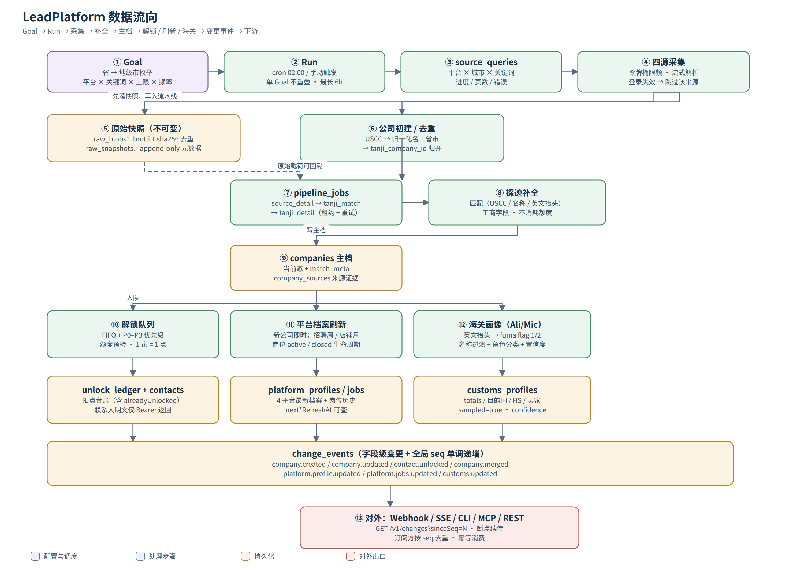

# 18 · API / CLI / MCP 使用指南

> 面向：下游 Agent、CRM/数据集成开发者、运维脚本作者
> 状态：v1.0（已按 v0.1.0 实现校正；契约以 `spec/*.json` 为准）。规模：REST 42 条路径 / CLI 45 条命令 / MCP 36 个工具。
> 契约：`spec/openapi.json`、`spec/mcp-tools.json`、`spec/cli-commands.json` 与 CLI `--help`；运行中的服务还提供 `/openapi.json`、`/mcp-tools.json`。
> Base URL `http://127.0.0.1:8793`（默认仅 loopback） · 更新 2026-11-16
> 前置：[03-接口草案](03-接口草案.md) · [02-架构与数据模型](02-架构与数据模型.md) · [04-上游对接与区域映射](04-上游对接与区域映射.md) · [05-部署与运维](05-部署与运维.md)



---

## 1. 5 分钟快速上手

### 1.1 启动

前置：Node ≥ 22.5；上游 client 已运行（Boss 8790 / 智联 8791 / Ali 8792 / Mic 8899 / 探迹 8787，海关另需 fuma 17890）。

```bash
cd ~/lead-platform
npm ci
npm run build
cp -n .env.example .env
TOKEN=$(node -e "console.log(require('node:crypto').randomBytes(32).toString('hex'))")
sed -i "s|^LEAD_API_TOKEN=.*|LEAD_API_TOKEN=$TOKEN|" .env
npm start                       # 等价 node --experimental-sqlite dist/main.js
# 或：systemctl --user start lead-platform
```

首次启动会自动创建数据目录、建库并执行幂等迁移（`src/db/migrate.ts`），**没有 `--migrate` 参数**，重复启动不会重复建表。默认数据目录为 `~/.lead-platform`，可用 `LEAD_DATA_DIR` 覆盖（见 §2.7）。

```bash
export BASE=http://127.0.0.1:8793
export LEAD_API_TOKEN=$(grep -E '^LEAD_API_TOKEN=' ~/lead-platform/.env | cut -d= -f2-)
curl -sS "$BASE/v1/health" | jq '{ok, status:.data.status, version:.data.version}'
curl -sS -H "Authorization: Bearer $LEAD_API_TOKEN" "$BASE/v1/status" | jq '{ok, db:.data.db, queue:.data.queue}'
```

`/v1/health` 免鉴权；`/v1/status` 需 Bearer（§10）。

### 1.2 Goal → Run → 公司

```bash
curl -sS -X POST "$BASE/v1/goals" -H "Authorization: Bearer $LEAD_API_TOKEN" \
  -H "Content-Type: application/json" \
  -d '{"name":"河北省-外贸线索","region":{"province":"河北省","provinceCode":"130000"},"platforms":["boss","zhilian","ali","mic"],"keywords":{"boss":["外贸"],"ali":["machinery"],"mic":[]},"schedule":{"cron":"0 2 * * *","timeZone":"Asia/Shanghai"},"maxLeadsPerRun":2000,"enabled":true}' \
  | tee /tmp/goal.json | jq '.data | {id, enabled, resolvedCities}'
```

返回 `201`；完整参数见 §3。随后：

```bash
export GOAL_ID=$(jq -r '.data.id' /tmp/goal.json)
curl -sS -X POST "$BASE/v1/goals/$GOAL_ID/run" -H "Authorization: Bearer $LEAD_API_TOKEN" | jq '.data | {id, status}'
curl -sS -G "$BASE/v1/companies" -H "Authorization: Bearer $LEAD_API_TOKEN" \
  --data-urlencode "province=河北省" --data-urlencode "platform=boss" --data-urlencode "limit=5" \
  | jq '.data.items[] | {id, name, city, platforms, unlockStatus}'
```

### 1.3 变更与 Webhook

```bash
curl -sS -H "Authorization: Bearer $LEAD_API_TOKEN" "$BASE/v1/changes?sinceSeq=0&limit=10" \
  | jq '{nextSeq:.data.nextSeq, hasMore:.data.hasMore, n:(.data.items|length)}'
curl -sS -X POST "$BASE/v1/webhooks" -H "Authorization: Bearer $LEAD_API_TOKEN" \
  -H "Content-Type: application/json" \
  -d '{"url":"https://example.com/hooks/lead","eventTypes":["company.created","company.updated","contact.unlocked"]}' \
  | tee /tmp/webhook.json | jq '.data | {id, active, eventTypes}'
```

`secret` 只在创建响应中返回一次明文（列表/更新接口只返回 `secretMasked`），用于本地验签，勿入库/入日志；验签见 §13。

### 1.4 CLI 版

```bash
cd ~/lead-platform && npm link     # package.json bin: lead -> dist/cli.js
lead status
lead goal create --name 河北省-外贸线索 --province 河北省 --platforms boss,zhilian,ali,mic --cron "0 2 * * *"
lead goal run <goal_id> --wait
lead company list --province 河北省 --platform boss --limit 5
lead changes --since-seq 0 --limit 10
lead webhook create --url https://example.com/hooks/lead --events company.created,company.updated,contact.unlocked
```

---

## 2. 通用约定

### 2.1 Base、鉴权与免鉴权

- Base `http://127.0.0.1:8793`；默认只监听 loopback（`LEAD_HOST` 可改，非必要不要暴露）；无 CORS；JSON charset utf-8。
- 免鉴权：`GET /v1/health`、`GET /health`、`GET /docs`、`GET /openapi.json`、`GET /mcp-tools.json`、`GET /favicon.ico`。
- 其余：`Authorization: Bearer <LEAD_API_TOKEN>`；Token 至少 16 字符（推荐 32 字节随机 hex），缺失/错误返回 `401 UNAUTHORIZED`。

```bash
curl -sS -H "Authorization: Bearer $LEAD_API_TOKEN" "$BASE/v1/status"
```

### 2.2 统一 envelope

```json
{"ok":true,"data":{"items":[],"hasMore":false},"meta":{"schemaVersion":"1.0","requestId":"req_01JEXAMPLE0000000000000000","timestamp":"2026-11-16T05:30:00.000Z","tookMs":8,"warnings":[]},"error":null}
```

```json
{"ok":false,"data":null,"meta":{"schemaVersion":"1.0","requestId":"req_01JEXAMPLE0000000000000000","timestamp":"2026-11-16T05:30:00.000Z","tookMs":3},"error":{"code":"VALIDATION_ERROR","message":"region.province is required","retryable":false,"details":{"field":"region.province"}}}
```

先判 `ok`，再看 `error.code`/`retryable`；`requestId` 用于报障，同时出现在响应头 `x-request-id`。分页字段的读取方式见 §2.5。

### 2.3 时间、ID

- 时间 ISO 8601（`Z`/`+08:00`），DB 内部 UTC；比较前先解析。
- 业务 ID 形如 `<prefix>_<ULID>`：`goal_`、`run_`、`cmp_`、`job_`、`whk_`、`dlv_`、`req_`；示例均为合成值。
- 事件 `eventId` 由 `seq` 确定性派生：`evt_<16 位 Base32>`，同一 `seq` 恒等；事件序号 `seq` 是去重/游标主键。
- `version` 用于乐观锁；`idempotencyKey` 用于解锁业务幂等。

### 2.4 错误码

| code | HTTP | 含义 → 处理 |
|---|---|---|
| `VALIDATION_ERROR` | 400 | 参数/枚举/区域不合法 → 修正，不重试 |
| `UNSUPPORTED` | 400 | 平台不支持该参数 → 降级 |
| `UNAUTHORIZED` | 401 | Token 缺失/错误 → 检查，不循环重试 |
| `NOT_FOUND` | 404 | 资源不存在（含无海关画像）→ 停止 |
| `CONFLICT` | 409 | 状态/版本冲突 → 重新 GET 后重试 |
| `RUN_IN_PROGRESS` | 409 | 同 Goal 已有 running Run → 轮询 |
| `QUOTA_EXHAUSTED` | 409 | 探迹额度不足 → 暂停解锁 |
| `SOURCE_SESSION_INVALID` | 409 | 上游登录失效 → 人工处理后重试/跳过 |
| `CUSTOMS_PERMISSION_DENIED` | 409 | fuma 海关权限不足 → 检查账号 |
| `SOURCE_VERIFICATION_PENDING` | 429 | 上游验证码/风控 → 冷却后重试 |
| `UPSTREAM_RATE_LIMITED` | 429 | 上游限频 → 退避 + jitter |
| `RATE_LIMITED` | 429 | 本服务/网关限频 → 退避 |
| `UPSTREAM_BAD_REQUEST` | 502 | 上游 4xx/协议异常 → 记录，不盲重试 |
| `SOURCE_UNAVAILABLE` | 503 | 上游不可达/5xx → 退避重试 |
| `INTERNAL_ERROR` | 500 | 未知错误 → 带 `requestId` 报障 |

> 以上 15 个码来自 `src/shared/errors.ts`（`ERROR_CODES`）。MCP 在 REST 不可达时返回的 `SERVICE_UNAVAILABLE` 是 MCP 传输层错误，不属于 REST 错误码（§12.3）。

### 2.5 分页

| 端点 | 返回形状 | 关键参数 | 续页/结束 |
|---|---|---|---|
| `GET /v1/companies` | `data.items[]` + `data.hasMore` + `data.nextCursor?` + `data.total?` | `limit`（默认 20，最大 200）、`cursor` | `hasMore=false`；`data.nextCursor` 缺省即结束 |
| `GET /v1/companies/{id}/snapshots` | `data.items[]` + `data.hasMore` + `data.nextCursor?` | `limit`（20/200）、`kind`、`platform`、`cursor` | 同上 |
| `GET /v1/jobs` | `data.items[]` + `data.hasMore` + `data.nextCursor?` | `limit`（50/200）、`status`、`stage`、`companyId`、`platform`、`cursor` | 同上 |
| `GET /v1/webhooks/{id}/deliveries` | `data.items[]` + `data.hasMore` + `data.nextCursor?` | `limit`（50/200）、`status`、`cursor` | 同上 |
| `GET /v1/companies/{id}/platforms/{platform}/jobs` | `data.items[]` + `data.hasMore` + `data.nextCursor?` | `limit`（50/200）、`status`、`cursor` | 同上 |
| `GET /v1/companies/{id}/changes`、`.../platforms/{platform}/changes` | 同上 | `limit`（100/500）、`sinceVersion`、`cursor` | 同上 |
| `GET /v1/changes` | `data.items[]` + `data.nextSeq` + `data.hasMore` | `limit`（100/500）、`sinceSeq`、`types`、`companyId` | `nextSeq` 作为下次 `sinceSeq`；`hasMore=false` 结束 |
| `GET /v1/goals`、`GET /v1/runs`、`GET /v1/goals/{id}/runs` | `data.items[]` + `data.total` | `limit`（默认 50，最大 200）、`offset` | 按 `offset` 翻页，`offset + items.length >= total` 结束 |

要点：

- 分页字段在 **`data`** 下：`data.nextCursor` / `data.hasMore`。`meta.nextCursor` 是兼容镜像，新代码不要依赖。
- 结束页 `data.nextCursor` 字段会缺省（不是显式 `null`）；用 `hasMore` 判断最稳妥。
- `GET /v1/changes` 不使用 `nextCursor` 续页，用 `data.nextSeq` 回填 `sinceSeq`；该端点的游标（可选）只在 `meta.nextCursor` 中返回，`data.nextCursor` 实际不出现。
- OpenAPI 中 `listCompanies` 的描述文案仍写着 `meta.nextCursor`，且 `changes` schema 列了可选的 `data.nextCursor`；以 `src/http/routes/helpers.ts`、`src/http/routes/handlers/core.ts` 与 `spec/openapi.json` 的 schema 字段为准，本文示例使用 `data.*`。
- `cursor` 是不透明字符串，不解析、不跨端点复用。`GET /v1/companies` 排序 `updated_at DESC, id DESC`；`changes` 按 `seq ASC`。

### 2.6 幂等、冲突与限频

- `POST /v1/goals/{id}/run` 非幂等；已有 running Run → `409 RUN_IN_PROGRESS`。
- `POST /v1/companies/{id}/unlock` 只入队，返回 `202` + job；同一公司/阶段/平台已有任务时复用现有 job。可带 `idempotencyKey` 供调用方追踪；业务幂等键由解锁流水线按 `unlock:<companyId>:<yyyy-mm-dd>` 生成，真正扣额度（1 家 = 1 点）发生在 worker 执行解锁时，重复请求不会重复扣点。
- 创建类 POST 无通用幂等键；重试前按业务键查询。内部按上游限频调度（Boss 12/min、智联 15/min、Ali 10s/页、探迹 20/min）；`429/503` 按 1s/2s/4s 退避（≤3 次），`400/401/404/409` 不重试。

### 2.7 配置与环境变量

配置优先级：`process.env` > `./.env` > `~/.lead-platform/config.json` > 默认值。常用项：

| 变量 | 默认值 | 说明 |
|---|---|---|
| `LEAD_API_TOKEN` | 无（必填） | REST/CLI/MCP 共用的 Bearer Token，至少 16 字符 |
| `LEAD_HOST` | `127.0.0.1` | 监听地址；见 `src/config.ts`，未列入 `.env.example` |
| `LEAD_PORT` | `8793` | 服务端口 |
| `LEAD_DATA_DIR` | `~/.lead-platform` | 数据根目录；见 `src/config.ts`，未列入 `.env.example` |
| `LEAD_DB` | `<dataDir>/lead.db` | SQLite 文件 |
| `LEAD_BACKUP_DIR` | `<dataDir>/backups` | 备份目录；见 `src/config.ts`，未列入 `.env.example` |
| `LEAD_ARCHIVE_DIR` | `<dataDir>/archive` | 冷归档目录 |
| `LEAD_PUBLIC_BASE_URL` | `http://127.0.0.1:<port>` | 对外展示/回调用的公开地址；见 `src/config.ts`，未列入 `.env.example` |
| `LEAD_TZ` | `Asia/Shanghai` | 调度/日期口径时区 |
| `LEAD_SCHEDULER_ENABLED` | `true` | 定时调度开关 |
| `LEAD_WEBHOOK_MAX_ATTEMPTS` | `8` | Webhook 最大尝试次数 |
| `LEAD_UNLOCK_DAILY_CAP` | 空（不限） | 每日解锁上限 |

上游地址/Token（`BOSS_CLIENT_URL`、`ZHILIAN_CLIENT_URL`、`ALI_CLIENT_URL`、`MIC_CLIENT_URL`、`TANJI_CLIENT_URL`、`FUMA_CLIENT_URL` 及对应 `*_API_TOKEN`）见 `.env.example`。**完整清单见 `.env.example` 与 `src/config.ts`。**

---

## 3. Goals

| 方法 | 路径 | 说明 |
|---|---|---|
| POST | `/v1/goals` | 创建，`201` + Goal（含 `resolvedCities`） |
| GET | `/v1/goals?enabled=true&limit=50&offset=0` | 列表（offset 分页） |
| GET | `/v1/goals/{id}` | 详情 + 最近 runs 摘要 |
| PATCH | `/v1/goals/{id}` | 更新；body 用 `expectedVersion` 做乐观锁 |
| DELETE | `/v1/goals/{id}` | 归档（软删除，`enabled=false`，历史保留） |
| POST | `/v1/goals/{id}/run` | 手动触发，`202` + Run |
| GET | `/v1/goals/{id}/runs?limit=20&offset=0` | 运行历史（offset 分页） |

参数：`name`、`region.province`（必填，如 `河北省`）、`region.provinceCode`（如 `130000`）、`region.cityCodes`（空 = 全省 11 地级市）、`platforms`（`boss/zhilian/ali/mic`）、`keywords`（按平台数组；Ali 行业词、Mic 留空）、`maxLeadsPerRun`/`dailyLeadLimit`、`schedule{cron,timeZone,timeWindow}`、`priority`（默认 100）、`unlockPolicy`（默认 priority 顺序）、`enabled`（默认 true）。

创建 curl 见 §1.2。响应（`201`，节选）：

```json
{"ok":true,"data":{"id":"goal_01JEXAMPLE0000000000000000","name":"河北省-外贸线索","region":{"province":"河北省","provinceCode":"130000"},"platforms":["boss","zhilian","ali","mic"],"enabled":true,"version":1,"resolvedCities":[{"code":"130100","name":"石家庄市","platformValues":{"boss":"130100","zhilian":"130100","ali":"130100","mic":"Shijiazhuang"}}]},"meta":{"schemaVersion":"1.0","requestId":"req_01JEXAMPLE0000000000000000","timestamp":"2026-11-16T05:30:00.000Z","tookMs":12,"warnings":[]},"error":null}
```

完整字段还含 `keywords/schedule/priority/unlockPolicy/maxLeadsPerRun/dailyLeadLimit`；`resolvedCities` 每项含 `code/name/platformValues`（各平台实际检索值）。

```bash
curl -sS -X PATCH "$BASE/v1/goals/$GOAL_ID" -H "Authorization: Bearer $LEAD_API_TOKEN" \
  -H "Content-Type: application/json" -d '{"enabled":false,"expectedVersion":1}'   # 旧 version → 409 CONFLICT
curl -sS -X DELETE "$BASE/v1/goals/$GOAL_ID" -H "Authorization: Bearer $LEAD_API_TOKEN"
curl -sS -X POST "$BASE/v1/goals/$GOAL_ID/run" -H "Authorization: Bearer $LEAD_API_TOKEN" | jq '.data | {id, status}'
```

> `DELETE` 只是归档：将 Goal 置为停用，不删除历史 run/线索。`PATCH` 不带 `expectedVersion` 时按当前版本更新；要做并发保护就显式传。

---

## 4. Runs

| 方法 | 路径 | 说明 |
|---|---|---|
| GET | `/v1/runs?goalId=&status=&limit=50&offset=0` | 运行列表 |
| GET | `/v1/runs/{id}` | 详情 + 平台/城市/关键词进度 |
| POST | `/v1/runs/{id}/cancel` | 取消（在飞请求结束后停止），`202` |

```bash
curl -sS "$BASE/v1/runs?goalId=$GOAL_ID&status=partial&limit=20" \
  -H "Authorization: Bearer $LEAD_API_TOKEN" | jq '.data.items[] | {id, status, startedAt, finishedAt}'
```

```json
{"ok":true,"data":{"id":"run_01JEXAMPLE0000000000000000","goalId":"goal_01JEXAMPLE0000000000000000","status":"partial","stats":{"platforms":{"boss":{"leads":860,"companiesNew":512}},"unlock":{"unlocked":223},"skippedSources":[{"platform":"zhilian","reason":"SOURCE_SESSION_INVALID"}]},"progress":{"totalQueries":220,"doneQueries":210},"queries":[]},"meta":{"schemaVersion":"1.0","requestId":"req_01JEXAMPLE0000000000000000","timestamp":"2026-11-16T05:30:00.000Z","tookMs":9,"warnings":[]},"error":null}
```

`status`：`pending/running/completed/partial/failed/cancelled`；`partial` = 部分来源失败但主流程完成。取消不中断已发出的上游请求；CLI `--wait` 轮询至终态。

---

## 5. Companies

### 5.1 端点与过滤

| 方法 | 路径 | 说明 |
|---|---|---|
| GET | `/v1/companies` | 列表（游标分页） |
| GET | `/v1/companies/{id}?include=platforms,customs` | 详情；可追加平台卡片/海关摘要 |
| GET | `/v1/companies/{id}/sources` | 来源证据 |
| GET | `/v1/companies/{id}/snapshots?kind=&platform=&limit=&cursor=` | 快照元数据（默认不含 payload） |
| GET | `/v1/companies/{id}/contacts?type=&unlockedOnly=` | 联系人明文（高敏） |
| GET | `/v1/companies/{id}/changes?sinceVersion=&limit=&cursor=` | 公司字段级变更 |
| POST | `/v1/companies/{id}/rematch` | 重匹配，`202` + job |
| POST | `/v1/companies/{id}/unlock` | 手动优先解锁，`202` + job |
| GET | `/v1/companies/{id}/platforms` | 各平台档案卡片 |
| GET | `/v1/companies/{id}/platforms/{platform}` | 单平台完整档案 |
| GET | `/v1/companies/{id}/platforms/{platform}/jobs?status=active\|closed` | 岗位 + 历史（仅 Boss/智联） |
| GET | `/v1/companies/{id}/platforms/{platform}/changes?sinceVersion=` | 平台档案变更 |
| POST | `/v1/companies/{id}/refresh` | 刷新档案/岗位，`202` + job |
| GET | `/v1/companies/{id}/customs` | 海关画像（仅 Ali/Mic） |
| POST | `/v1/companies/{id}/customs/refresh` | 刷新海关，`202` + job |

过滤：`province`/`city`（名或 GB code）、`platform`、`unlockStatus`（`none/pending/waiting_quota/unlocked/failed`）、`enrichmentStatus`（`discovered/source_detailed/tanji_matched/tanji_enriched/unmatched/failed`）、`q`（≥2 字符）、`updatedSince`、`limit`/`cursor`。

### 5.2 列表与详情

```bash
curl -sS -G "$BASE/v1/companies" -H "Authorization: Bearer $LEAD_API_TOKEN" \
  --data-urlencode "province=河北省" --data-urlencode "platform=boss" \
  --data-urlencode "unlockStatus=unlocked" --data-urlencode "limit=2"
```

```json
{"ok":true,"data":{"items":[{"id":"cmp_01JEXAMPLE0000000000000000","name":"河北示例机械有限公司","province":"河北省","city":"石家庄市","sourceCount":2,"platforms":["boss","ali"],"enrichmentStatus":"tanji_enriched","unlockStatus":"unlocked","tradeTags":["机械"],"version":7,"updatedAt":"2026-11-16T05:20:00.000Z"}],"total":1,"hasMore":false},"meta":{"schemaVersion":"1.0","requestId":"req_01JEXAMPLE0000000000000000","timestamp":"2026-11-16T05:30:00.000Z","tookMs":6,"warnings":[],"nextCursor":null},"error":null}
```

```bash
curl -sS "$BASE/v1/companies/cmp_01JEXAMPLE0000000000000000?include=platforms,customs" \
  -H "Authorization: Bearer $LEAD_API_TOKEN" | jq '.data.company'
```

```json
{"company":{"id":"cmp_01JEXAMPLE0000000000000000","name":"河北示例机械有限公司","uscc":"91130100MA0EXAMPLE","province":"河北省","city":"石家庄市","enrichmentStatus":"tanji_enriched","unlockStatus":"unlocked","version":7}}
```

> 详情默认带 `sources/contacts/recentChanges`（`contacts` 为摘要）；`include=platforms` 追加 `platforms[]`，`include=customs` 追加 `customs`，`include=all` 全带。联系人 API 在 Bearer 下可返回明文（本文示例不含明文）；`/changes` 等列表永不返回明文。

### 5.3 子资源与人工干预

```bash
CID=cmp_01JEXAMPLE0000000000000000
curl -sS "$BASE/v1/companies/$CID/sources" -H "Authorization: Bearer $LEAD_API_TOKEN"
curl -sS "$BASE/v1/companies/$CID/snapshots?kind=source_detail&limit=20" -H "Authorization: Bearer $LEAD_API_TOKEN"
curl -sS "$BASE/v1/companies/$CID/contacts?type=mobile&unlockedOnly=true" -H "Authorization: Bearer $LEAD_API_TOKEN"
curl -sS "$BASE/v1/companies/$CID/changes?sinceVersion=5&limit=50" -H "Authorization: Bearer $LEAD_API_TOKEN"
curl -sS -X POST "$BASE/v1/companies/$CID/rematch" -H "Authorization: Bearer $LEAD_API_TOKEN"
curl -sS -X POST "$BASE/v1/companies/$CID/unlock" -H "Authorization: Bearer $LEAD_API_TOKEN" \
  -H "Content-Type: application/json" -d '{"idempotencyKey":"'$CID':2026-11-16"}'
curl -sS -X POST "$BASE/v1/companies/$CID/refresh" -H "Authorization: Bearer $LEAD_API_TOKEN" \
  -H "Content-Type: application/json" -d '{"platforms":["boss","ali"],"kinds":["profile","jobs"]}'
curl -sS -X POST "$BASE/v1/companies/$CID/customs/refresh" -H "Authorization: Bearer $LEAD_API_TOKEN"
```

rematch/unlock/refresh/customs-refresh 均返回 `202` + job：

```json
{"ok":true,"data":{"jobId":"job_01JEXAMPLE0000000000000000","created":true,"stage":"unlock","status":"pending","companyId":"cmp_01JEXAMPLE0000000000000000","idempotencyKey":"cmp_01JEXAMPLE0000000000000000:2026-11-16","queued":true},"meta":{"schemaVersion":"1.0","requestId":"req_01JEXAMPLE0000000000000000","timestamp":"2026-11-16T05:30:05.000Z","tookMs":4,"warnings":[]},"error":null}
```

> `unlock` 需要公司已匹配探迹主体（有 `tanjiCompanyId`），否则 `400 VALIDATION_ERROR`。解锁服务只入队，不直接调用上游；worker 实际解锁时才消耗 1 点额度。

### 5.4 平台卡片、岗位与海关

```bash
curl -sS "$BASE/v1/companies/$CID/platforms" -H "Authorization: Bearer $LEAD_API_TOKEN" | jq '.data.items[].platform'
```

```json
{"ok":true,"data":{"items":[{"platform":"boss","platformStatus":"active","displayName":"河北示例机械有限公司","cityName":"石家庄","jobCount":12,"latestJobs":[{"title":"外贸业务员","salaryText":"6-10K"}],"lastFetchedAt":"2026-11-16T03:12:00+08:00"},{"platform":"ali","platformStatus":"active","displayName":"Hebei Sample Machinery Co., Ltd.","store":{"membership":{"label":"金品诚企","verifiedSupplier":true},"joinedYears":8,"supplierIndex":92,"mainProducts":["wire mesh"]},"lastFetchedAt":"2026-11-02T03:00:00+08:00"}],"total":2},"meta":{"schemaVersion":"1.0","requestId":"req_01JEXAMPLE0000000000000000","timestamp":"2026-11-16T05:30:06.000Z","tookMs":5,"warnings":[]},"error":null}
```

单平台档案：`GET /v1/companies/{id}/platforms/boss`（Boss/智联含招聘字段，Ali/Mic 含 `store`）。

```bash
curl -sS "$BASE/v1/companies/$CID/platforms/boss/jobs?status=active&limit=50" -H "Authorization: Bearer $LEAD_API_TOKEN"
# 仅 Boss/智联；其它平台 400 UNSUPPORTED
curl -sS "$BASE/v1/companies/$CID/platforms/boss/changes?sinceVersion=1" -H "Authorization: Bearer $LEAD_API_TOKEN"
```

```json
{"ok":true,"data":{"items":[{"jobId":"boss_90001","title":"外贸业务员","salaryText":"6-10K","cityName":"石家庄","degree":"大专","experience":"1-3年","status":"active"}],"hasMore":false},"meta":{"schemaVersion":"1.0","requestId":"req_01JEXAMPLE0000000000000000","timestamp":"2026-11-16T05:30:07.000Z","tookMs":4,"warnings":[]},"error":null}
```

```bash
curl -sS "$BASE/v1/companies/$CID/customs" -H "Authorization: Bearer $LEAD_API_TOKEN"
```

```json
{"ok":true,"data":{"status":"ok","confidence":"high","sampled":true,"englishName":"Hebei Sample Machinery Co., Ltd.","totals":{"importView":{"totalNum":1310},"exportView":{"totalNum":754}},"dateRange":{"min":"2026-09-05","max":"2026-11-08"},"topDestinations":[{"key":"Ukraine","count":26}],"topHs4":[{"key":"7314","count":20}],"topBuyers":[{"key":"SAMPLE TRADING LLC","count":17}],"lastFetchedAt":"2026-11-16T06:00:00.000Z"},"meta":{"schemaVersion":"1.0","requestId":"req_01JEXAMPLE0000000000000000","timestamp":"2026-11-16T05:30:08.000Z","tookMs":7,"warnings":[]},"error":null}
```

> 仅 Ali/Mic 有海关画像，其它公司 `404 NOT_FOUND`；`totalNum` 是上游模糊命中总数，不是精确提单量；榜单基于样本（`sampled=true`）；`confidence=low/none` 不推 webhook。

---

## 6. Changes（全局增量）

| 参数 | 说明 |
|---|---|
| `sinceSeq` | 返回 seq **大于**该值的事件；缺省 0 |
| `types` | 逗号分隔，如 `company.created,company.updated` |
| `companyId` | 可选，单公司 |
| `limit` / `cursor` | 默认 100、最大 500；`cursor` 不透明，通常直接用 `nextSeq` |

```bash
curl -sS -H "Authorization: Bearer $LEAD_API_TOKEN" \
  "$BASE/v1/changes?sinceSeq=12344&types=company.updated,contact.unlocked&limit=100"
```

```json
{"ok":true,"data":{"items":[{"eventId":"evt_0000000000ABCDEF","seq":12345,"type":"company.updated","occurredAt":"2026-11-16T05:20:00.000Z","companyId":"cmp_01JEXAMPLE0000000000000000","version":8,"source":"source:boss","runId":"run_01JEXAMPLE0000000000000000","data":{"field":"legalRepresentative","valueType":"string","oldValue":"张*","newValue":"李*"}}],"nextSeq":12345,"hasMore":false},"meta":{"schemaVersion":"1.0","requestId":"req_01JEXAMPLE0000000000000000","timestamp":"2026-11-16T05:30:00.000Z","tookMs":5,"warnings":[],"nextCursor":null},"error":null}
```

字段级事件：同一公司一次变更多字段会产生多条同 `version` 事件，按 `field` 聚合。断点用 `nextSeq`；`hasMore=true` 时继续用同一 `nextSeq` 拉下一页，直到 `hasMore=false`。

---

## 7. Events SSE（接口层）

- `GET /v1/events/stream?types=...`，`text/event-stream`，需 Bearer；`Last-Event-ID` = 上次收到的 `seq`，也可用 `sinceSeq` 查询参数，服务端从 DB 补发。
- `data:` 是**事件 envelope**（`eventId/seq/type/...`），不是 REST envelope；消费见 §14。

```bash
curl -sS -N -H "Authorization: Bearer $LEAD_API_TOKEN" -H "Accept: text/event-stream" \
  "$BASE/v1/events/stream?types=company.created,company.updated"
```

---

## 8. Webhooks

| 方法 | 路径 | 说明 |
|---|---|---|
| POST | `/v1/webhooks` | 创建 `{url, eventTypes, secret?, description?}`，`201` |
| GET | `/v1/webhooks` | 列表（secret 脱敏） |
| PATCH | `/v1/webhooks/{id}` | 更新 `url/eventTypes/active/description` |
| DELETE | `/v1/webhooks/{id}` | 删除，返回 `{id, deleted:true}` |
| GET | `/v1/webhooks/{id}/deliveries?status=&limit=&cursor=` | 投递记录 |
| POST | `/v1/webhooks/{id}/deliveries/{deliveryId}/replay` | 重放，`202` |

创建见 §1.3；响应（`201`，`secret` 仅此处返回一次）：

```json
{"ok":true,"data":{"id":"whk_01JEXAMPLE0000000000000000","url":"https://example.com/hooks/lead","eventTypes":["company.created","company.updated","contact.unlocked"],"active":true,"description":null,"secret":"0123456789abcdef0123456789abcdef0123456789abcdef0123456789abcdef","secretMasked":"****cdef","createdAt":"2026-11-16T05:30:00.000Z","updatedAt":"2026-11-16T05:30:00.000Z"},"meta":{"schemaVersion":"1.0","requestId":"req_01JEXAMPLE0000000000000000","timestamp":"2026-11-16T05:30:00.000Z","tookMs":10,"warnings":[]},"error":null}
```

```bash
WEBHOOK_ID=whk_01JEXAMPLE0000000000000000
curl -sS -X PATCH "$BASE/v1/webhooks/$WEBHOOK_ID" -H "Authorization: Bearer $LEAD_API_TOKEN" \
  -H "Content-Type: application/json" -d '{"eventTypes":["company.created","contact.unlocked"],"active":true}'
curl -sS "$BASE/v1/webhooks/$WEBHOOK_ID/deliveries?status=dead&limit=20" -H "Authorization: Bearer $LEAD_API_TOKEN"
curl -sS -X POST "$BASE/v1/webhooks/$WEBHOOK_ID/deliveries/dlv_01JEXAMPLE0000000000000000/replay" -H "Authorization: Bearer $LEAD_API_TOKEN"
```

投递记录字段：`id/subscriptionId/eventSeq/eventType/status/attempts/nextRetryAt/responseStatus/responseBodyHead/lastError/createdAt/deliveredAt`。投递 ID 形如 `dlv_<ULID>`。

`status`：`pending/delivered/failed/dead`；`dead` 只能人工 replay 或修复后重试。重放按原 `eventId` 再投，消费端必须幂等；URL 仅允许 http(s)。

---

## 9. Jobs（流水线任务）

| 方法 | 路径 | 说明 |
|---|---|---|
| GET | `/v1/jobs?status=&stage=&companyId=&platform=&limit=&cursor=` | 队列任务（含死信） |
| GET | `/v1/jobs/{id}` | 详情（attempts、lastError、lease） |
| POST | `/v1/jobs/{id}/retry` | 重试 failed/dead，`202` |

```bash
curl -sS "$BASE/v1/jobs?status=dead&stage=unlock&limit=20" -H "Authorization: Bearer $LEAD_API_TOKEN" \
  | jq '.data.items[] | {id, stage, attempts, lastError}'
curl -sS -X POST "$BASE/v1/jobs/job_01JEXAMPLE0000000000000000/retry" -H "Authorization: Bearer $LEAD_API_TOKEN" | jq '.data | {id, status}'
```

```json
{"ok":true,"data":{"id":"job_01JEXAMPLE0000000000000000","companyId":"cmp_01JEXAMPLE0000000000000000","stage":"unlock","status":"failed","attempts":3,"maxAttempts":3,"lastError":"QUOTA_EXHAUSTED","createdAt":"2026-11-16T04:00:00.000Z","updatedAt":"2026-11-16T05:00:00.000Z"},"meta":{"schemaVersion":"1.0","requestId":"req_01JEXAMPLE0000000000000000","timestamp":"2026-11-16T05:30:00.000Z","tookMs":3,"warnings":[]},"error":null}
```

`stage`：`source_detail/tanji_match/tanji_detail/unlock/contact_sync/platform_profile/platform_jobs/customs`；`status`：`pending/running/waiting_quota/done/failed/dead/cancelled`。普通任务最多 3 次（`LEAD_JOB_MAX_ATTEMPTS`，默认 3），超过转 `dead`；`waiting_quota` 不计失败。

---

## 10. 运行态、额度与健康

端点：`GET /v1/status`、`/v1/sources`、`/v1/quota`、`/v1/stats?from=&to=&kind=`、`/v1/health`。

`GET /v1/status` 的 `data`（节选；字段以当前实现为准）：

```json
{"ok":true,"data":{"service":"lead-platform","version":"0.1.0","nodeEnv":"development","time":"2026-11-16T05:30:00.000Z","db":{"sizeBytes":1048576,"schemaVersion":1,"companies":1280,"changes":8642},"queue":{"pending":12,"waiting_quota":3,"dead":1},"scheduler":{"enabled":true},"upstream":[{"platform":"boss","state":"ok","logged_in":1,"checked_at":"2026-11-16T05:25:00.000Z"}],"quota":{"observedAt":"2026-11-16T05:20:00.000Z","daily":{"limit":500,"remaining":420},"monthly":{"limit":1500,"remaining":223},"enterprise":{"limit":19500,"remaining":19500},"settlementDay":11},"coverage":null,"alerts":[]},"meta":{"schemaVersion":"1.0","requestId":"req_01JEXAMPLE0000000000000000","timestamp":"2026-11-16T05:30:00.000Z","tookMs":4,"warnings":[]},"error":null}
```

`/v1/status` 的 `queue` 是 `status → count` 映射；`quota` 是最近一次原始观测（字段较简，`enterprise` 而非 `enterpriseMonthly`）；详细额度用 `/v1/quota`。`/v1/sources` 返回 `items[]`（6 个上游：`boss/zhilian/ali/mic/tanji/fuma`，字段 `platform/state/loggedIn/expiresAt/checkedAt/consecutiveFailures/detail`），`state`：`ok/degraded/session_invalid/verification_pending/unavailable`。

`GET /v1/quota` 的 `data`（以 `src/services/quota.ts` 为准）：

```json
{"ok":true,"data":{"daily":{"limit":500,"used":80,"remaining":420,"unit":"point"},"monthly":{"limit":1500,"used":1277,"remaining":223,"unit":"point"},"enterpriseMonthly":{"limit":19500,"used":0,"remaining":19500,"unit":"point"},"settlementDay":11,"nearlySevenDayUnlockCount":68,"observedAt":"2026-11-16T05:20:00.000Z","recentUnlockCurve":[{"date":"2026-11-15","count":12,"quotaCost":12}]},"meta":{"schemaVersion":"1.0","requestId":"req_01JEXAMPLE0000000000000000","timestamp":"2026-11-16T05:30:00.000Z","tookMs":5,"warnings":[]},"error":null}
```

三层额度均为 `{limit, used, remaining, unit}`；`recentUnlockCurve` 是近 14 天按北京时间聚合的成功解锁数（含 `quotaCost`）。

```bash
curl -sS -G "$BASE/v1/stats" -H "Authorization: Bearer $LEAD_API_TOKEN" \
  --data-urlencode "from=2026-11-01" --data-urlencode "to=2026-11-16" --data-urlencode "kind=coverage" \
  | jq '.data | {kind, uniqueCompanies:.coverage.uniqueCompanies, crossSourceOverlap:.coverage.crossSourceOverlap, coverageByCity:.coverage.coverageByCity}'
```

```json
{"ok":true,"data":{"kind":"coverage","from":"2026-11-01T00:00:00.000Z","to":"2026-11-16T00:00:00.000Z","coverage":{"uniqueCompanies":1280,"crossSourceOverlap":214,"coverageByCity":{"石家庄":530,"保定":210},"keywordYield":{"外贸":420,"machinery":85}}},"meta":{"schemaVersion":"1.0","requestId":"req_01JEXAMPLE0000000000000000","timestamp":"2026-11-16T05:30:00.000Z","tookMs":18,"warnings":[]},"error":null}
```

`kind`：`summary`（默认）/`coverage`/`unlocks`；`from`/`to` 为 ISO 时间或日期，`runId` 可限定 Run。`GET /v1/health` 免鉴权、毫秒级；`status/sources/quota/stats` 需 Bearer。

### 10.1 Admin（本机运维接口）

管理接口与其它 `/v1/**` 一样走本机 Bearer，仅用于本机脚本/人工运维，不要暴露到远程或 MCP。全部返回 `200`（不是 202），`restore` 为幂等回填、不删除归档。

| 方法 | 路径 | 说明 |
|---|---|---|
| POST | `/v1/admin/backup` | SQLite 在线备份（`VACUUM INTO`）到 `backups/` |
| POST | `/v1/admin/archive` | 原始快照冷归档（brotli + manifest；只归档不删除），body `{afterDays?, dryRun?}` |
| GET | `/v1/admin/archive/manifests` | 归档清单列表（按月份） |
| GET | `/v1/admin/verify?month=YYYY-MM` | 校验归档文件 sha256 |
| POST | `/v1/admin/restore` | 按月份恢复归档元数据/文件到 hot 库，body `{month?, dryRun?}` |
| GET | `/v1/admin/db-stats` | DB 体积/表行数/归档与备份统计 |

```bash
TOKEN_HEADER="Authorization: Bearer $LEAD_API_TOKEN"
curl -sS -X POST "$BASE/v1/admin/backup" -H "$TOKEN_HEADER" | jq '.data | {path, bytes, schemaVersion}'
curl -sS -X POST "$BASE/v1/admin/archive" -H "$TOKEN_HEADER" -H "Content-Type: application/json" \
  -d '{"dryRun":true}' | jq '.data | {dryRun, snapshotCount, blobCount, bytes}'
curl -sS "$BASE/v1/admin/archive/manifests" -H "$TOKEN_HEADER" | jq '.data.items | length'
curl -sS "$BASE/v1/admin/verify?month=2026-08" -H "$TOKEN_HEADER" | jq '.data | {ok, months}'
curl -sS -X POST "$BASE/v1/admin/restore" -H "$TOKEN_HEADER" -H "Content-Type: application/json" \
  -d '{"month":"2026-08","dryRun":true}' | jq '.data'
curl -sS "$BASE/v1/admin/db-stats" -H "$TOKEN_HEADER" | jq '.data | {sizeBytes, walBytes, tables}'
```

CLI 等价：`lead admin backup | archive | manifests | verify | restore | db-stats`（§11.2）。归档参数/输出细节见 [05-部署与运维](05-部署与运维.md)。

---

## 11. CLI 指南（`lead`）

### 11.1 安装与配置

```bash
cd ~/lead-platform && npm ci && npm run build
npm link                       # 全局 lead -> package.json bin("lead": "dist/cli.js")
lead --help
```

`package.json` 的 bin 是 `dist/cli.js`（源码入口 `src/cli.ts`）。Base URL/Token 解析优先级：

- Base URL：`--base-url` > `LEAD_BASE_URL` > `~/.lead-platform/config.json` 的 `baseUrl/base_url/url` > `http://127.0.0.1:<LEAD_PORT|config.port|8793>`。
- Token：`--token` > `LEAD_API_TOKEN` > `config.json` 的 `apiToken/api_token/token`。

```bash
export LEAD_API_TOKEN=$(grep -E '^LEAD_API_TOKEN=' .env | cut -d= -f2-)
lead status --base-url http://127.0.0.1:8793
```

`~/.lead-platform/config.json`（建议 0600）示例：

```json
{"baseUrl":"http://127.0.0.1:8793","apiToken":"replace-with-32-byte-hex"}
```

### 11.2 命令树（45 条）

```bash
# 运行态（4）
lead status [--json] ; lead quota [--json] ; lead sources [--json]
lead stats [--kind summary|coverage|unlocks] [--from <iso>] [--to <iso>] [--run-id <id>] [--json]

# Goal（6）
lead goal list [--enabled|--disabled] [--limit 50] [--offset 0] [--json]
lead goal show <id> [--json]
lead goal create --name 河北省-外贸线索 [--province 河北省] [--city-codes 130100,130200] \
                 [--platforms boss,zhilian,ali,mic] [--keywords-boss 外贸,外贸业务员] \
                 [--keywords-zhilian ...] [--keywords-ali ...] [--max-leads 2000] [--daily-limit N] \
                 [--cron "0 2 * * *"] [--priority 100] [--disabled] [--json]
lead goal update <id> [--name ...] [--enable|--disable] [--cron ...] [--platforms ...] \
                    [--keywords-boss ...] [--max-leads N] [--priority N] [--version N] [--json]
lead goal run <id> [--wait] [--interval 5] [--json]
lead goal runs <id> [--limit 50] [--offset 0] [--json]

# Run（3）
lead run list [--goal <id>] [--status pending|running|completed|partial|failed|cancelled] \
              [--limit 50] [--offset 0] [--json]
lead run show <id> [--json] ; lead run cancel <id> [--json]

# 公司（15）
lead company list [--province 河北省] [--city 石家庄市] [--platform boss] \
                  [--unlock-status unlocked] [--enrichment-status tanji_enriched] [--q 关键词] \
                  [--updated-since <iso>] [--limit 20] [--cursor <cursor>] [--json]
lead company show <id> [--include platforms,customs,contacts,sources,changes] [--json]
lead company sources <id> [--json]
lead company contacts <id> [--type mobile|phone|email] [--unlocked-only] [--json]
lead company changes <id> [--since-version N] [--limit 100] [--json]
lead company snapshots <id> [--kind <kind>] [--platform <platform>] [--limit 20] [--cursor <cursor>] [--json]
lead company platforms <id> [--json]
lead company platform <id> <platform> [--json]
lead company jobs <id> <platform> [--status active|closed] [--limit 50] [--cursor <cursor>] [--json]
lead company platform-changes <id> <platform> [--since-version N] [--limit 100] [--json]
lead company refresh <id> [--platforms boss,ali] [--kinds profile,jobs,store,customs] [--json]
lead company customs <id> [--json]
lead company customs-refresh <id> [--json]
lead company rematch <id> [--force] [--json]
lead company unlock <id> [--idempotency-key <key>] [--json]

# 变更 / 事件（2）
lead changes [--since-seq N] [--types company.created,company.updated] [--company <id>] \
             [--limit 100] [--cursor <cursor>] [--json]
lead events tail [--types ...] [--since-seq N] [--company <id>] [--timeout <sec>] [--json]

# Webhook（6）
lead webhook list [--json]
lead webhook create --url https://example.com/hooks/lead --events company.created,contact.unlocked \
                    [--secret <secret>] [--description <text>] [--json]
lead webhook update <id> [--url <url>] [--events <csv>] [--enable|--disable] [--json]
lead webhook delete <id> [--json]
lead webhook deliveries <id> [--status pending|delivered|failed|dead] [--limit 50] [--cursor <cursor>] [--json]
lead webhook replay <id> <deliveryId> [--json]

# 任务（3）
lead job list [--status dead] [--stage unlock] [--company <id>] [--limit 50] [--cursor <cursor>] [--json]
lead job show <id> [--json] ; lead job retry <id> [--json]

# 管理（6）
lead admin backup [--json]
lead admin archive [--after-days 90] [--dry-run] [--json]
lead admin manifests [--json]
lead admin verify [--month 2026-08] [--json]
lead admin restore [--month 2026-08] [--dry-run] [--json]
lead admin db-stats [--json]
```

### 11.3 `--json` 与 jq

`--json` 输出与 REST **`data`** 一致（不是完整 envelope）：

```bash
lead company list --province 河北省 --platform boss --limit 2 --json \
  | jq '.items[] | {id, name, city, platforms, unlockStatus}'
lead goal list --json | jq -r '.items[] | select(.enabled) | "\(.id)\t\(.name)"'
lead webhook deliveries whk_01JEXAMPLE0000000000000000 --status dead --json \
  | jq '.items[] | {id, eventSeq, attempts, lastError}'
lead stats --kind coverage --json | jq '.coverage'
```

典型工作流：`lead goal create ... --json` 取 `.id` → `lead goal run <id> --wait` → `lead company list` → `lead company platforms/customs` → `lead events tail` → `lead job list --status dead` + `lead job retry` → `lead admin backup`。

### 11.4 退出码

| 退出码 | 含义 | 处理 |
|---|---|---|
| `0` | 成功（含 `--help`/`--version`、`--wait` 到终态、SSE 正常结束） | 继续 |
| `1` | 通用失败（HTTP/业务/连接失败） | 读 stderr 的 `error <CODE>: <message>`；连接失败为 `SERVICE_UNAVAILABLE` |
| `2` | 用法错误（未知命令/选项、缺参数） | 修正命令 |
| `3` | 鉴权失败（`UNAUTHORIZED`） | 检查 Token |

> 自动化优先解析 `--json` 输出与 stderr 中的 `error.code`，不要只依赖退出码。CLI 没有单独的“连接失败=4”约定。

---

## 12. MCP 指南

### 12.1 启动与客户端配置

MCP server 走 stdio、代理 REST，不直接持有 DB；必须先启动 REST。入口固定为 `dist/mcp/server.js`（源码 `src/mcp/server.ts`），没有 `dist/mcp.js` 或 `dist/api/mcp.js`，也没有 `lead mcp` 子命令。

```bash
npm run build
node dist/mcp/server.js       # stdio；由 MCP 客户端拉起
```

```json
{
  "mcpServers": {
    "lead-platform": {
      "command": "node",
      "args": ["/opt/lead-platform/dist/mcp/server.js"],
      "env": {"LEAD_API_TOKEN": "replace-with-32-byte-hex", "LEAD_BASE_URL": "http://127.0.0.1:8793"}
    }
  }
}
```

Linux 下客户端配置常见于 `~/.config/Claude/claude_desktop_config.json`。Token 勿入仓库；MCP 通过 `LEAD_API_TOKEN`（或 `~/.lead-platform/config.json`）访问本地 REST，Base URL 用 `LEAD_BASE_URL`。

### 12.2 工具清单（36 个）

工具总数为 **36**，完整清单以 `spec/mcp-tools.json`（或运行中的 `GET /mcp-tools.json`）为准。按用途分组：

**运行态/统计（4）**

| 工具 | REST | 用途 |
|---|---|---|
| `lead_status` | GET `/v1/status` | 服务/队列/上游/额度概览 |
| `lead_quota` | GET `/v1/quota` | 探迹三层额度与消耗曲线 |
| `lead_sources` | GET `/v1/sources` | 6 个上游健康/登录态 |
| `lead_stats` | GET `/v1/stats` | 统计与覆盖度（`kind=coverage`） |

**Goal / Run（8）**

| 工具 | REST | 用途 |
|---|---|---|
| `lead_goals_list` | GET `/v1/goals` | Goal 列表（`enabled/limit/offset`） |
| `lead_goal_get` | GET `/v1/goals/{id}` | Goal 详情 + `resolvedCities` |
| `lead_goal_create` | POST `/v1/goals` | 创建 Goal（§3 参数） |
| `lead_goal_update` | PATCH `/v1/goals/{id}` | 更新（`expectedVersion`） |
| `lead_goal_run` | POST `/v1/goals/{id}/run` | 手动触发 |
| `lead_runs_list` | GET `/v1/runs` | Run 列表（`goalId/status`） |
| `lead_run_get` | GET `/v1/runs/{id}` | Run 进度/统计 |
| `lead_run_cancel` | POST `/v1/runs/{id}/cancel` | 取消 Run |

**公司检索/详情（9）**

| 工具 | REST | 用途 |
|---|---|---|
| `lead_companies_list` | GET `/v1/companies` | 区域/平台/状态/关键词检索 |
| `lead_company_get` | GET `/v1/companies/{id}` | 公司详情（可 `include=platforms,customs`） |
| `lead_company_sources` | GET `/v1/companies/{id}/sources` | 来源证据 |
| `lead_company_snapshots` | GET `/v1/companies/{id}/snapshots` | 快照元数据 |
| `lead_company_contacts` | GET `/v1/companies/{id}/contacts` | 联系人明文（高敏） |
| `lead_company_changes` | GET `/v1/companies/{id}/changes` | 单公司字段级变更 |
| `lead_company_platforms` | GET `/v1/companies/{id}/platforms` | 各平台卡片 |
| `lead_company_platform` | GET `/v1/companies/{id}/platforms/{platform}` | 单平台完整档案 |
| `lead_company_jobs` | GET `/v1/companies/{id}/platforms/{platform}/jobs` | 岗位（Boss/智联） |

**公司运维/写操作（5）**

| 工具 | REST | 用途 |
|---|---|---|
| `lead_company_refresh` | POST `/v1/companies/{id}/refresh` | 刷新档案/岗位（202 + job） |
| `lead_company_customs` | GET `/v1/companies/{id}/customs` | 海关画像（Ali/Mic） |
| `lead_company_customs_refresh` | POST `/v1/companies/{id}/customs/refresh` | 刷新海关（202 + job） |
| `lead_company_rematch` | POST `/v1/companies/{id}/rematch` | 重匹配探迹主体（202 + job） |
| `lead_company_unlock` | POST `/v1/companies/{id}/unlock` | 优先解锁（202 + job，消耗额度） |

**变更 / 事件 / 任务 / Webhook（10）**

| 工具 | REST | 用途 |
|---|---|---|
| `lead_changes` | GET `/v1/changes` | 全局增量（`sinceSeq/types`） |
| `lead_events_tail` | GET `/v1/events/stream` | SSE 截断窗口（默认 5s/50 条） |
| `lead_jobs_list` | GET `/v1/jobs` | 任务与死信 |
| `lead_job_get` | GET `/v1/jobs/{id}` | 任务详情 |
| `lead_job_retry` | POST `/v1/jobs/{id}/retry` | 重试 failed/dead |
| `lead_webhooks_list` | GET `/v1/webhooks` | 订阅列表 |
| `lead_webhooks_create` | POST `/v1/webhooks` | 创建订阅 |
| `lead_webhooks_delete` | DELETE `/v1/webhooks/{id}` | 删除订阅 |
| `lead_webhook_deliveries` | GET `/v1/webhooks/{id}/deliveries` | 投递记录/死信 |
| `lead_webhook_replay` | POST `/v1/webhooks/{id}/deliveries/{deliveryId}/replay` | 重放投递 |

> 写类工具（`lead_goal_create/update/run`、`lead_company_refresh/rematch/unlock/customs_refresh`、`lead_webhooks_create/delete`、`lead_webhook_replay`）会改数据或消耗额度，Agent 默认只读，执行前需人工确认。

### 12.3 工作流、错误与 SKILL

**每日增量（只读）**：`lead_status`/`lead_quota` → `lead_changes {sinceSeq,types}` 并持久化 `nextSeq` → 对变化公司 `lead_company_get`（按需 `lead_company_platforms`/`lead_company_customs`）→ 汇总，不解锁、不改 Goal。

**公司调研**：`lead_companies_list {province,city,platform,limit:20}` → `lead_company_get`（看 `matchMeta.confidence`）→ `lead_company_platforms` → `lead_company_jobs` → `lead_company_customs`（标注 `sampled/confidence`）→ 必要时 `lead_company_contacts`（不批量导出）。

MCP 工具把 REST 错误原样转成文本 `<CODE>: <message>` 并置 `isError`；REST 不可达/超时返回 `SERVICE_UNAVAILABLE`（不属于 REST 错误码）。先 `curl -sS $BASE/v1/health`，确认服务/Token/`LEAD_BASE_URL` 后重试；MCP 不会自动拉起服务。

仓库已提供 [skills/lead/SKILL.md](../skills/lead/SKILL.md)：说明何时使用工具、REST 映射、安全边界（默认只读、解锁/刷新前确认、不导出 PII）。Agent 接入时优先读该 SKILL，本文章节用于补全契约细节。

---

## 13. Webhook 消费

### 13.1 投递头与签名

| 头 | 示例 | 说明 |
|---|---|---|
| `X-Lead-Event` | `company.updated` | 事件类型 |
| `X-Lead-Delivery` | `dlv_01JEXAMPLE0000000000000000` | 投递 ID（`dlv_<ULID>`），用于去重/排障 |
| `X-Lead-Timestamp` | `1794807000` | Unix 秒，参与签名 |
| `X-Lead-Signature` | `sha256=<hex>` | `HMAC-SHA256(secret, timestamp + "." + rawBody)` |

Body 是事件 envelope（非 REST envelope）；返回任意 2xx 视为成功。

### 13.2 Node.js 验签（原生模块）

```js
import { createServer } from 'node:http';
import { createHmac, timingSafeEqual } from 'node:crypto';

const SECRET = process.env.LEAD_WEBHOOK_SECRET;

createServer((req, res) => {
  if (req.method !== 'POST' || req.url !== '/hooks/lead') return res.writeHead(404).end();
  const chunks = [];
  req.on('data', (c) => chunks.push(c));
  req.on('end', () => {
    const raw = Buffer.concat(chunks);
    const ts = req.headers['x-lead-timestamp'];
    const sig = req.headers['x-lead-signature'];
    if (!ts || !sig || Math.abs(Date.now() / 1000 - Number(ts)) > 300) return res.writeHead(400).end();
    const mac = createHmac('sha256', SECRET).update(`${ts}.`);
    mac.update(raw);
    const expected = Buffer.from(`sha256=${mac.digest('hex')}`);
    const provided = Buffer.from(String(sig));
    if (expected.length !== provided.length || !timingSafeEqual(expected, provided)) return res.writeHead(401).end();
    const evt = JSON.parse(raw.toString('utf8'));
    console.log(evt.seq, evt.type, req.headers['x-lead-delivery']);
    // 先按 eventId/seq 去重并持久化，再入队
    res.writeHead(204).end();
  });
}).listen(18080, '127.0.0.1');
```

### 13.3 Python 验签（Flask）

```python
import hashlib, hmac, os, time
from flask import Flask, request, abort

app = Flask(__name__)
SECRET = os.environ["LEAD_WEBHOOK_SECRET"].encode()

@app.post("/hooks/lead")
def hook():
    raw = request.get_data()
    ts = request.headers.get("X-Lead-Timestamp", "")
    sig = request.headers.get("X-Lead-Signature", "")
    try:
        ts_i = int(ts)
    except ValueError:
        abort(400)
    if not sig or abs(time.time() - ts_i) > 300:
        abort(400)
    expected = "sha256=" + hmac.new(SECRET, f"{ts}.".encode() + raw, hashlib.sha256).hexdigest()
    if not hmac.compare_digest(expected, sig):
        abort(401)
    evt = request.get_json()
    # 按 evt["eventId"] / evt["seq"] / X-Lead-Delivery 去重
    return "", 204
```

### 13.4 重试、replay 与幂等

- 失败退避：`10s / 1m / 5m / 30m / 2h / 6h / 24h`，最多 8 次尝试（第 8 次失败即 `dead`；`LEAD_WEBHOOK_MAX_ATTEMPTS=8`）。档位来自 `src/events/signature.ts` 的 `WEBHOOK_BACKOFF_SECONDS`。
- 尽快返回 2xx，重活入队；不要先同步拉详情再响应。
- 重试/重放会重复投递：以 `X-Lead-Delivery` 或 `eventId` 建唯一键，成功后落库；顺序不保证，跨事件用 `seq` 去重。
- 死信：`GET /v1/webhooks/{id}/deliveries?status=dead`，修复后 `POST .../replay`；去重键建议保留 30 天。

---

## 14. SSE 消费

```bash
curl -sS -N -H "Authorization: Bearer $LEAD_API_TOKEN" -H "Accept: text/event-stream" \
  "$BASE/v1/events/stream?types=company.created,company.updated"
```

输出：`id: 12345` / `event: company.updated` / `data: {"eventId":...,"seq":12345,...}`，空行分隔；服务端每 15s 发心跳注释。

```js
const BASE = process.env.LEAD_BASE_URL ?? 'http://127.0.0.1:8793';
const TOKEN = process.env.LEAD_API_TOKEN;
let lastId = process.env.LAST_EVENT_ID ?? '';

async function connect() {
  const res = await fetch(`${BASE}/v1/events/stream?types=company.created,company.updated`, {
    headers: { Authorization: `Bearer ${TOKEN}`, Accept: 'text/event-stream', ...(lastId ? { 'Last-Event-ID': lastId } : {}) },
  });
  if (!res.ok) throw new Error(`SSE ${res.status}`);
  const reader = res.body.getReader();
  const decoder = new TextDecoder();
  let buf = '';
  for (;;) {
    const { value, done } = await reader.read();
    if (done) break;
    buf += decoder.decode(value, { stream: true });
    let i;
    while ((i = buf.indexOf('\n\n')) >= 0) {
      const block = buf.slice(0, i);
      buf = buf.slice(i + 2);
      let id = '';
      let data = '';
      for (const line of block.split('\n')) {
        if (line.startsWith('id:')) id = line.slice(3).trim();
        else if (line.startsWith('data:')) data += line.slice(5).trim();
      }
      if (!data) continue;
      const evt = JSON.parse(data);
      lastId = id || String(evt.seq);
      console.log(evt.seq, evt.type, evt.companyId); // 先持久化 lastId，再处理业务
    }
  }
}

for (;;) {
  try { await connect(); } catch (e) { console.error('SSE 断开，重连', e.message); await new Promise((r) => setTimeout(r, 2000)); }
}
```

- 重连带 `Last-Event-ID=<seq>`（或 `?sinceSeq=`），服务端按 seq 补发；必须持久化 `lastId` 才不丢事件。
- 浏览器原生 `EventSource` 不能设 `Authorization`，且服务无 CORS；用 Node/服务端代理消费。
- `types` 逗号分隔，不传为全部；`lead_events_tail` 是截断窗口（默认 5s/50 条），长期消费用 `changes`。

---

## 15. OpenAPI、/docs 与生成物

- `GET /openapi.json`：OpenAPI 3.1（42 个路径 / 47 个操作），免鉴权，生成客户端首选。
- `GET /docs`：自包含 HTML（不依赖外部 CDN），可 Try it；页面内填 Bearer。
- `GET /mcp-tools.json`：MCP 工具清单（36 个），**免鉴权**。

```bash
curl -sS "$BASE/openapi.json" -o /tmp/lead-openapi.json
curl -sS "$BASE/mcp-tools.json" | jq '.tools[].name'
```

**Postman**：Import → `http://127.0.0.1:8793/openapi.json`；变量 `baseUrl`/`token`，Bearer `{{token}}`。

**生成客户端**：`npx openapi-typescript /tmp/lead-openapi.json -o src/generated/lead-api.d.ts`。

**仓库生成/校验**：`npm run gen` 生成 `spec/openapi.json`、`spec/mcp-tools.json`、`spec/cli-commands.json`；`npm run gen:check` 校验漂移（CI 用）。生成物已提交，不要手改。

---

## 16. 集成配方

### 16.1 每日增量同步器（changes + 断点）

```bash
#!/usr/bin/env bash
set -euo pipefail
BASE=${LEAD_BASE_URL:-http://127.0.0.1:8793}; TOKEN=${LEAD_API_TOKEN:?}
STATE=${SYNC_STATE:-$HOME/.lead-platform/sync-seq}; OUT=${SYNC_OUT:-$HOME/.lead-platform/changes.ndjson}
seq=$(cat "$STATE" 2>/dev/null || echo 0)
while :; do
  resp=$(curl -fsS -H "Authorization: Bearer $TOKEN" "$BASE/v1/changes?sinceSeq=$seq&limit=500")
  echo "$resp" | jq -e '.ok == true' >/dev/null || { echo "bad response" >&2; exit 1; }
  echo "$resp" | jq -c '.data.items[]' >> "$OUT"
  seq=$(echo "$resp" | jq -r '.data.nextSeq'); echo "$seq" > "$STATE"
  [ "$(echo "$resp" | jq -r '.data.hasMore')" = "true" ] || break
done
echo "synced to seq=$seq"
```

语义 at-least-once：崩溃后从旧断点重放，按 `seq/eventId` 去重；先写 NDJSON 并去重，再推进断点。`contact.unlocked` 不含明文，需要时另调 `/contacts` 并最小化导出。

### 16.2 CRM 同步（Webhook 触发拉详情）

订阅 `company.created/company.updated/contact.unlocked` → 验签（§13）→ 按 `X-Lead-Delivery` 去重 → 立即 204 → 入队 → Worker 调 `GET /v1/companies/{id}`（按需叠加 `platforms/customs`）→ 以 `companyId` upsert，仅接受 `version` 更大的数据。Webhook 重试可能重复，必须幂等。

### 16.3 额度监控脚本（cron + 退出码）

```bash
#!/usr/bin/env bash
set -euo pipefail
BASE=${LEAD_BASE_URL:-http://127.0.0.1:8793}; TOKEN=${LEAD_API_TOKEN:?}
json=$(curl -fsS -H "Authorization: Bearer $TOKEN" "$BASE/v1/quota") || { echo "quota failed" >&2; exit 3; }
remaining=$(echo "$json" | jq -r '.data.daily.remaining')
[ -n "$remaining" ] && [ "$remaining" != "null" ] || { echo "unexpected quota shape" >&2; exit 3; }
echo "daily remaining: $remaining"
if [ "$remaining" -le 0 ]; then exit 2; elif [ "$remaining" -lt 50 ]; then exit 1; else exit 0; fi
```

阈值按业务调整；月额度看 `.data.monthly.remaining`，企业月看 `.data.enterpriseMonthly.remaining`。cron：`*/30 * * * * LEAD_API_TOKEN=... /path/quota-check.sh || /path/alert.sh`。

### 16.4 Agent 调研

`lead_companies_list` 限定省/市/平台 → `lead_company_get` + `lead_company_platforms` 建画像 → `lead_company_customs` 补目的国/HS/买家（标注 `sampled/confidence`）→ `lead_company_jobs` 看招聘强度 → `lead_company_changes` 看变化 → 人工确认后才 `lead_company_unlock`/`customs_refresh`。输出保留 `companyId/uscc/version/数据时间`，不批量导出联系人。

---

## 17. 附录

### 17.1 字段字典

| 对象 | 关键字段 |
|---|---|
| 公司主档 | `id/name/englishName/uscc/tanjiCompanyId/legalRepresentative/regCapital/foundTime/operStatus/industry/scale/province/city/district/address/businessScope/homepage/tradeTags/sourceCount/enrichmentStatus/unlockStatus/matchMeta/version` |
| 平台卡片 | `platform/platformStatus/displayName/sourceUrl/cityName/jobCount/bossCount/recruiters/latestJobs/store/lastFetchedAt/nextJobsRefreshAt/nextStoreRefreshAt` |
| 岗位 | `jobId/title/salaryText/salaryMin/salaryMax/cityName/district/degree/experience/publishTime/recruiterName/status/firstSeenAt/lastSeenAt/closedAt` |
| 海关画像 | `status/confidence/sampled/englishName/chineseName/totals/sample/dateRange/topDestinations/topOrigins/topHs4/topProducts/topBuyers/sampleRecords/lastFetchedAt/nextRefreshAt` |
| 投递记录 | `id/subscriptionId/eventSeq/eventType/status/attempts/nextRetryAt/responseStatus/responseBodyHead/lastError/createdAt/deliveredAt` |

### 17.2 枚举与事件

| 类别 | 取值 |
|---|---|
| Run 状态 | `pending` `running` `completed` `partial` `failed` `cancelled` |
| 补全/解锁 | `discovered/source_detailed/tanji_matched/tanji_enriched/unmatched/failed`；`none/pending/waiting_quota/unlocked/failed` |
| 任务 | `pending/running/waiting_quota/done/failed/dead/cancelled`；阶段 `source_detail/tanji_match/tanji_detail/unlock/contact_sync/platform_profile/platform_jobs/customs` |
| 平台/来源健康 | `active/stale/lost`；`ok/degraded/session_invalid/verification_pending/unavailable` |
| Webhook 投递 | `pending/delivered/failed/dead` |
| 事件 | `company.created`、`company.updated`、`contact.unlocked`、`company.merged`、`company.rematched`、`platform.profile.updated`、`platform.jobs.updated`、`customs.updated` |

事件 `data`：`company.created` 为公司初始快照（无联系人明文）；`company.updated` 为 `field/oldValue/newValue/valueType`；`contact.unlocked` 为 `contactCount/types/quotaCost/alreadyUnlocked`；岗位事件为 `previous/next` 摘要（通常含 `{active,added,closed,total}`）；`customs.updated` 含 `confidence`、进/出口记录数、日期范围、目的国 Top。`confidence=low/none` 的海关更新不推送。

### 17.3 合成数据说明

本文所有公司、USCC、联系人、ID、URL、Token、secret、签名均为合成示例：河北示例机械有限公司 / Hebei Sample Machinery Co., Ltd.、`91130100MA0EXAMPLE`、`张*`、`138****0000`、`https://example.com/hooks/lead`。示例 ID 仅模仿 ULID 形式，不是真实值；勿把示例 token/secret 用于生产。真实数据只经 Bearer API 读取，联系人 PII 按最小化原则处理。

### 17.4 REST 端点索引（42 个路径 / 47 个操作）

| # | 方法 | 路径 |
|---|---|---|
| 1 | GET | `/v1/health` |
| 2 | GET | `/v1/status` |
| 3 | GET, POST | `/v1/goals` |
| 4 | GET, PATCH, DELETE | `/v1/goals/{id}` |
| 5 | POST | `/v1/goals/{id}/run` |
| 6 | GET | `/v1/goals/{id}/runs` |
| 7 | GET | `/v1/runs` |
| 8 | GET | `/v1/runs/{id}` |
| 9 | POST | `/v1/runs/{id}/cancel` |
| 10 | GET | `/v1/companies` |
| 11 | GET | `/v1/companies/{id}` |
| 12 | GET | `/v1/companies/{id}/sources` |
| 13 | GET | `/v1/companies/{id}/snapshots` |
| 14 | GET | `/v1/companies/{id}/contacts` |
| 15 | GET | `/v1/companies/{id}/changes` |
| 16 | POST | `/v1/companies/{id}/rematch` |
| 17 | POST | `/v1/companies/{id}/unlock` |
| 18 | GET | `/v1/companies/{id}/platforms` |
| 19 | GET | `/v1/companies/{id}/platforms/{platform}` |
| 20 | GET | `/v1/companies/{id}/platforms/{platform}/jobs` |
| 21 | GET | `/v1/companies/{id}/platforms/{platform}/changes` |
| 22 | POST | `/v1/companies/{id}/refresh` |
| 23 | GET | `/v1/companies/{id}/customs` |
| 24 | POST | `/v1/companies/{id}/customs/refresh` |
| 25 | GET | `/v1/changes` |
| 26 | GET | `/v1/events/stream` |
| 27 | GET, POST | `/v1/webhooks` |
| 28 | PATCH, DELETE | `/v1/webhooks/{id}` |
| 29 | GET | `/v1/webhooks/{id}/deliveries` |
| 30 | POST | `/v1/webhooks/{id}/deliveries/{deliveryId}/replay` |
| 31 | GET | `/v1/jobs` |
| 32 | GET | `/v1/jobs/{id}` |
| 33 | POST | `/v1/jobs/{id}/retry` |
| 34 | GET | `/v1/sources` |
| 35 | GET | `/v1/quota` |
| 36 | GET | `/v1/stats` |
| 37 | POST | `/v1/admin/backup` |
| 38 | POST | `/v1/admin/archive` |
| 39 | GET | `/v1/admin/archive/manifests` |
| 40 | GET | `/v1/admin/verify` |
| 41 | POST | `/v1/admin/restore` |
| 42 | GET | `/v1/admin/db-stats` |

---

**相关文档**：[03-接口草案](03-接口草案.md) · [02-架构与数据模型](02-架构与数据模型.md) · [04-上游对接与区域映射](04-上游对接与区域映射.md) · [07-平台档案与招聘信息](07-平台档案与招聘信息.md) · [08-海关数据补全](08-海关数据补全.md) · [05-部署与运维](05-部署与运维.md) · [13-数据口径与质量说明](13-数据口径与质量说明.md) · [返回 README](../README.md)
